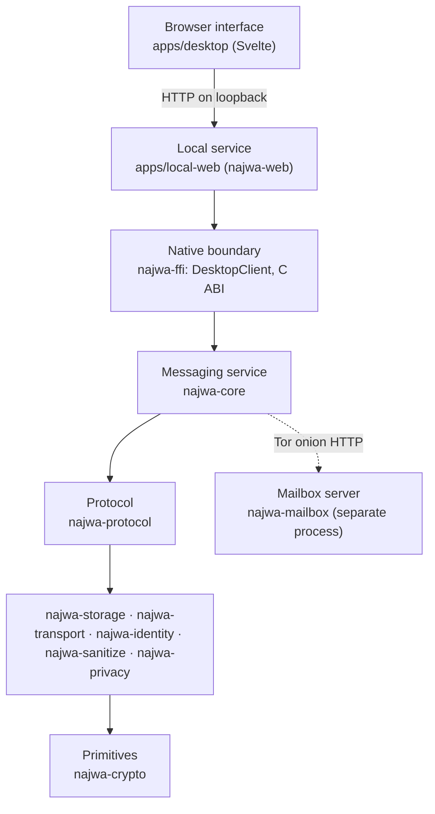
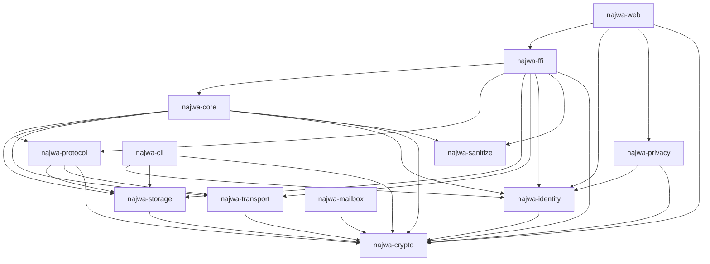
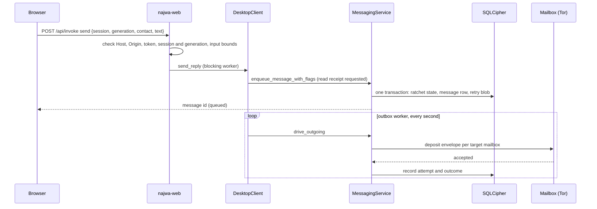

# Architecture

Najwa is a Rust workspace with a Svelte interface. One native process,
`najwa-web`, owns one profile: the identity, its device key, the SQLCipher
database, an embedded Tor client and the messaging service. It serves the
interface to a browser on `127.0.0.1`. Peers never connect to each other; every
message goes through store-and-forward mailboxes, separate `najwa-mailbox`
servers reached as Tor onion services. This page maps the code: layers, crates,
the send and receive paths, lifecycle and concurrency, and which crate
implements which specification.

## 1. Layers



| Layer | Owns | Does not own |
| --- | --- | --- |
| Interface (`apps/desktop`) | Rendering, input, polling for state | Keys, storage, network. It reaches only the local service. |
| Local service (`apps/local-web`) | Profile lease, identity lifecycle (create, unlock, lock, recover, erase), loopback HTTP and its authentication, preferences and file HTTP I/O | Message protocol |
| Native boundary (`najwa-ffi`) | The process-wide client state, the operation gate, background workers, Tor bootstrap and the cover runtime | Wire formats |
| Messaging (`najwa-core`) | Outbox, delivery, receive path, ACKs and receipts, repair, cover scheduling, disappearing messages, file transfer | Byte layouts, SQL |
| Protocol (`najwa-protocol`) | Every byte on the wire, X3DH, the Double Ratchet, the mailbox client | Persistence policy |
| Storage, transport, identity, sanitize, privacy | SQLCipher schema; Tor and onion HTTP; identity record and device keys; file sanitization; profile erasure | Each other's concerns |
| Primitives (`najwa-crypto`) | Every cryptographic primitive | Protocol logic |

Two rules keep the layers honest: bytes on the wire are built and parsed only
in `najwa-protocol`, and persistence lives only in `najwa-storage`. Crates above
them use their types and traits (`CoreStorage`, `PrekeyStorage`,
`MailboxClient`, `Transport`), which also lets tests substitute in-memory
storage or a loopback mailbox.

## 2. Workspace

| Package | Path | Kind | Role |
| --- | --- | --- | --- |
| `najwa-web` | `apps/local-web` | binary | The native app ([README](../../apps/local-web/README.md)) |
| `najwa-ffi` | `crates/najwa-ffi` | library, C dynamic library | Native boundary ([README](../../crates/najwa-ffi/README.md)) |
| `najwa-core` | `crates/najwa-core` | library | Messaging service ([README](../../crates/najwa-core/README.md)) |
| `najwa-protocol` | `crates/najwa-protocol` | library | Protocol ([README](../../crates/najwa-protocol/README.md)) |
| `najwa-storage` | `crates/najwa-storage` | library | Encrypted database ([README](../../crates/najwa-storage/README.md)) |
| `najwa-transport` | `crates/najwa-transport` | library | Tor ([README](../../crates/najwa-transport/README.md)) |
| `najwa-identity` | `crates/najwa-identity` | library | Identity and device keys ([README](../../crates/najwa-identity/README.md)) |
| `najwa-sanitize` | `crates/najwa-sanitize` | library | File sanitization ([README](../../crates/najwa-sanitize/README.md)) |
| `najwa-privacy` | `crates/najwa-privacy` | library | Profile erasure ([README](../../crates/najwa-privacy/README.md)) |
| `najwa-crypto` | `crates/najwa-crypto` | library | Primitives ([README](../../crates/najwa-crypto/README.md)) |
| `najwa-mailbox` | `crates/najwa-mailbox` | binary and library | Mailbox server ([README](../../crates/najwa-mailbox/README.md)) |
| `najwa-cli` | `crates/najwa-cli` | binary | Development CLI ([README](../../crates/najwa-cli/README.md)) |

Outside the Cargo workspace: `apps/desktop` (the interface, built with npm;
[README](../../apps/desktop/README.md)) and `apps/desktop/local-demo` (a
development harness;
[README](../../apps/desktop/local-demo/README.md)).

## 3. Crate dependency graph

Internal dependencies as declared in each `Cargo.toml` (normal dependencies
only; no crate has an internal dev- or build-dependency):



| Package | Direct internal dependencies |
| --- | --- |
| `najwa-web` | `najwa-ffi`, `najwa-identity`, `najwa-privacy`, `najwa-crypto` |
| `najwa-ffi` | `najwa-core`, `najwa-protocol`, `najwa-storage`, `najwa-transport`, `najwa-identity`, `najwa-sanitize`, `najwa-crypto` |
| `najwa-core` | `najwa-protocol`, `najwa-storage`, `najwa-transport`, `najwa-identity`, `najwa-sanitize`, `najwa-crypto` |
| `najwa-protocol` | `najwa-storage`, `najwa-transport`, `najwa-crypto` |
| `najwa-privacy` | `najwa-identity`, `najwa-crypto` |
| `najwa-identity` | `najwa-crypto` |
| `najwa-storage` | `najwa-crypto` |
| `najwa-transport` | `najwa-crypto` |
| `najwa-mailbox` | `najwa-crypto` |
| `najwa-cli` | `najwa-identity`, `najwa-storage`, `najwa-crypto` |
| `najwa-sanitize` | none |
| `najwa-crypto` | none |

Feature flags that change the graph:

| Package | Feature | Effect |
| --- | --- | --- |
| `najwa-web` | `hardware-keystore` (default) | Enables `najwa-identity/hardware-keystore` and `najwa-ffi/hardware-keystore`. Required: the crate does not compile without it. |
| `najwa-web` | `approved-software-fallback` (default) | Enables OS key storage after explicit user approval. Required. |
| `najwa-web` | `bundled-ui` | Embeds `target/local-web-ui` in the executable. Used for packages. |
| `najwa-identity` | `hardware-keystore` | `windows-tpm` + `linux-tpm` (adds `tss-esapi`) + `macos-secure-enclave` (adds Security framework bindings) |
| `najwa-ffi` | `windows-tpm`, `linux-tpm`, `macos-secure-enclave`, `hardware-keystore` | Forward to the same `najwa-identity` features |

Platform-specific dependencies: `windows-sys` (Windows), `keyring` and
`dbus-secret-service` (Linux), `security-framework` (macOS) in
`najwa-identity`; `libc` and `windows-sys` for memory locking in `najwa-crypto`;
`windows-sys` (Windows), `dbus` (Linux) and `core-foundation` (macOS) for the OS
lock listener in `najwa-web`. Exact versions and the advisory assessment are in
[Dependencies](../security/dependencies.md). To see the graph for one target:

```sh
cargo tree --locked -e normal,build -p najwa-web --target x86_64-unknown-linux-gnu
```

## 4. Send path



1. The browser posts a `send` operation with the session and generation it
   holds. `najwa-web` checks the request boundary (exact `Host`, matching
   `Origin`, session token, content type), confirms the session and generation
   are current before and after the call, and bounds the input: a decimal
   contact id, 1 to 16,000 bytes of text, an optional 32-hex-digit reply target.
2. `DesktopClient::send_reply` takes an operation guard (refused once a lock
   has started), requires a ready contact (a ratchet session and a long-term
   remote queue) and no pending timer change, and calls the core with a
   15-second timeout. It does not wait for the network.
3. `MessagingService` refuses blocked contacts, applies the outbound rate limit,
   derives the message id from the outgoing ratchet header, pads the payload to a
   size bucket, encrypts it with the Double Ratchet and builds the wire message.
   If the conversation has a disappearing timer, the local copy is sealed under a
   per-message key held in memory. The advanced ratchet state, the message row
   and the retry blob commit in one transaction. The id is returned as soon as
   that commit succeeds.
4. The outbox worker (`drive_outgoing`, at most 32 frames in flight) picks up
   due frames. For each target mailbox it wraps the frame in a deposit envelope
   keyed to that mailbox's deposit capability and deposits it over Tor on a fresh
   circuit, solving a proof-of-work challenge if the mailbox asks for one. In
   responsive mode (the default) deposits go out at once; in timing-privacy mode
   they wait for cover-traffic slots. Each attempt and its outcome are persisted,
   so a crash or restart resumes delivery.
5. The interface polls `messages` for the stored status. A delivery ACK and,
   later, a read receipt from the peer update it. A completed HTTP call means
   "queued", never "delivered".

Files take a separate path into the same outbox: the browser uploads bounded
parts over HTTP, the native side sanitizes the file with `najwa-sanitize` (the
original is never sent), and `najwa-core` splits it into chunks and queues
file-metadata and chunk frames. Transfer progress is persisted on both sides.

## 5. Receive path

1. Every two seconds after the previous run finishes, a worker reconnects Tor if
   it is offline and calls `DesktopClient::sync`, which runs
   `MessagingService::poll_messages` and then finishes any pending mailbox
   registration, prekey publication and contact setup.
2. `poll_messages` maintains prekeys, then visits the configured mailboxes in a
   random order, skipping any that is backing off after failures. For each it
   fetches released, unacknowledged blobs in pages of 10 (at most 64 pages per
   mailbox per poll) over that mailbox's circuit. Acknowledgement is the only
   cursor: a blob stays on the server until it is acknowledged.
3. Each blob's deposit envelope is opened with the capability its hint names,
   falling back to trying every known capability. A blob that opens with none is
   cover or spam: it is discarded and acknowledged.
4. `process_message` parses the wire message and routes it by type:
   - **Initial**: X3DH as responder and a new ratchet. On a single-use
     invitation queue the first valid Initial wins and the queue is deactivated.
   - **Normal**: ratchet decryption. A frame that skips an epoch is quarantined
     (at most 32 frames, for up to 600 seconds) in case an earlier frame is
     still in flight, then escalates to session repair. A frame for a session
     that does not exist yet is held encrypted until its Initial arrives.
   - **ReadReceipt**, **CumulativeAck**: update delivery and read status.
5. For content, the core validates the timestamp, checks deduplication, verifies
   the sender's pairwise pseudonym, handles control messages (repair, timer
   changes, introductions) and seals the local copy when a timer is set. The
   new ratchet state, the message and the deduplication mark commit in one
   transaction; in responsive mode the delivery-ACK intent joins that
   transaction.
6. Only after that commit is the blob acknowledged to the mailbox. Transient
   failures leave the blob on the server for the next poll; duplicates caused by
   a lost acknowledgement are absorbed by deduplication. After the batch, the
   core retries quarantined frames and, in responsive mode, sends the
   cumulative delivery ACKs; in timing-privacy mode each frame is ACKed as it
   completes.
7. The interface polls `messages`. Fetching does not mark anything read. When a
   message is visible in a focused window, the interface calls `displayed`,
   which in one transaction sets the read time, starts the disappearing timer
   and records a read-receipt intent. A background worker sends the encrypted
   receipt.

The receive path is the authority for what a release peer accepts on the wire;
see [S07](../specs/07-message-format.md) and
[S08](../specs/08-messaging-service.md) for the formats and rules.

## 6. Lifecycle

| Event | What happens |
| --- | --- |
| Start | `najwa-web` takes an exclusive lease on `owner.lock` in the profile (a second instance hands the browser to the first), then binds the loopback port, starts locked and opens the browser with a launch token. |
| Unlock | The passphrase and device key unlock the identity record. `DesktopClient::attach_identity` derives the database key from the identity, opens `najwa.db`, restores disappearing-message keys, re-opens the operation gate, starts Tor in the background and spawns the workers in section 7. Once Tor is connected, the messaging service and cover runtime are installed. |
| Lock | The browser's generation is invalidated first. The operation gate stops admitting work, cancels in-flight work and waits up to 5 seconds for it to drain. Only then are volatile disappearing keys saved encrypted and the unlocked keys and database handle dropped. If draining fails, the keys are kept and the lock is reported as failed, never as done. The Tor client and cover traffic keep running while locked. |
| Idle | The service checks every 5 seconds and locks after the configured idle time (300 seconds by default). |
| Quit, Ctrl+C | Lock, stop the HTTP server, exit. |
| Erase | A `wipe.pending` marker holding the encrypted identity record is written first; then the profile locks; if it was unlocked, each mailbox is asked over Tor, within 20 s, to deactivate the profile's receive capabilities; then the device key is deleted and every profile file is overwritten and removed, whatever the mailboxes answered. An interrupted erasure leaves the profile in the erasing state, which cannot be unlocked, until erasure is retried. |

The browser's session and generation tie every request to one lifecycle state.
Lock, each identity operation and erasure advance the generation, and
`najwa-web` rejects a request whose generation is stale, both before and after
running it.

## 7. Concurrency

- **Processes.** One `najwa-web` per profile. Browser tabs share it. The mailbox
  server is always another process, normally on another machine.
- **Runtimes.** `najwa-web` serves HTTP on its own Tokio runtime and runs every
  identity and messaging call on a blocking worker. `najwa-ffi` keeps a single
  process-wide client state with its own multi-threaded Tokio runtime; its
  `DesktopClient` methods block on that runtime and must be called from a
  blocking context.
- **Background workers** (started at unlock, stopped when the identity
  generation changes):

  | Interval | Work |
  | --- | --- |
  | 1 s | Queue read receipts, prepare streamed transfers and attachments |
  | 1 s | Outbox delivery (`drive_outgoing`) |
  | 2 s after the previous run | Reconnect Tor if offline, then `sync` (receive, mailbox and contact setup) |
  | Scheduler-driven | Cover traffic, independent of unlock |

- **Admission.** Every key-using operation holds an operation guard; lock
  closes admission and waits for the guards to drop. Network operations that
  set up mailboxes and contacts, and `sync`, are single-flight and return `busy`
  if one is already running. Outbox delivery is single-flight on its own, so a
  slow receive poll never delays queued sends. Sending takes only an operation
  guard and never waits on network admission.
- **Inside the core.** A state gate serializes ratchet-advancing work, a poll
  gate serializes receive passes, a semaphore bounds background deposits, and
  per-frame claims stop two workers depositing the same frame.
- **Tor.** One embedded Arti client per process. Circuits are isolated per use:
  a fresh circuit for each deposit, cover deposits included (responsive file
  parts may share one isolated circuit per file), one per mailbox for fetches,
  one per contact for prekey-bundle fetches, and separate per-mailbox circuits
  for cover polls. A proof-of-work challenge rides the circuit isolation of the
  request it gates.

## 8. Profile contents

| File | Content |
| --- | --- |
| `identity.najwa` | Identity record, encrypted under the passphrase and device key |
| `identity.recovery` | Recovery record: the identity key sealed under a key derived from the recovery phrase |
| `najwa.db` | SQLCipher database: contacts, sessions, messages, outbox, transfers, settings |
| `tor/` | Arti state and directory cache |
| `owner.lock` | Process lease |
| `web-instance.json` | Port and token of the running instance, for a second launch |
| `web-launch.html` | Linux and macOS: owner-only page that redirects the browser to the tokenized URL; removed at exit |
| `browser-access.json` | Browser access grants for the bootstrap cookie |
| `prekey-recovery-<identity>` | Present only while prekeys still have to be republished after a recovery |
| `wipe.pending` | Present only while an erasure is incomplete |

The key inventory and lifecycle are in [Keys](../reference/keys.md).

## 9. C ABI

`najwa-ffi` also builds a C dynamic library with 20 exported functions,
declared in the committed header `crates/najwa-ffi/include/najwa.h`: 13
operations (`najwa_init`, `najwa_identity_exists`, `najwa_create_identity`,
`najwa_unlock`, `najwa_lock`, `najwa_cancel_operations`, `najwa_send_message`,
`najwa_poll_messages`, `najwa_list_contacts`, `najwa_list_messages`,
`najwa_update_battery`, `najwa_version`, `najwa_free_string`), six callback
registrations and `najwa_clear_all_callbacks`. Every export catches
panics, validates null and UTF-8 input, and returns owned strings that must be
freed with `najwa_free_string`, which zeroizes them; the version string is
static. Callbacks run only on a dedicated thread and must not call back into
the library. The C ABI shares the client state and operation gate with
`DesktopClient`, but the app uses only `DesktopClient`. The contract is
[S17](../specs/17-ffi-bindings.md).

## 10. Errors and logging

Errors cross each boundary as fixed codes (`DesktopError` codes, C ABI result
codes, HTTP `{"error": {"code": ...}}`), never as free-form text. An operation
reports what actually happened: queued locally, deposited, acknowledged by the
peer, refused, or cancelled by a lock. A failure never becomes a success in the
interface, and drafts and resumable state survive a failure where the operation
allows it.

Logging uses `tracing`. Logs must not contain passphrases, keys, recovery
material, capability tokens, bridge lines or message content.

## 11. Specification map

| Specification | Primary crate | Also in |
| --- | --- | --- |
| [S01 Cryptographic Primitives](../specs/01-crypto-primitives.md) | `najwa-crypto` | |
| [S02 Identity & Key Protection](../specs/02-identity-key-protection.md) | `najwa-identity` | `apps/local-web` (identity lifecycle) |
| [S03 Encrypted Storage](../specs/03-encrypted-storage.md) | `najwa-storage` | `najwa-ffi` (database key) |
| [S04 Transport Layer](../specs/04-transport.md) | `najwa-transport` | `najwa-protocol` (mailbox HTTP) |
| [S05 Contact Establishment](../specs/05-contact-establishment.md) | `najwa-protocol` (`contact`) | `najwa-ffi` (invitations, contact setup), `najwa-core` |
| [S06 Key Agreement & Double Ratchet](../specs/06-key-agreement-ratchet.md) | `najwa-protocol` (`x3dh`, `ratchet`, `prekey`) | `najwa-core` (repair) |
| [S07 Message Format & Encryption](../specs/07-message-format.md) | `najwa-protocol` (`message`) | |
| [S08 Messaging Service](../specs/08-messaging-service.md) | `najwa-core` | `najwa-ffi` (workers) |
| [S10 Cover Traffic System](../specs/10-cover-traffic.md) | `najwa-core` (`cover`) | `najwa-ffi` (cover runtime) |
| [S11 File Transfer & Media Sanitization](../specs/11-file-transfer-sanitization.md) | `najwa-sanitize`, `najwa-core` (`filetransfer`) | `najwa-ffi`, `apps/local-web` (upload and download) |
| [S12 Disappearing Messages](../specs/12-disappearing-messages.md) | `najwa-core` (`disappearing`) | `najwa-storage`, `najwa-ffi` |
| [S13 Privacy Hardening & Account Lifecycle](../specs/13-privacy-hardening.md) | `najwa-privacy` (erasure) | `apps/local-web` (idle lock, erasure) |
| [S16 Mailbox Server](../specs/16-mailbox-server.md) | `najwa-mailbox` | `najwa-protocol` (`mailbox` client) |
| [S17 FFI Bindings](../specs/17-ffi-bindings.md) | `najwa-ffi` | |
| [S18 Test Vectors](../specs/18-test-vectors.md) | tests in `najwa-crypto`, `najwa-identity`, `najwa-protocol` | |

Scope and format versions: [SPECS-VERSION](../SPECS-VERSION.md). Build and test
instructions: [Building](building.md), [Testing](testing.md).
