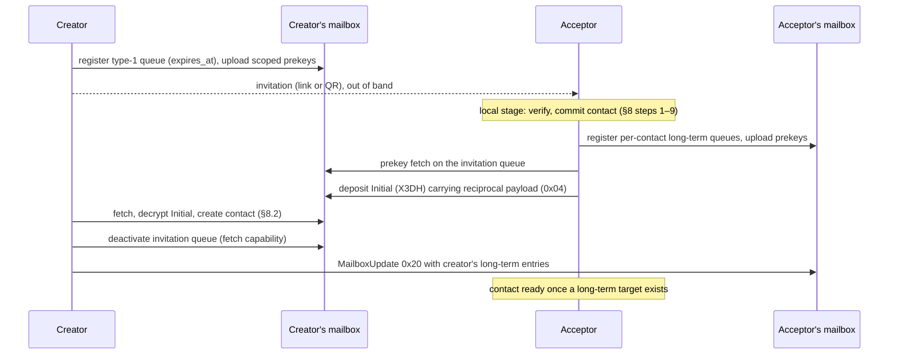

# S05 — Contact Establishment

## Overview

Two people who want to talk privately first need two things: each other's
identity key, and a place to drop the first encrypted message. Najwa has no
phone numbers, usernames or directory, so both travel inside a single signed
object, the **HandshakePayload**. One person creates an *invitation* (a link and
the same payload as a QR code). The other person pastes or scans it.

The invitation carries the creator's identity key, one entry per mailbox the
creator uses, a display name and an expiry. Each mailbox entry holds a
single-use deposit capability, the envelope secret that encrypts deposits to it,
and a per-mailbox signing key certified by the identity key. The invitation does
not carry prekeys: the acceptor fetches the creator's prekey bundle from the
mailbox and runs X3DH ([S06](06-key-agreement-ratchet.md)).

The acceptor's first message (an X3DH Initial) carries the acceptor's own signed
HandshakePayload. That reciprocal payload gives the creator the acceptor's
identity key and long-term mailbox coordinates. The creator then answers with a
`MailboxUpdate` naming its own long-term coordinates. From then on both sides use
per-contact capabilities, and the invitation's capability is closed.

Acceptance has two durable stages. The **local stage** verifies the invitation
and commits the contact in one transaction; it needs no network. The **remote
stage** registers receive queues, publishes prekeys, runs X3DH and deposits the
Initial; the background worker runs it and resumes it after restart.

Safety numbers let both people confirm, over a separate trusted channel, that
no one substituted keys during the exchange. An unverified contact still has
end-to-end encryption; verification defends against an active attacker at first
contact.

Cross-references: wire layouts in [Wire Formats](../reference/wire-formats.md),
domain-separation strings in [HKDF Strings](../reference/hkdf-strings.md),
mailbox endpoints in [S16](16-mailbox-server.md).

## 1. Scope

This specification defines:

- The HandshakePayload v0x02 wire format, `MailboxEntry` and the implicit
  `MailboxCertificate`.
- The per-mailbox derived signing key.
- Envelope secrets distributed with deposit capabilities.
- The invitation receive queue: a single-use capability of type `0x01` with an
  absolute expiry.
- QR and URI encodings.
- The contact acceptance procedure, the reciprocal handshake and remote setup
  completion.
- Safety numbers and verification state.
- The receive-side handling of contact introductions (control subtype `0x25`).
- Mailbox coordinate updates (control subtype `0x20`).

The HandshakePayload does not contain prekey bundles. A bundle with 200 one-time
prekeys would not fit in a QR code. The prekey bundle format, its signed manifest
and X3DH are in [S06](06-key-agreement-ratchet.md).

## 2. HandshakePayload (Version 0x02)

### 2.1 Structure

```
struct HandshakePayload {
  u8  version;                       // 0x02
  u8  ik_pub[32];                    // Identity public key (Ed25519)
  u8  mailbox_count;                 // 1–8
  MailboxEntry mailboxes[mailbox_count];
  u16 display_name_len;              // big-endian, 0–128
  u8  display_name[display_name_len];// UTF-8
  u64 created_at;                    // Unix seconds, big-endian
  u64 expires_at;                    // Unix seconds, big-endian
  u8  signature[64];                 // Ed25519, §4.1
}
```

| Offset | Size | Field |
|--------|------|-------|
| 0 | 1 | `version` = `0x02` |
| 1 | 32 | `ik_pub` |
| 33 | 1 | `mailbox_count` (n) |
| 34 | 217·n | `mailboxes` (§2.2) |
| 34 + 217n | 2 | `display_name_len` (L) |
| 36 + 217n | L | `display_name` |
| 36 + 217n + L | 8 | `created_at` |
| 44 + 217n + L | 8 | `expires_at` |
| 52 + 217n + L | 64 | `signature` |

Total length is `116 + 217n + L` bytes. The largest valid payload (8 mailboxes,
128-byte name) is 1,980 bytes.

A parser MUST reject, before any signature work:

- input longer than 2,048 bytes or shorter than 116 bytes;
- a first byte other than `0x02` (`UnsupportedVersion`), without parsing further;
- `mailbox_count` of 0 or greater than 8;
- `display_name_len` greater than 128, or a name that is not valid UTF-8;
- `expires_at <= created_at`;
- truncated fields or trailing bytes after the signature.

Producers MUST apply the same limits before signing or encoding.

### 2.2 MailboxEntry (217 bytes)

```
struct MailboxEntry {
  u8 onion_address[56];       // v3 onion label, no ".onion"; NUL-padded if shorter
  u8 deposit_capability[32];  // where the reader deposits
  u8 envelope_secret[32];     // keys the deposit envelope; never sent to a server
  u8 mailbox_ik_pub[32];      // per-mailbox derived signing key (§3)
  u8 cert_signature[64];      // §2.3 / §4.2
  u8 capability_type;         // 0x01 invitation queue, 0x02 long-term
}
```

| Offset | Size | Field |
|--------|------|-------|
| 0 | 56 | `onion_address` |
| 56 | 32 | `deposit_capability` |
| 88 | 32 | `envelope_secret` |
| 120 | 32 | `mailbox_ik_pub` |
| 152 | 64 | `cert_signature` |
| 216 | 1 | `capability_type` |

**Envelope secret.** The owner of a deposit capability generates a fresh 32-byte
CSPRNG `envelope_secret` for it. A depositor derives the deposit-envelope key from
it ([S07 §3](07-message-format.md)). The secret travels wherever the deposit
capability travels (HandshakePayload, `MailboxUpdate`, introductions) and MUST
NOT be sent to any mailbox server. The server stores the deposit capability for
routing but cannot derive the envelope key, so it cannot read deposits to
capabilities it hosts.

The outer payload signature (§4.1) authenticates every entry field. The
certificate signature covers only the identity key, the derived key, the onion
field and the certificate times.

**Onion field.** Senders write the 56-character lowercase base32 label of a v3
onion address, without the `.onion` suffix. The desktop client accepts only
entries whose field is exactly such a label.

### 2.3 MailboxCertificate (200 bytes)

A certificate binds `mailbox_ik_pub` to the identity key for one onion address:

```
struct MailboxCertificate {
  u8  ik_pub[32];          // identity public key
  u8  mailbox_ik_pub[32];  // derived mailbox signing key
  u8  mailbox_onion[56];   // the entry's onion_address field, byte for byte
  u64 created_at;          // big-endian
  u64 expires_at;          // big-endian
  u8  signature[64];       // Ed25519_Sign(IK_priv, bytes 0–135)
}
```

A HandshakePayload carries only the certificate signature (`cert_signature`).
The verifier reconstructs the rest:

- `ik_pub` = the payload's `ik_pub`;
- `mailbox_onion` = the entry's 56-byte `onion_address`;
- `created_at` = the payload's `created_at`;
- `expires_at` = `created_at + MAILBOX_CERT_VALIDITY_SECS` (180 days).

The verifier MUST check the signature against the payload's `ik_pub` and MUST
reject the payload if `expires_at <= now` (`HandshakeError::Expired`).

## 3. Per-Mailbox Derived Signing Key

Each mailbox sees a different signing key, so colluding mailbox operators cannot
link a user's mailboxes by key:

```
seed = HKDF-SHA256(
  IKM    = IK_priv (32-byte Ed25519 seed),
  salt   = UTF8(onion_address),
  info   = "najwa/v1/mailbox-signing-key",
  length = 32)
(mailbox_ik_priv, mailbox_ik_pub) = Ed25519_FromSeed(seed)
```

The derivation is deterministic in `(IK_priv, onion_address)`. The salt is the
onion label as configured (56 characters, no suffix). The seed MUST be zeroized
after use. The derived key signs the owner's prekey material for that mailbox
(§4.3); the identity key signs the certificate (§4.2).

## 4. Signature Computation

### 4.1 Outer Signature (HandshakePayload)

```
signable  = "najwa/v1/handshake/" || payload_bytes[0 .. len-64]
signature = Ed25519_Sign(IK_priv, signable)
```

`payload_bytes[0 .. len-64]` is the serialized payload (§2.1) without the trailing
signature. The prefix is 19 bytes. Verification uses the payload's own `ik_pub`.

### 4.2 Certificate Signature

```
cert_signable  = ik_pub(32) || mailbox_ik_pub(32) || mailbox_onion(56) ||
                 created_at(8, BE) || expires_at(8, BE)        // 136 bytes
cert_signature = Ed25519_Sign(IK_priv, cert_signable)
```

### 4.3 Signatures by the Mailbox Key

The derived key `mailbox_ik_priv` signs the signed prekey and the prekey-bundle
manifest uploaded to that mailbox. Formats are in
[S06 §4.2](06-key-agreement-ratchet.md). Initiators MUST verify both against the
`mailbox_ik_pub` from the certified entry, never against the identity key.

## 5. Invitation Receive Queue

An invitation advertises one bootstrap receive queue per mailbox. Each queue is
a fresh capability pair registered as **capability type `0x01`** with an absolute
expiry. The server enforces the expiry, the idempotent prekey fetch, the deposit
proof-of-work floor and the reduced quota for type `0x01`
([S16 §3.1, §3.7, §7.2, §9](16-mailbox-server.md)).

### 5.1 Lifetime

| Item | Value |
|------|-------|
| Queue lifetime | `INVITATION_TTL_SECS` = 172,800 s (48 hours) from queue creation |
| Server clamp for type `0x01` | 48 hours (`ephemeral_max_lifetime_hours`) |
| Minimum remaining lifetime to export an invitation | 600 s |
| Payload `expires_at` | the earliest expiry among the advertised queues |

The link and the QR code are two encodings of the same signed payload with the
same expiry. The UI MUST show the payload's actual `expires_at`.

### 5.2 Lifecycle

1. **Create and register.** For each enabled, registered mailbox the creator
   generates `deposit_capability`, `fetch_capability` and `envelope_secret` (32
   CSPRNG bytes each) and stores them with
   `expires_at = created_at + INVITATION_TTL_SECS` before any network request. It
   registers the pair with `POST /v1/capability/register`, `capability_type = 1`
   and the stored absolute `expires_at` ([S16 §3.1](16-mailbox-server.md)), then
   publishes a prekey bundle scoped to the queue
   ([S06 §5.7](06-key-agreement-ratchet.md)). Retries reuse the exact stored pair
   and expiry. An invitation MUST NOT be exported before its queues are
   registered and their prekeys published. Each exported invitation has its own
   queues, so several invitations can be outstanding and each completes on its
   own. A request that failed or was cancelled before export leaves its stored
   queue for the next request to reuse while that queue is not accepted, not
   deactivated, has the full lifetime and has more than 600 s left; otherwise
   the request creates a new queue. Export releases the queue from reuse.
2. **Serve prekeys and deposits.** The queue accepts deposits until it is
   deactivated or expires. The first `POST /v1/prekey/fetch` on a type `0x01`
   queue consumes at most one one-time prekey. The server caches that response
   and returns it byte-for-byte to every later fetch on the same queue.
3. **Trial-decrypt.** The creator decrypts each blob with the queue's envelope
   secret. Blobs that fail envelope decryption are discarded and acknowledged.
4. **Consume and deactivate.** The first Initial on the queue that
   authenticates and commits consumes it. The commit stamps the queue as accepted
   in the same transaction as the new session
   ([S06 §3.11](06-key-agreement-ratchet.md) I3). Remaining blobs in that fetch
   page are acknowledged without processing. The creator then calls
   `POST /v1/capability/deactivate`, keyed by the queue's **fetch** capability
   ([S16 §3.9](16-mailbox-server.md)). If the call fails, the next poll retries it
   and does not fetch from the queue again.
5. **Closed.** After deactivation the server answers deposits with `410`.
6. **Expire.** If no Initial arrives, the server deletes the queue at
   `expires_at`; later deposits and fetches fail.

Undecryptable garbage does not consume the queue, and a fetch does not close
it. Only a valid Initial does.

### 5.3 Flow



## 6. QR Code Encoding

```
to_qr_string(payload):
  validate payload (§2.1)
  bytes      = payload.to_bytes()
  compressed = zlib_compress(bytes, level 9)
  data       = Base45_Encode(compressed)
  checksum   = Base45_Encode(CRC32(ASCII(data)) as 4 bytes big-endian)   // 6 chars
  return "NAJWA:" || data || checksum

from_qr_string(s):
  reject if len(s) > 3,276 or s is not ASCII
  strip "NAJWA:" (reject if absent)
  split the last 6 characters as checksum; reject if fewer
  reject if Base45_Decode(checksum) != CRC32(ASCII(data)) (4 bytes, big-endian)
  compressed = Base45_Decode(data)
  bytes      = zlib_decompress(compressed), reading at most 2,049 bytes
  reject if len(bytes) > 2,048
  return HandshakePayload.from_bytes(bytes)
```

The payload is always zlib-compressed. The 3,276-character bound is
`6 + ceil(2,176 / 2) × 3 + 6`, where 2,176 is the 2,048-byte cap plus 128 bytes of
zlib framing. Decoders MUST bound decompression output before allocating the
expanded payload.

The checksum detects scanning errors only. The Ed25519 signature provides
integrity.

### 6.1 Base45

Base45 follows RFC 9285 with the alphabet
`0123456789ABCDEFGHIJKLMNOPQRSTUVWXYZ $%*+-./:`:

- Each byte pair `(a, b)` with `n = a·256 + b` encodes as three characters
  `c, d, e` where `n = c + 45·d + 45²·e`, emitted in the order `c d e`.
- A trailing single byte `n` encodes as two characters `c, d` with `n = c + 45·d`.
- Decoders MUST reject characters outside the alphabet, a triple whose value
  exceeds 65,535, a pair whose value exceeds 255, and a single trailing character.

### 6.2 CRC-32

CRC-32 is the IEEE 802.3 / zlib variant: reflected polynomial `0xEDB88320`,
initial value `0xFFFFFFFF`, final XOR `0xFFFFFFFF`. It is computed over the ASCII
bytes of the Base45 data and serialized big-endian before Base45 encoding.

### 6.3 Rendering

Every character of the QR string is in the QR alphanumeric set. The desktop
renders it as an SVG with error-correction level M at the smallest QR version
that fits, 4 pixels per module and a 50-pixel margin. If the string does not fit
in a QR code, rendering fails with `qr_too_large` and the link remains usable.

## 7. URI Encoding

```
to_uri(payload):
  validate payload (§2.1)
  return "najwa://contact?data=" || Base64URL_NoPad(payload.to_bytes())

from_uri(uri):
  strip "najwa://contact?data=" (reject if absent)
  reject if the remainder is longer than 2,731 characters
  bytes = Base64URL_NoPad_Decode(remainder)   // padding characters are rejected
  return HandshakePayload.from_bytes(bytes)
```

2,731 is `ceil(2,048 × 4 / 3)`.

## 8. Contact Acceptance Procedure

The acceptor runs steps 1–9 locally (the `accept_invitation` operation). Steps
10–11 run later in the background setup worker.

```
accept_invitation(invitation, my_display_name):
  // Local stage
  1. Reject input over 4,096 bytes. Decode as a QR string if it starts with
     "NAJWA:", otherwise as a URI (§6, §7).
  2. Apply the structural checks of §2.1 (size, version, counts, lengths).
  3. Verify the outer signature (§4.1) against the payload's ik_pub.
  4. Reject if now > expires_at + 300 (5-minute clock tolerance).
  5. Confirm 1 <= mailbox_count <= 8.
  6. For each entry:
     a. Verify cert_signature against ik_pub and reject an expired certificate
        (§2.3).
     b. Reject capability_type other than 0x01 or 0x02.
     c. Reject an onion field that is not a 56-character lowercase base32 label.
  7. Identity checks:
     - Reject the user's own ik_pub (self_contact).
     - If a contact with this ik_pub exists: accept only the exact signed payload
       that created it (an idempotent retry); otherwise reject (contact_exists).
     - Acceptance MUST NOT replace or rebind a pinned identity key. A key change
       for an existing contact arrives only through a cross-signed identity
       rotation (S02 §18).
  8. Derive the pairwise pseudonyms (S01 §8).
  9. In ONE transaction commit: the contact (their ik_pub, device_pub = ik_pub,
     pseudonyms, the payload's display name), every signed entry as a remote
     target (the first is primary), the signed payload bytes, and one fresh local
     capability per enabled local mailbox (deposit, fetch and envelope secret,
     32 CSPRNG bytes each, type 0x02, unregistered). Then record the reciprocal
     obligation with my_display_name. A duplicate identity or any storage failure
     leaves nothing behind.

  // Remote stage (background worker, resumable)
 10. Per-contact receive queues. Each local capability from step 9 is a
     (deposit, fetch, envelope_secret) triple used only for this contact, so no
     two contacts share a deposit capability and a mailbox operator cannot group
     a user's contacts by it. The envelope secret goes to the contact and never
     to a server (S07 §3). Register each unregistered capability with its
     mailbox (POST /v1/capability/register, type 2, registration proof-of-work,
     own one-shot circuit; S16 §3.1, §7). In timing-privacy delivery mode each
     registration waits for a control slot from the cover scheduler (S10 §5.2);
     in Responsive mode the registrations run one after another without slot
     pacing. A capability MUST NOT be advertised before the server accepts its
     registration. Once registered, the queue is polled with the mailbox's own
     queue (S08 §6.1).
 11. Publish prekeys for each new queue (S06 §5.6). Build the reciprocal
     HandshakePayload (§8.2) from the registered queues, then send it as the
     content of the first message. Sending runs X3DH against the creator's
     bundle fetched through the invitation queue (S06 §2.2) and commits the
     ratchet, the Initial frame and the outbox entry atomically before deposit
     (S06 §3.11 I2). The Initial is deposited to the creator's invitation queue
     under that entry's envelope secret (S07 §3).
```

If the Initial already committed but the operation's result was lost, the worker
does not create a second Initial. It sends a `MailboxUpdate` (§12) with the
current coordinates instead.

### 8.1 Contact Addition Rate Limit

To limit social-engineering enumeration (an adversary sending many invitations to
learn which identities a target accepts), the client MUST count contacts added in
the last 24 hours. When the count reaches `DAILY_CONTACT_LIMIT = 10`, the client
MUST warn the user that frequent additions may reduce anonymity and MUST require
an explicit confirmation before adding another contact.

The count covers every stored contact whose `created_at` lies in the 24 hours
before now, so a restart or lock does not reset it; a deleted contact no longer
counts. It includes contacts created on the creator side from the user's own
invitations (§8.2). The confirmation gate applies
to `accept_invitation`, after the checks of steps 1–7 and before step 9: without
explicit confirmation it fails with `contact_limit_confirm` and stores nothing.
An idempotent retry of an already accepted invitation adds no contact and is not
gated. Creator-side contact creation (§8.2) is not gated: the user chose to share
that invitation, each invitation admits one contact, and the Initial arrives in
the background where no one can confirm; refusing it would discard the peer's
Initial. The desktop and web client shows "Adding many contacts in a short time
can make you easier to identify." with a checkbox, then retries with confirmation.

### 8.2 Reciprocal Handshake

The reciprocal HandshakePayload gives the invitation's creator the acceptor's
identity and return coordinates. Without it the creator could decrypt the
Initial but could not reply.

**Content.** The payload travels as `content_type 0x04 ReciprocalHandshake`
([Message Types](../reference/message-types.md)) inside the Initial's encrypted
Payload. The content is exactly one HandshakePayload serialization.

**Generation.** The acceptor builds it after step 10, from registered,
unrevoked per-contact capabilities, ordered with the primary mailbox first. It is
signed per §4.1 with:

- `display_name` = the name the acceptor chose to share;
- every entry's `capability_type = 0x02`;
- `expires_at = created_at + INVITATION_TTL_SECS` (48 hours). The invitation
  queue it is deposited to was created before acceptance and lives
  `INVITATION_TTL_SECS`, so the payload stays valid for as long as the creator
  can still fetch it from that queue.

**Validation by the creator.** A `0x04` content is valid only inside an Initial.
It MUST have arrived on one of the creator's own invitation queues (§5); on any
other queue, which existing contacts can reach, the creator drops it as
`UnknownPseudonym` and creates nothing. When the Initial's sender pseudonym
matches no contact, the creator MUST:

1. Reject a payload whose version byte is not `0x02`.
2. Parse the content and reject trailing bytes.
3. Verify the payload with §8 steps 2–6a (outer signature, expiry with tolerance,
   certificate signatures and certificate expiry).
4. Keep entries of type `0x01` or `0x02`; reject the payload if none remain.
5. Reject unless the payload's `ik_pub` equals the X3DH header's `identity_key`.
6. Derive the pairwise pseudonyms and reject unless the Initial's
   `sender_pseudonym` equals the peer's pseudonym.
7. Reject if a contact with that identity key already exists.
8. Create the contact on this first decrypted Initial: identity key, device key
   equal to the identity key, the payload's display name if non-empty, every kept
   entry as a remote target (the first is primary), and one unregistered
   long-term local capability on the first enabled mailbox.

Any failure aborts contact creation and discards the Initial. The reciprocal
content is protocol metadata and does not appear in the conversation.

**Reordering.** A Standard message from the new session can arrive before its
Initial. The receiver quarantines it and retries after later frames
([S06 §3.7.1](06-key-agreement-ratchet.md)). No contact or session is created
from such a frame. If the Initial does not arrive within `REPAIR_GRACE_SECS` the
frame is discarded.

### 8.3 Remote Setup Completion

After §8.2 the creator's worker registers its per-contact queues for the new
contact (one per enabled mailbox), publishes prekeys for them and sends a
`MailboxUpdate` (§12) with its long-term entries. The acceptor replaces its
targets with those entries.

A contact is **ready** when it has a ratchet session and at least one remote
target of type `0x02`. Text sending is refused until the contact is ready. The
creator is ready on processing the Initial. The acceptor is ready once the
creator's `MailboxUpdate` arrives.

The acceptor's setup state is derived from durable data. The deadline is the
reciprocal payload's `expires_at` once the Initial exists, and the invitation's
`expires_at` before that.

| State | Condition |
|-------|-----------|
| `queued` | The Initial is not deposited yet and the deadline has not passed |
| `waiting` | The Initial is deposited and the deadline has not passed |
| `unconfirmed` | The Initial is deposited, the deadline has passed and the contact is not ready |
| `expired` | The deadline passed before the Initial was deposited |
| `failed` | The Initial frame failed permanently |
| `ready` | A session and a long-term target exist |

The worker retires an `expired` setup: it marks the undeposited Initial as
permanently failed and drops the reciprocal obligation. A deposit that wins a
race with retirement keeps the session for a late reply.

Each side needs its own app unlocked to send its part. The two apps never need
to be online at the same time.

## 9. Safety Numbers

### 9.1 Format

```
safety_number(ik_a, ik_b):
  (lo, hi) = sort(ik_a, ik_b)                  // §9.2
  h = SHA-256(lo || hi)                         // 64-byte input
  hex = lowercase_hex(h[0:16])                  // 32 characters
  return hex split into 8 groups of 4, joined by single spaces
```

A safety number is exactly 39 characters, for example
`3f2a 9c41 07be d5e0 6a18 c2f7 4b90 e13d`. Both parties compute the same value.

### 9.2 Byte-Form Pinning

All key sorts and comparisons in the protocol use **unsigned bytewise
lexicographic order (memcmp order) of the 32-byte Ed25519 public keys**. This
covers the safety-number sort above and the pairwise-pseudonym role and salt
order ([S01 §8](01-crypto-primitives.md)). X25519-converted keys are used only
inside DH and MUST NOT be sorted or compared. Implementations that sorted on
different byte forms would derive different pseudonyms and fail every first
message with `PseudonymMismatch`. [S18](18-test-vectors.md) pins the order with
the pairwise-pseudonym vector.

### 9.3 Verification State

The user compares the safety number with the contact over a separate trusted
channel (in person, a voice call they recognise, another trusted messenger).

- Marking a contact verified (or clearing it) MUST carry the safety number the
  user compared. The client recomputes the number from the stored identity key
  and rejects the request if it differs (`stale_operation`).
- The verified flag is written only while the contact's identity key equals the
  key the number was computed from.
- The UI MUST show whether the current identity is verified.

## 10. Reserved

## 11. Contact Introductions

A contact can send an attributed introduction: control subtype `0x25` inside an
encrypted Standard message, naming another identity and its deposit
coordinates, signed with the introducer's identity key. This release processes
`0x25` on receive (§11.4). It does not send introductions, and it does not turn a
received introduction into a contact.

### 11.1 IntroductionPayload (v0x02)

```
struct IntroductionPayload {
  u8  version;                         // 0x02
  u8  introduced_ik_pub[32];
  u16 mailbox_count;                   // big-endian, 0–8
  IntroductionMailbox mailboxes[mailbox_count];
  u16 display_name_len;                // big-endian, 0–128
  u8  introduced_display_name[display_name_len];   // UTF-8
  u8  introducer_ik_pub[32];
  u64 timestamp;                       // big-endian
  u64 expires_at;                      // big-endian, > timestamp
  u8  introducer_signature[64];
}

struct IntroductionMailbox {
  u16 onion_length;                    // big-endian, 1–56
  u8  onion_address[onion_length];     // UTF-8
  u8  deposit_capability[32];
  u8  envelope_secret[32];
}
```

Decoders MUST reject: input over 2,048 bytes or under 149 bytes; a first byte
other than `0x02` (`UnsupportedVersion`, handled as an unknown nested version per
[S07 §10](07-message-format.md)); counts and lengths outside the ranges above;
invalid UTF-8; `expires_at <= timestamp`; trailing bytes.

### 11.2 Signature

```
signable  = serialized payload without the trailing 64-byte signature
signature = Ed25519_Sign(introducer IK_priv, signable)
```

There is no domain prefix. The default validity is 7 days
(`DEFAULT_INTRODUCTION_VALIDITY_DAYS`).

### 11.4 Receiver Processing

On receipt of `0x25` from an unblocked contact the receiver MUST:

1. **Bind to the channel.** Use the contact whose ratchet session decrypted the
   message as the delivering contact.
2. **Bind the introducer.** Reject (`IntroducerMismatch`) unless
   `introducer_ik_pub` equals the delivering contact's identity key.
3. **Drop known peers.** If `introduced_ik_pub` belongs to an existing contact,
   take no visible action.
4. **Check expiry.** Reject if `now > expires_at`.
5. **Verify the signature** (§11.2) against the delivering contact's identity key.

A valid introduction is stored as pending, together with the raw payload, in the
same transaction as the message commit. The conversation shows a local notice
"*name* introduced you to *introduced name*". The control message itself is not
stored as a conversation message.

Checks 1 and 2 enforce the anti-spam property: an introduction can only come
from an existing contact, signed by that contact's key.

## 12. Mailbox Updates (MailboxUpdate 0x20)

A contact's coordinates change through control subtype `0x20` sent inside the
ratchet session.

**Body.** One to eight `MailboxEntry` structures (§2.2), concatenated, with no
count prefix. The receiver MUST reject:

- an empty body, a body length that is not a multiple of 217, or more than 8
  entries;
- any entry whose `capability_type` is not `0x02`;
- any entry whose `onion_address` field is not 56 lowercase base32 characters.

The receiver replaces the contact's remote targets with the entries, in order;
the first is primary. The ratchet session authenticates the update. The receiver
does not verify the entries' certificate signatures; the update carries no
`created_at` to rebuild them. It does keep each entry's `mailbox_ik_pub` for
prekey verification ([S06 §2.2](06-key-agreement-ratchet.md)).

**When it is sent.** The desktop sends an update after remote setup (§8.3) and
whenever the ordered set of its registered per-contact queues for that contact
changes: a new mailbox gets a queue for the contact, or a different mailbox
becomes primary. It records the exact ordered set it last announced and sends
again when the current set differs. Each announced entry is a registered
capability with its own envelope secret. The release does not retire active
per-contact queues.

The update is an ordinary control message. It stays in the durable outbox and is
retransmitted byte-identically until a `CumulativeAck` covers it
([S07 §8.1](07-message-format.md)).

A capability that is replaced MUST NOT be deactivated before the peer has
acknowledged the update that replaces it.

## 13. Error Types

Protocol errors:

```
enum HandshakeError {
  Expired,                     // payload or certificate expired
  InvalidFormat(String),       // structure, size, prefix, checksum, encoding
  InvalidSignature(String),    // outer or certificate signature
  UnsupportedVersion(u8),
  CompressionFailed(String),
  DecompressionFailed(String),
  Base45DecodeError(String),
  Base64DecodeError(String),
  CryptoError(String),
}

enum ContactError {
  AlreadyExists,
  HandshakeError(HandshakeError),
  PseudonymError(String),
  StorageError(String),
}

enum IntroductionError {
  Expired, IntroducerMismatch, InvalidSignature(String), AlreadyContact,
  InvalidFormat(String), UnsupportedVersion(u8), CryptoError(String),
  StorageError(String),
}
```

Desktop operation codes for this specification ([S17](17-ffi-bindings.md)):

| Code | Meaning |
|------|---------|
| `invalid_invitation` | Decoding, structure, signature, expiry, certificate or onion check failed |
| `invalid_name` | Display name empty, over 128 bytes or containing control characters |
| `self_contact` | The invitation carries the user's own identity key |
| `contact_exists` | Another payload already established this identity |
| `contact_limit_confirm` | `DAILY_CONTACT_LIMIT` contacts were added in 24 hours; retry with explicit confirmation (§8.1) |
| `mailbox_required` | No registered mailbox to advertise |
| `invitation_expiring` | Fewer than 600 s of lifetime remain |
| `qr_too_large` | The QR string does not fit in a QR code |
| `stale_operation` | The safety number to verify no longer matches |
| `registration_*` | Capability registration failed (transport, proof-of-work, rate limit, conflict, server, rejected) |

## 14. Constants

```
// Handshake
HANDSHAKE_VERSION              = 0x02
MAX_HANDSHAKE_SIZE             = 2048      // bytes
MAX_MAILBOX_COUNT              = 8
MAX_DISPLAY_NAME_LEN           = 128       // bytes
MAILBOX_ENTRY_SIZE             = 217
MAILBOX_CERTIFICATE_SIZE       = 200
MAILBOX_CERT_VALIDITY_SECS     = 15552000  // 180 days
ENVELOPE_SECRET_LEN            = 32
CAP_TYPE_EPHEMERAL             = 0x01      // invitation queue
CAP_TYPE_LONG_TERM             = 0x02
HANDSHAKE_EXPIRY_TOLERANCE_SECS = 300      // TIMESTAMP_TOLERANCE_NORMAL_SECS

// Encodings
QR_PREFIX                      = "NAJWA:"
QR_CHECKSUM_LEN                = 6         // Base45 characters
MAX_QR_STRING_LEN              = 3276
URI_PREFIX                     = "najwa://contact?data="
MAX_URI_DATA_LEN               = 2731
MAX_INVITATION_INPUT_LEN       = 4096      // desktop boundary

// Invitation and setup (desktop)
INVITATION_TTL_SECS            = 172800    // 48 h, EPHEMERAL_CAP_TTL_SECS
INVITATION_MIN_REMAINING_SECS  = 600
RECIPROCAL_VALIDITY_SECS       = 172800    // 48 h, INVITATION_TTL_SECS

// Safety numbers
SAFETY_NUMBER_LEN              = 39        // characters

// Contact limits
DAILY_CONTACT_LIMIT            = 10

// Introductions
INTRODUCTION_VERSION           = 0x02
DEFAULT_INTRODUCTION_VALIDITY_DAYS = 7
```

## 15. Rust Crate Dependencies

| Crate | Purpose |
|-------|---------|
| `najwa-crypto` | Ed25519, HKDF, SHA-256, CSPRNG |
| `flate2` 1.1 | zlib compression for the QR encoding |
| `base64` 0.22 | Base64URL (URI) and standard Base64 (mailbox JSON) |
| `qrcode` 0.14 | QR rendering of the invitation |
| `serde` / `serde_json` | Stored contact targets |
| `async-trait` | `ContactStore` |

## 16. Security Considerations

- **First contact is trust on first use.** Whoever presents an invitation first
  gets the contact. Anyone who sees an invitation before it is consumed (a
  photographed QR, a forwarded link) can accept it in the owner's place. The
  creator then sees an Initial from the wrong identity. Safety-number comparison
  (§9) is the only defence against this and against key substitution in transit.
- **Single use.** The invitation queue closes after the first valid Initial.
  Sharing one invitation with several people connects only the first. The others
  stay in `waiting` or `unconfirmed`. Separate invitations have separate queues,
  so a creator can invite several people at once with one invitation each.
- **Display names are claims.** The name in a payload is chosen by its signer and
  is not verified.
- **Registration timing.** In Responsive delivery mode, per-contact capability
  registrations for one contact run back to back. A mailbox operator can group
  capabilities created together. Timing-privacy mode spaces them through cover
  slots ([S10](10-cover-traffic.md)).
- **Envelope secrets** never reach a server, so a mailbox cannot read the
  Initial or the reciprocal payload it stores.
- **Introductions reveal the social graph** to both introduced parties: each
  learns that the introducer knows the other.

## 17. Conformance Checklist

- HandshakePayload v0x02 with 217-byte entries, structural limits and version
  dispatch (§2.1, §2.2).
- Certificate reconstruction, signature and 180-day expiry check (§2.3).
- Per-mailbox derived signing key (§3); outer signature with the 19-byte prefix
  (§4.1); certificate signature (§4.2).
- Invitation queue: type `0x01` registration with absolute 48-hour expiry,
  prekeys published before export, own queues per exported invitation, reuse
  only before export, single use, deactivation keyed by the fetch capability
  (§5).
- QR encoding with zlib, Base45, CRC-32 checksum, bounded decoding and
  `qr_too_large` rendering failure (§6).
- URI encoding with Base64URL without padding and length bound (§7).
- Local acceptance in one transaction with self and duplicate-identity checks;
  pinned keys never replaced (§8 steps 1–9).
- Daily contact limit: from stored `created_at`, all contacts counted; a new
  acceptance after `DAILY_CONTACT_LIMIT` in 24 hours needs explicit confirmation
  (`contact_limit_confirm`) (§8.1).
- Remote setup: registration before advertisement, prekey publication,
  reciprocal payload in the Initial valid for `INVITATION_TTL_SECS`, no
  duplicate Initial after a lost result (§8 steps 10–11, §8.2).
- Creator-side reciprocal validation and contact creation on the first decrypted
  Initial; Standard-before-Initial quarantine (§8.2).
- Setup states and readiness gate on text sending (§8.3).
- Safety number format and byte-form sort; verification bound to the compared
  number and the current key (§9).
- Introduction parsing; receiver checks 1–3 (§11).
- `MailboxUpdate` validation, target replacement and change-driven announcement
  with durable retransmission (§12).
