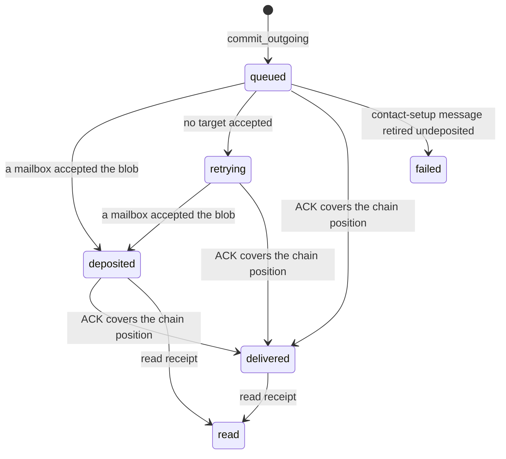

# S08 — Messaging Service

## Overview

The messaging service turns a message the user typed into an encrypted blob in one of the
contact's mailboxes, and turns blobs fetched from the user's own mailboxes back into stored
messages. It sits between the desktop client (`najwa-ffi`, driven by the local web service)
and the protocol layers: X3DH and the Double Ratchet ([S06](06-key-agreement-ratchet.md)),
the wire format ([S07](07-message-format.md)), the encrypted store
([S03](03-encrypted-storage.md)), Tor transport ([S04](04-transport.md)) and the mailbox
API ([S16](16-mailbox-server.md)).

Two ideas shape the design.

- **A crash never loses or duplicates state.** Everything that belongs together commits in
  one storage transaction: the advanced ratchet, the message row, the queued ciphertext,
  the dedup marks and the acknowledgement obligation. Network work starts only after that
  commit. A crash leaves either no trace or a complete trace.
- **The mailbox is a store, not a relay.** Two contacts are rarely online together. The
  sender deposits a blob in one of the recipient's mailboxes. The recipient fetches it the
  next time it is unlocked and online, stores it, and only then tells the server to delete
  it.

An outgoing message moves through these states, which the desktop app shows next to each
message:

| App status | Meaning |
|---|---|
| `queued` | Encrypted and committed to the local outbox. Nothing has left the device. |
| `retrying` | A deposit attempt failed. The outbox retries automatically while unlocked. |
| `deposited` | A mailbox accepted the blob. The recipient can be offline. |
| `delivered` | The recipient's acknowledgement covers the message: it decrypted and stored it. |
| `read` | The recipient displayed the message and sent a read receipt. |
| `failed` | Only for a contact-setup message that expired before it was ever deposited. |

A mailbox accepting a blob is not a delivery confirmation, and delivery is not reading.

Reliability is layered. Each layer handles a failure the one before it cannot:

| Layer | Mechanism | Recovers from |
|---|---|---|
| 1 | Durable outbox with same-blob retry (§5, §10.1.1) | Deposit failure, crash, restart, recipient offline |
| 2 | `CumulativeAck` with exact coverage (§6.6) | Nothing by itself; it is the evidence the other layers use |
| 3 | Gap repair (§6.5) | A message that was deposited and then lost before the recipient stored it |
| 4 | Session repair (§6.2, [S06 §3.7.1](06-key-agreement-ratchet.md)) | Ratchet desynchronisation |
| 5 | `ReSendRequest` handling (§10.2) | A peer's long-offline catch-up from local history |

Retries and repairs can deliver the same content twice. Two dedup layers absorb this
(§9.4): transport dedup drops a frame or payload already seen, and logical dedup drops a
re-encrypted copy of content already stored.

## 1. Scope

This specification defines:

- the `MessagingService` orchestration struct and its `CoreStorage` contract;
- session management: X3DH initiation, acceptance with replay and crossing guards, and
  decryption with an existing session;
- the send pipeline with persist-before-send, and the outgoing message status lifecycle;
- the receive pipeline: poll, fetch, envelope decryption, ratchet decryption, verification,
  dedup and the single-transaction commit;
- epoch-reorder quarantine, gap detection and repair, and the session-repair trigger;
- control-message handling;
- acknowledgements and read receipts;
- contact blocking and session reset;
- inbound and outbound rate limiting;
- multi-path delivery, mailbox health, the mailbox set and primary selection;
- transport, header and logical deduplication;
- background work, retry and backoff, long-offline handling, and behaviour across lock and
  restart.

Wire layouts of every frame referenced here are in [S07](07-message-format.md).

## 2. `MessagingService`

```
struct MessagingService<S: CoreStorage, M: MailboxClient> {
  identity_key:      Ed25519KeyPair
  storage:           S                 // durable state (§3)
  mailbox_client:    M                 // S16 API over Tor
  transport:         Option<TorTransport>
  pseudonym_table:   in-memory map their_pseudonym → contact_id
  repair_states:     in-memory map contact_id → RepairState      // §6.2
  epoch_quarantine:  in-memory buffer, ≤ EPOCH_QUARANTINE_MAX     // §6.2
  outbound_limiter:  token bucket                                 // §8.1
  inbound_limiter:   per-contact sliding window                   // §8.2
  volatile_cache:    per-message disappearing keys                // S12 §4
  last_gap_repair:   in-memory map contact_id → unix seconds      // §6.5
  slot_source:       Option<SlotSource>                           // S10 §6
}
```

The service is generic over storage and mailbox client so tests can substitute both. The
production instance is `MessagingService<SqliteStorage, HttpMailboxClient>`.

Concurrency rules:

- A single state lock serialises every ratchet read, derivation and commit (send, receive,
  confirmations, contact controls). It is released before any network wait.
- A per-frame claim prevents two deposit attempts of the same outbox frame from running at
  once.
- At most 4 background outbox attempts run concurrently. A busy frame waits for the next
  outbox scan instead of blocking.
- Polls do not overlap.

Protocol timestamps (payload `timestamp`, timestamp validation) use the Tor-derived clock
([S04 §7](04-transport.md)) when a transport is present. Local retention deadlines use the
system clock.

| Constant | Value | Use |
|---|---|---|
| `MAX_REPAIR_RETRIES` | 3 | Session-repair attempts before local teardown (§6.2) |
| `REPAIR_GRACE_SECS` | 600 | Quarantine window before escalation (§6.2) |
| `EPOCH_QUARANTINE_MAX` | 32 | Frames held in quarantine at once (§6.2) |
| `GAP_REPAIR_MIN_INTERVAL_SECS` | 3600 | Minimum interval between gap-repair requests to one contact (§6.5) |

## 3. `CoreStorage` Trait

`CoreStorage` is the storage contract of the service. The production implementation is
`SqliteStorage` ([S03](03-encrypted-storage.md)). The trait groups:

| Group | Operations |
|---|---|
| Atomic commits | `commit_incoming`, `commit_outgoing`, `commit_outgoing_timer`, `commit_read_receipt`, `commit_confirmation`, `commit_received`, `commit_initial_received` |
| Outbox | `outgoing_frame_batch`, `outgoing_frame_ids`, `outgoing_frame`, `outgoing_frame_live`, `finish_outgoing`, `timer_change_pending` |
| Acknowledgement intents | `durable_ack_intents`, `pending_ack_contacts`, `pending_ack_ranges`, `repeat_ack` |
| Inbound work | `inbound_work`, `advance_inbound_work`, `outbound_history`, `get_outbound_repair_entry` |
| Contacts and routes | `get_contact`, `get_contact_by_pseudonym`, `get_contact_by_ik`, `get_contact_by_ik_device`, `list_contacts`, `create_reciprocal_contact`, `get_contact_capabilities`, `get_contact_mailbox_signing_key`, `record_remote_mailbox`, `next_outbound_seq` |
| Sessions | `get_ratchet_state`, `get_ratchet_state_by_dh_pub`, `delete_ratchet_state`, `get_session_ad`, `delete_session_ad` |
| Prekeys | `get_spk_keypair`, `get_opk_keypair`, `count_available_opks` |
| Dedup | `check_msg_id_seen`, `check_logical_msg_id_seen` |
| Receive queues | `list_mailboxes_with_ids`, `get_ephemeral_handshake_capability`, `mark_ephemeral_handshake_cap_deactivated` |
| Mailbox health | `get_mailbox_health`, `record_mailbox_success`, `record_mailbox_failure` |
| Quarantine | `save_quarantined_frame`, `load_quarantined_frames`, `delete_quarantined_frame` |
| Timers | `get_conversation_timer`, `get_conversation_timer_setting` |

Every "atomic commit" operation MUST execute as one storage transaction and MUST either
apply all of its effects or none. The commits are:

| Operation | Commits together |
|---|---|
| `commit_outgoing` | advanced sending ratchet and skipped keys; session AD (Initial only); message row with its cached wire bytes; outbound chain position; repair record and outbound history (new user content); the outbox frame; clearing of acknowledged receive intents (ACK frames) |
| `commit_outgoing_timer` | everything in `commit_outgoing` for a `TimerChange`, plus the local timer setting and the pending-timer marker ([S12 §2](12-disappearing-messages.md)) |
| `commit_read_receipt` | everything in `commit_outgoing` for a `ReadReceipt`, plus consumption of the display intent |
| `commit_incoming` | advanced or newly established receiving ratchet and skipped keys; session AD and OPK consumption (Initial); invitation-capability acceptance; message row with its disappearing deadline; transport, header and logical dedup marks; the received-frame acknowledgement intent; every control effect (§6.4) |
| `commit_confirmation` | advanced ratchet; header dedup mark; status and timer effects of a `CumulativeAck` or `ReadReceipt` |

`commit_incoming` MUST check the header dedup mark inside the transaction and make no change
when it is already present.

## 4. Session Management

### 4.1 AD Construction

The associated data binds a session to both identity keys:

```
AD (64 bytes) = IK_pub(initiator) || IK_pub(responder)
```

The initiator computes `our_IK_pub || their_IK_pub`; the responder computes
`their_IK_pub || our_IK_pub`. Both come from the X3DH result
([S06 §2](06-key-agreement-ratchet.md)). The AD is stored per contact (settings key
`session_ad:<contact_id>`) in the same transaction that first persists the session, and is
used for every later ratchet operation of that session.

### 4.2 Get or Create Session (Initiator)

```
func get_or_create_session(contact) → (state, ad_or_initial_prefix, is_initial):
  if state = storage.get_ratchet_state(contact.id):
    ad = storage.get_session_ad(contact.id) or (our_IK_pub || contact.their_IK_pub)
    return (state, ad, false)
  return create_session_candidate(contact)

func create_session_candidate(contact):
  last_error = NoMailboxCapability
  for cap in storage.get_contact_capabilities(contact.id):          // advertised order, §9.5
    if cap.their_deposit_capability is None: continue
    signer = storage.get_contact_mailbox_signing_key(contact.id, cap.onion)
             or contact.their_IK_pub
    for attempt in 0..2:
      bundle = mailbox.fetch_prekey_bundle(cap.onion, cap.their_deposit_capability,
                                           contact.their_pseudonym)   // ByContact circuit
        on error: last_error = error; next cap
      require bundle.identity_key == signer and the bundle manifest verifies (S06 §4)
      x3dh = x3dh_initiate(identity_key, bundle)
      on InvalidSignature: if attempt == 1 return error; refetch on this mailbox
      on other error:      last_error = error; next cap
      on success:          goto done
  return last_error
done:
  state = init_alice(x3dh.shared_secret, bundle.signed_prekey, x3dh.ephemeral_seed)
  return (state, serialize_x3dh_header(x3dh.header) || x3dh.associated_data, true)
```

The candidate is not persisted here. It becomes durable only when `commit_outgoing` commits
the first frame encrypted under it. A rejected first frame leaves the contact without a
session.

The cleartext X3DH header is 101 bytes without a one-time prekey and 105 bytes with one:
`IK_pub(32) || EK_pub(32) || device_pub(32) || spk_id(4) || opk_flag(1) [|| opk_id(4)]`
([S06 §2.4](06-key-agreement-ratchet.md)). A release peer sets `device_pub = IK_pub`.

### 4.3 Accept Session (Responder)

Acceptance follows [S06 §3.11](06-key-agreement-ratchet.md): nothing is persisted until
the single receive commit; an Initial for an advanced session is dropped unless it is a
genuine `SessionRepairInit`; crossing Initials resolve by an `EK_pub` comparison.

There is no top-level wire type for session repair. `SessionRepairInit` is a control
subtype (`0x31`) carried inside an ordinary `0x01` Initial
([S06 §3.7.1](06-key-agreement-ratchet.md), [S07 §2.1](07-message-format.md)). The repair
discriminator is therefore inside the ciphertext, and the existing-session guard runs after
decryption. Decryption advances only a candidate state, so "after decryption" is still
"before anything is persisted".

A session that has received at least one frame has a receiving chain (`ckr` is set). A
session whose `ckr` is unset is an un-answered outbound Initial whose sending key is our
`EK_pub`.

```
func accept_session(x3dh_header, ratchet_header, encrypted_payload, wire_prefix):
  require prekey recovery is complete (S06 §5)
  ik_contact = storage.get_contact_by_ik_device(x3dh_header.IK_pub, x3dh_header.device_pub)
  spk = storage.get_spk_keypair(x3dh_header.spk_id)            or fail NoSignedPrekey
  if x3dh_header.opk_id is Some:
    opk = storage.get_opk_keypair(opk_id)                      or fail NoSignedPrekey
    // fail fast: never fall back to 3-DH for a named OPK
  x3dh  = x3dh_respond(identity_key, spk, opk, x3dh_header)
  state = init_bob(x3dh.shared_secret, spk)                    // candidate only
  plaintext = ratchet_decrypt(state, ratchet_header, encrypted_payload,
                              x3dh.associated_data, wire_prefix)   // forged Initial fails here
  payload   = Payload.from_bytes(plaintext)                    // unknown content type tolerated
  is_repair = payload.content_type == Control
              AND ControlMessage.from_bytes(payload.content) is SessionRepairInit
  contact = storage.get_contact_by_pseudonym(plaintext[0..32])
  if contact is Some:
    // The pseudonym only names the contact; the header IK must be its stored IK.
    if contact.their_ik_pub != x3dh_header.IK_pub: fail PseudonymMismatch
    if ik_contact is Some AND ik_contact.id != contact.id: fail PseudonymMismatch
  else if payload.content_type == ReciprocalHandshake AND blob came from our invitation queue:
    contact = create_reciprocal_contact(...)                   // S05 §8.2, validated first
  else:
    fail UnknownPseudonym

  // GUARD — after decryption, before commit
  existing = storage.get_ratchet_state(contact.id)
  if existing is Some:
    if existing.ckr is None:                                   // crossing Initial
      if existing.dhs.public > x3dh_header.EK_pub: fail KeepLocalSession
      // otherwise adopt the incoming session, repair or not
    else if is_repair:
      // re-establish: the commit overwrites the desynchronised session
    else:
      fail DuplicateMessage                                    // replay or redundant copy
  return AcceptedInitial { contact, plaintext, state, ad: x3dh.associated_data, opk_id }
```

The comparison of `EK_pub` values is an unsigned bytewise comparison of the 32-byte keys.
The larger key wins on both sides, so both converge on one session.

The caller commits the accepted Initial with `commit_incoming`, which writes the ratchet
state (insert or replace), the session AD, the OPK consumption and the message in one
transaction, after the dedup checks of §6.3. A replayed Initial or repair is therefore
dropped by dedup before it can overwrite anything.

A reciprocal handshake (content type `0x04`) creates a contact only if the sender is not
already known by identity key, the content is exactly one `HandshakePayload`, its signature
and every mailbox certificate verify, at least one mailbox entry has a supported capability
type, its `ik_pub` equals the X3DH header identity key, and the payload's sender pseudonym
equals the derived pairwise pseudonym ([S05 §8.2](05-contact-establishment.md)).

### 4.4 Decrypt with Existing Session

```
func decrypt_with_existing_session(ratchet_header, encrypted_payload, wire_prefix):
  // fast path: the session whose receiving DH key or a skipped key matches dh_pub
  if (cid, state) = storage.get_ratchet_state_by_dh_pub(ratchet_header.dh_pub):
    trial = clone(state)
    if pt = ratchet_decrypt(trial, ratchet_header, encrypted_payload, session_ad(cid), wire_prefix):
      return (contact(cid), pt, cid, trial)
  // slow path: trial decryption over every non-blocked contact with a session
  for contact in storage.list_contacts() where not contact.blocked:
    trial = clone(storage.get_ratchet_state(contact.id))
    if pt = ratchet_decrypt(trial, ..., session_ad(contact.id), wire_prefix):
      return (contact, pt, contact.id, trial)
  // a failure counts only from the session the header names (S06 §3.7.1)
  if a non-blocked session with DHr == dh_pub, or DHr == epoch_link != 0, failed with TooManySkipped:
    fail TooManySkipped
  fail NoMatchingSession
```

Trial decryption MUST operate on a copy. The advanced state is returned to the caller and
persisted only by the receive commit; a frame rejected later (for example by the pseudonym
check) never advances the stored session. `ratchet_decrypt` performs the DH ratchet step and
the `epoch_link` check ([S06 §3.5](06-key-agreement-ratchet.md)).

### 4.5 Contact Resolution

- **Initial frames.** The sender is identified by the decrypted payload's sender pseudonym
  and cross-checked against the contact found by `(IK_pub, device_pub)` from the cleartext
  X3DH header (§4.3). A mismatch is rejected.
- **Normal frames.** The sender is the contact whose session decrypts the frame (§4.4). The
  payload's sender pseudonym MUST then equal that contact's `their_pseudonym` exactly.
- **`ReadReceipt (0x11)` and `CumulativeAck (0x12)`.** These carry no payload and no
  pseudonym. The sender is the contact whose session decrypts the frame. Successful AEAD
  verification under that contact's session is the binding.

## 5. Send Message Pipeline

The pipeline enforces persist-before-send ([S06 §3.11](06-key-agreement-ratchet.md)): the
advanced sending ratchet, the message row and the exact wire bytes commit durably before any
byte reaches the network. A crash between encryption and deposit therefore never re-derives
a message key for different plaintext. Restart finds the frame in the outbox and deposits the
same bytes.

The desktop client queues user messages (`enqueue_*`, no network work in the call) and the
outbox worker delivers them (§10.1). The direct `send_*` entry points commit identically and
then attempt delivery at once.

```
func send_content(contact_id, content, requested_flags, original, dispatch):
  lock state
  validate_flags(requested_flags)                     // S07 §4.2: bits 3–7 zero
  contact = storage.get_contact(contact_id)           or fail ContactNotFound
  if contact.blocked: fail ContactBlocked
  if not dispatch:
    require a session exists                          or fail NoMatchingSession
    require no local timer change awaits acknowledgement (S12 §2.3)
  outbound_limiter.check()                            // §8.1
  (state, ad_or_prefix, is_initial) = get_or_create_session(contact)

  timestamp    = original.timestamp or message_time()
  content_hash = SHA256(content_type_byte || content_bytes)
  msg_id       = generate_msg_id(state.dhs.public, state.ns, content_hash,
                                 contact.our_pseudonym)          // S07 §6.1, final header
  logical_seq  = original.logical_seq or storage.next_outbound_seq(contact.id)
  timer        = storage.get_conversation_timer(contact.id)
  if not dispatch AND timer is Some AND content_type in {0x10, 0x11}:
    fail                                              // files need the timer off (S12 §9.4)
  flags = requested_flags | (EPHEMERAL if original is None AND timer is Some)
  payload = Payload { contact.our_pseudonym, content_type, flags, timestamp, msg_id,
                      logical_seq, content }
  Payload.from_bytes(payload.to_bytes())              // reject bad framing before encrypting
  padded = pad_payload(payload.to_bytes(), deposit_fixed_overhead(is_initial))   // S07 §5
  epoch_transition = state.ns < EPOCH_REDUNDANCY_WINDOW                         // §9.1
  (header, ciphertext) = ratchet_encrypt(state, padded, ad, wire_prefix_meta)   // S07 §2.3
  wire = WireMessage { 0x01, Initial or Normal, header, x3dh_header if Initial, ciphertext }
  require storage.get_contact_capabilities(contact.id) is non-empty
                                                      or fail NoMailboxCapability
  stored_content = seal_content(content) if timer is Some and original is None  // S12 §4.1
                   else content
  deadline = (timer, now_ms + (SENDER_FALLBACK_SECS + timer) × 1000) if timer   // S12 §3.1
  logical_id = generate_logical_msg_id(our_IK_pub, contact.their_IK_pub, timestamp,
                                       logical_seq, content_type, content)       // S07 §6.2
  (frame_id, row_id) = storage.commit_outgoing(
      state, AD if is_initial, message row (status Pending) if original is None,
      existing row id if original is Some, wire, (header.dh_pub, header.n),
      requires_ack = false, deadline, repair record, logical_id)
  unlock state
  if not dispatch: return
  strategy = Adaptive if epoch_transition else Primary
  dispatch_frame(frame_id, strategy, priority = RealMessage)   // failure leaves the frame queued
```

The fixed overhead used for padding targets the deposited-blob bucket
([S07 §5.1.1](07-message-format.md)):

```
deposit_fixed_overhead = ENVELOPE_OVERHEAD(40) + wire_prefix + AEAD_OVERHEAD(40)
wire_prefix            = 80                  // version, type, reserved, payload_length, 72-byte header
                       | 82 + x3dh_len       // Initial: + x3dh_header_length(2) + 101 or 105
result                 = 160 (Normal) | 263 (Initial, no OPK) | 267 (Initial with OPK)
```

`original` is set only when the service re-sends history for a `ReSendRequest` (§10.2). The
re-send reuses the original `timestamp`, `logical_seq`, content type, flags and content, so
the receiver derives the same `logical_msg_id`. It creates no new message row and records
the new chain position against the existing row.

**Transport retry (normative).** A deposit failure, a crash or a restart re-deposits the
byte-identical committed wire bytes; only the outer envelope changes (§9.2).
`ratchet_encrypt` MUST NOT run again for a retry of the same frame.

The repair record kept for gap repair (§6.5) is limited to the 256 most recent outbound
messages per contact. When the conversation timer is on, the record holds the sealed content,
never the plaintext.

### 5.1 Send Control Message

Control messages use the same pipeline with `content_type = 0x20 (Control)`, `flags = 0`
and `logical_seq = 0`. The content is `subtype(1) || body` ([S07 §4](07-message-format.md)).
Differences from user content:

- Control messages are not subject to the outbound limiter.
- No message row is created; the outbox frame alone carries the obligation.
- Every control frame commits with `requires_ack = true`. It stays in the outbox after a
  successful deposit and is re-deposited byte-identically until a `CumulativeAck` covers its
  chain position ([S07 §8.3](07-message-format.md), §10.1.1).
- `SessionRepairInit (0x31)` is encrypted under a fresh session candidate from
  `create_session_candidate` (§4.2), so it travels as an Initial, and is dispatched with the
  Paranoid strategy (§9.1). Other controls are dispatched with Primary.
- A local timer change is queued, not dispatched: `enqueue_timer_change` sets
  `set_at = max(now, previous_set_at + 1)` and commits the frame, the local setting and the
  pending marker in one `commit_outgoing_timer` transaction
  ([S12 §2.3](12-disappearing-messages.md)).

### 5.2 Message Status Lifecycle

Outgoing message rows carry a status. The desktop client exposes it under the names in the
Overview.



| Stored status | Value | App name | Set when |
|---|---|---|---|
| `Pending` | 0 | `queued` | the row is committed |
| `Sent` | 1 | `deposited` | the first deposit is accepted (`DepositResult.accepted = true`) |
| `Delivered` | 2 | `delivered` | a `CumulativeAck` range covers the row's chain position (§6.6) |
| `Read` | 3 | `read` | a `ReadReceipt` names the row's `msg_id` and the row requested receipts |
| `Failed` | 4 | `retrying` | a deposit attempt fails and the row was not yet deposited |
| `PermanentlyFailed` | 5 | `failed` | an undeposited contact-setup message is retired at expiry ([S05](05-contact-establishment.md)) |

Rules:

- A deposit result MUST NOT change a row that is `Delivered`, `Read` or `PermanentlyFailed`.
- A failed attempt MUST NOT move a `Sent` row back to `Failed`.
- Received messages are stored with status `Delivered`; displaying one sets its `read_at`
  (§6.6).
- A file's status in the app is derived from its parts: it stays queued until every part is
  deposited ([S11](11-file-transfer-sanitization.md)).

## 6. Receive Message Pipeline

### 6.1 Poll Messages

There is no fetch cursor. Under batched release a randomised `release_at` can make an
earlier deposit visible after a later one, so any cursor would skip it permanently
([S16 §3.4](16-mailbox-server.md)). Acknowledgement is the only cursor: a fetch returns
released, unacknowledged blobs, and the client deletes each blob with `/v1/acknowledge`
once it reaches a terminal outcome.

Every enabled mailbox contributes these receive queues: its own queue, every registered
per-contact queue on that mailbox (§9.5), and every active invitation queue
([S05](05-contact-establishment.md)).

```
func poll_messages():
  lock poll
  maintain_prekeys()                       // S06 §5; failure tolerated unless recovery is incomplete
  reload_quarantine_once()                 // §6.2
  queues = []
  for each enabled mailbox M:
    queues += fetch_plan.select(M, real receive queues of M)   // §6.1.1, dummies included
  queues = shuffle(queues)                 // random visiting order
  defer_acks = Responsive mode AND storage.durable_ack_intents()
  for (mailbox_id, queue) in queues:
    if not mailbox_poll_due(storage.get_mailbox_health(mailbox_id), now): continue   // §9.3
    if queue is an invitation queue whose Initial was already accepted:
      retry deactivation; continue
    for iteration in 1..=MAX_DRAIN_ITERS:
      batch = mailbox.fetch(queue, limit = FETCH_COUNT)      // ByMailbox(onion) circuit
        on error: record a transport-class failure (§9.3); break
      record success
      if batch is empty: break
      acks = []; deferred = false
      for blob in batch:
        if this invitation queue already accepted an Initial in this batch:
          acks.push(blob.id); continue                       // first valid Initial wins
        inner = envelope_decrypt(queue.envelope_secret, queue.deposit_capability, blob)
          on failure: acks.push(blob.id); continue           // cover, spam or not ours
        match process_message(inner):                        // §6.2
          Ok(_)                               → acks.push(blob.id)
          Err(RateLimitExceeded | Storage)    → deferred = true      // not acknowledged
          Err(DuplicateMessage | KeepLocalSession) → acks.push(blob.id)
          Err(other)                          → acks.push(blob.id)   // terminal, avoids poison loops
        if an Initial was accepted on an invitation queue: deactivate it (S05)
      if acks non-empty: mailbox.acknowledge(queue, acks)  on error: break
      if deferred OR batch.len < FETCH_COUNT: break
  retry_quarantine()                       // §6.2
  request_aged_gap_repairs()               // §6.5
  drain_inbound_work(); flush_ack_intents(); retry_outgoing()   // §6.5, §6.6, §10.1.1
```

The envelope is decrypted with the queue's own `(deposit_capability, envelope_secret)` pair
([S07 §3.2](07-message-format.md)). A dummy queue (§6.1.1) has no envelope secret, so each of
its blobs fails decryption and is acknowledged as not ours. Redelivery after a lost
acknowledgement is absorbed by dedup (§9.4), which makes delivery safe at-least-once.

#### 6.1.1 Fetch Count and Mailbox Limit — normative

```
FETCH_COUNT          = 10   // blobs requested per fetch call
MAX_DRAIN_ITERS      = 64   // fetch calls per queue per poll; bounds a poison backlog
MAX_MAILBOX_SERVERS  = 8    // mailboxes a profile may configure
FETCH_CAPS_MIN       = 4    // fetch capabilities polled per mailbox per poll: lower bound
FETCH_CAPS_MAX       = 10   //                                              upper bound
```

`FETCH_COUNT` is the message batch limit of one fetch request. It is unrelated to the number
of capabilities fetched.

**Fetch-capability selection.** To keep the mailbox from learning how many contacts a user
has on it, the client MUST poll, per mailbox and per poll, a number of fetch capabilities
drawn uniformly from `[FETCH_CAPS_MIN, FETCH_CAPS_MAX]`. It round-robins through the real
per-contact capabilities on that mailbox and pads with locally registered dummy
capabilities when there are fewer real ones. Dummy capabilities receive modelled
self-deposits ([S10 §5.1](10-cover-traffic.md)) so their fetch and deposit profile matches a
real contact's. A user with more than `FETCH_CAPS_MAX` contacts on one mailbox produces
observable drift in the fetched-capability count.

```
DUMMY_CAPS_PER_MAILBOX = FETCH_CAPS_MAX − 1   // the mailbox's own queue is always real

func select(M, real):                          // real: M's receive queues, stable order
    pool = real ‖ first max(0, FETCH_CAPS_MAX − len(real)) registered dummies of M
    k    = uniform integer in [FETCH_CAPS_MIN, FETCH_CAPS_MAX], at most len(pool)
    picked = pool[cursor(M) .. cursor(M) + k]   (wrapping)
    cursor(M) = (cursor(M) + k) mod len(pool)
    return shuffle(picked)
```

- Real and dummy queues share one rotation, so every pool entry is read at the same
  average rate and every entry within `⌈len(pool) / FETCH_CAPS_MIN⌉` polls. Padding only the
  poll, and reading every real queue on every poll, would mark the queues read every time
  as the real ones.
- The pool holds `max(len(real), FETCH_CAPS_MAX)` entries, so its size does not depend on the
  contact count up to `FETCH_CAPS_MAX`. Dummies beyond the pool idle: they are neither
  fetched nor deposited to.
- A dummy queue is fetched like any queue, with `limit = FETCH_COUNT` over the mailbox's
  `ByMailbox` circuit. It has no envelope secret, so its blobs are discarded and
  acknowledged.
- The selection state (`cursor`, the dummy list and the last-known real fetch capabilities)
  lives in a fetch plan that outlives the profile lock, so polls while locked use the same
  rotation ([S13 §8.3](13-privacy-hardening.md)).
- Dummy pairs are provisioned and registered like cover pairs ([S10 §5.1](10-cover-traffic.md)).
  An embedder without dummies still round-robins its real queues, but cannot pad.

**Mailbox limit.** A profile holds at most `MAX_MAILBOX_SERVERS` mailboxes. Adding one more
fails with `mailbox_limit`. A `MailboxUpdate` advertises at most 8 entries (§6.4).

### 6.2 Process Message

```
func process_message(raw, is_retry, invitation_cap):
  if raw[0] != WIRE_VERSION (0x01): log; return None          // terminal, acknowledged
  wire = WireMessage.from_bytes(raw)
  lock state
  header_id = SHA256(header.dh_pub || u32_be(header.n))[0:16]
  if storage.check_msg_id_seen(header_id):
    storage.repeat_ack(header_id)                             // re-arm the ACK intent
    return None
  match wire.message_type:
    0x01 Initial:  accepted = accept_session(...)              // §4.3
    0x02 Normal:   decrypt_with_existing_session(...)          // §4.4
      on TooManySkipped:       on_ratchet_failure(reason 0x02); fail
      on MissedEpochBoundary:  quarantine or repair (below)
      on NoMatchingSession:    quarantine (below)
    0x11 ReadReceipt | 0x12 CumulativeAck | unknown:
      (contact, plaintext, cid, state) = decrypt_with_existing_session(...)
      if unknown type: commit_received(state, header_id); return None    // S07 §10, no ACK
      body = from_padded_plaintext(plaintext)                  // S07 §5.5
      effect = ReadReceiptContent.from_bytes(body) or CumulativeAck.from_bytes(body)
      if contact.blocked: commit_received(state, header_id)
      else:               commit_confirmation(cid, state, header_id, effect)   // §6.6
      return None                                              // confirmations are not acknowledged
  return process_payload(contact, plaintext, pending_commit, header)          // §6.3
```

**Epoch-reorder quarantine.** A `MissedEpochBoundary` is usually a reorder: batched release
and multi-path copies can release a later epoch before the frame that links it. The
receiver therefore quarantines the frame instead of starting a repair.

- A frame that fails with `MissedEpochBoundary`, or a Normal frame with no matching session
  (it can arrive before its Initial), is stored durably under `SHA256(raw)` with its
  `quarantined_at` time and kept in an in-memory buffer of at most `EPOCH_QUARANTINE_MAX`
  frames. Storing it is a terminal outcome for the server copy.
- When the buffer is full, a `MissedEpochBoundary` escalates to session repair at once.
- The first poll after start reloads the durable quarantine, keeping the original
  `quarantined_at`, so grace windows resume rather than restart.
- At the end of every poll each quarantined frame is retried through `process_message`:

| Retry outcome | Action |
|---|---|
| Decrypts | Deliver; delete the durable copy |
| Still `MissedEpochBoundary`, age < `REPAIR_GRACE_SECS` | Keep |
| Still `MissedEpochBoundary`, age ≥ `REPAIR_GRACE_SECS` | `on_ratchet_failure(reason 0x01)`; delete the copy |
| Still no session, age < `REPAIR_GRACE_SECS` | Keep |
| Still no session, age ≥ `REPAIR_GRACE_SECS` | Delete the copy (no authenticated peer to repair with) |
| Storage error or inbound rate limit | Keep |
| Any other error | Delete the copy |

**Session-repair trigger.** A Normal frame whose decryption fails with `TooManySkipped`, or
a quarantined frame still failing with `MissedEpochBoundary` after the grace window, MUST
start session repair for the contact that owns the failing session.
`on_ratchet_failure(dh_pub, epoch_link, reason)` resolves that contact as the session whose
`dhr` equals `dh_pub`, or else a non-zero `epoch_link` (§4.4), increments its in-memory
repair counter and records `InProgress`:

- While the counter is ≤ `MAX_REPAIR_RETRIES`, it sends `SessionRepairInit` with
  `reason` (`0x01` missed epoch boundary, `0x02` too many skipped), the failing `dh_pub` and
  the failing `epoch_link` ([S06 §3.7.1](06-key-agreement-ratchet.md)).
- When the counter exceeds `MAX_REPAIR_RETRIES`, the phase becomes `Failed` and the client
  deletes its own session and AD for that contact. It MUST NOT send `SessionReset (0x30)`
  for this: that signal would also delete the peer's working direction. The next Initial
  from either side establishes a fresh session.
- Receiving a `SessionRepairInit` from the peer clears the local repair state. So does any
  later frame from the contact that commits, Initial, Normal or confirmation: the repair
  replaced the old session, so that frame is the peer answering in the new one (normally its
  ACK of the repair Initial). Gap repair for the contact resumes from then on.

The desktop client reports `repairing` or `failed` for a contact from this state.

### 6.3 Process Payload — single-transaction receive (normative)

The receive path follows [S06 §3.11](06-key-agreement-ratchet.md): the ratchet update,
skipped-key rows, message row, dedup marks, acknowledgement intent and control effects
commit in ONE transaction, and that transaction commits BEFORE the blob id is sent to
`/v1/acknowledge`. A crash leaves either no trace (the blob is fetched again) or a complete
trace (dedup absorbs the redelivery).

```
func process_payload(contact, plaintext, pending, header):
  payload = Payload.from_bytes(plaintext)        // unknown content type → S07 §10 discard
  if payload.timestamp > now + MAX_FUTURE_SKEW_SECS: fail TimestampOutOfRange   // S07 §7.1
  // older than the 90-day window: accepted; logical dedup decides (re-send carve-out)
  if storage.check_msg_id_seen(payload.msg_id): fail DuplicateMessage
  if payload.sender_pseudonym != contact.their_pseudonym: fail PseudonymMismatch
  inbound_limiter.check(contact.id)                                          // §8.2
  if payload.content_type == ReciprocalHandshake AND pending is not Initial: fail
  store = not contact.blocked AND content_type != ReciprocalHandshake
  ack_required = not contact.blocked
  effects = []
  if content_type == Control AND not contact.blocked:
    control = ControlMessage.from_bytes(payload.content)   // unknown subtype → S07 §10 discard
    effects = prepare_control_effects(contact, control)    // §6.4, no storage writes
    adjust store and ack_required per §6.4
  if content is user content:
    logical_id = generate_logical_msg_id(our_IK_pub, contact.their_IK_pub, payload.timestamp,
                                         payload.logical_seq, content_type, content)
    if storage.check_logical_msg_id_seen(contact.id, logical_id): store = false   // ACK still sent
  timer = storage.get_conversation_timer(contact.id) if store
  message = row(content sealed if timer, status Delivered) if store          // S12 §4.1
  deadline = (timer, recipient_deadline(now_ms, timer, payload.flags)) if timer   // S12 §3.2
  storage.commit_incoming(state, AD and OPK if Initial, invitation acceptance, message,
                          payload.msg_id, logical_id, deadline, header_id,
                          received_frame(header.dh_pub, header.n, ack_required), effects)
  unlock state
  clear local repair state for contact                       // any committed frame (§6.2)
  drain_inbound_work()
  if ack_required AND not defer_acks: send CumulativeAck now (§6.6)
  return message if stored
```

**Terminal outcomes (normative).** A blob id is included in `/v1/acknowledge` if and only if
its processing reached durable persistence or a definitive terminal discard:

| Outcome | Acknowledged |
|---|---|
| Frame committed (message, control, logical duplicate, blocked-contact frame) | yes |
| Frame durably quarantined (§6.2) | yes |
| Envelope decryption failed | yes |
| Header, transport or Initial duplicate; crossing-Initial `KeepLocalSession` | yes |
| Unknown wire version, type, content type or control subtype (S07 §10) | yes |
| Other terminal error: malformed frame, failed AEAD, unknown pseudonym, pseudonym mismatch, future timestamp, repair initiated | yes |
| Storage error | no |
| Inbound rate limit exceeded | no |

A transient failure MUST NOT be acknowledged: the server copy is then the only copy.

Quarantine follows the same rule. A quarantined frame is acknowledged only after its durable
copy (`SHA256(raw)`, frame bytes, `quarantined_at`) is committed. After a crash or restart
the copy is reloaded on the first poll with its original `quarantined_at`, and deleted when
the frame is delivered, escalated or discarded (§6.2).

### 6.4 Handle Control Message

Control effects are prepared without writing to storage and applied inside the receive
commit (§6.3). Body layouts are in [S07](07-message-format.md) and the
[message-type registry](../reference/message-types.md).

| Subtype | Name | Receive handling | Stored | ACKed |
|---|---|---|---|---|
| `0x01` | TimerChange | Body `timer_secs(u32 BE) ‖ set_at(u64 BE)`; a body shorter than 12 bytes is rejected and bytes after the twelfth are ignored. `timer_secs` in `1..=29`, or a `set_at` more than `MAX_FUTURE_SKEW_SECS` ahead ([S07 §7.1](07-message-format.md)), is ignored. Otherwise merged by [S12 §2.2](12-disappearing-messages.md). | hidden row | yes |
| `0x02` | TypingIndicator | Empty body required. No effect. | no | yes |
| `0x05` | ReSendRequest | Mode `0x01` with a 24-byte body or mode `0x02` with a 16-byte body; anything else is rejected. Queued as durable inbound work (§10.2). | no | yes |
| `0x20` | MailboxUpdate | 1 to 8 entries of 217 bytes, each long-term (`capability_type = 0x02`) with a lowercase base32 onion. Replaces the contact's advertised targets, keeping order; the first entry is the contact's primary (§9.5). | hidden row | yes |
| `0x21` | IdentityRotation | 200-byte body. The first 32 bytes MUST equal the contact's current `IK_pub`; signatures by the old and new keys over bytes `0..72` MUST verify. The contact's `IK_pub` is replaced and the change recorded in identity history ([S02](02-identity-key-protection.md)). | hidden row | yes |
| `0x22` | RevocationNotice | Empty body required. Sent when the peer deletes this contact (§7.1). Deletes the contact's session, AD, queued outgoing frames, advertised targets and the contact row, which removes its messages. | no | no |
| `0x25` | Introduction | Version `0x01` only; another version is discarded as unknown. `introducer_ik_pub` MUST equal the delivering contact's `IK_pub` or the frame is rejected. A known `introduced_ik_pub` is ignored. Otherwise a pending introduction and a visible system text are stored. The receiver MUST also verify `expires_at > now` and the introducer signature ([S05 §11](05-contact-establishment.md)). | system text | yes |
| `0x26` | RotationAnnouncementRequest | Empty body required. No effect. | hidden row | yes |
| `0x30` | SessionReset | Deletes the contact's session, AD and queued outgoing frames. | no | no |
| `0x31` | SessionRepairInit | Body `reason(1) ‖ failed_dh_pub(32) ‖ failed_epoch_link(32)`. Valid inside an Initial; the session was re-established by §4.3. Clears local repair state. | hidden row | yes |
| `0x36` | GapRepairRequest | Bounds per [S07 §8.5.1](07-message-format.md). Queued as durable inbound work (§6.5). | no | yes |
| `0x37` | GapRepairUnavailable | If `start_n ≤ end_n` and the range covers at most `GAP_REPAIR_MAX_RANGE` positions, deletes the skipped keys for the range. | no | yes |
| `0x38` | GapRepairBundle | Per-item handling in §6.5. | no | yes |
| `0x3C` | FileChunkNack | Parsed per [S11 §2.2.1](11-file-transfer-sanitization.md). Queued as durable inbound work and answered per [S11 §4.1](11-file-transfer-sanitization.md). | no | yes |
| other | — | [S07 §10](07-message-format.md): commit ratchet and header dedup, discard, no reply. | no | no |

"Hidden row" means the frame is also kept as a message row of content type Control. The
conversation view does not show these rows.

From a blocked contact, control frames are decrypted and their ratchet advance is committed,
but no effect is applied, nothing is stored and nothing is acknowledged.

A release peer emits subtypes `0x01`, `0x20`, `0x22`, `0x36`, `0x37`, `0x38` and `0x3C`.
It accepts every subtype in the table.

### 6.5 Gap Detection and Repair (normative)

Wire structures and constants: [S07 §8.5](07-message-format.md).

Same-blob retry covers deposit failure and session repair covers desynchronisation. Neither
recovers a message that was deposited and then lost: the blob expired before fetch, a fetch
failed after the server dropped it, or the mailbox lost data. Only the receiver can tell
"never arrived" from "arrived late", so gap repair is receiver-driven.

**Receiver-side detection.** A gap is a missing message number below the highest received
on a chain, which is exactly what creates a skipped-key entry
([S06 §3.7](06-key-agreement-ratchet.md)). After every poll:

```
func request_aged_gap_repairs():
  for contact in storage.list_contacts() with a session:
    missing = skipped keys of the session with age ≥ GAP_DETECT_SECS (600 s)
    if missing is empty: continue
    request = coalesce missing, sorted by (dh_pub, n), into inclusive ranges, bounded by
              GAP_REPAIR_MAX_EPOCHS (8), GAP_REPAIR_MAX_RANGES_PER_EPOCH (16) and
              GAP_REPAIR_MAX_RANGE (100) positions in total
    if repair_state(contact) is InProgress: continue          // repair supersedes gap repair
    if now − last_gap_repair(contact) < GAP_REPAIR_MIN_INTERVAL_SECS: continue
    record last_gap_repair(contact) = now
    send_control_message(contact, GapRepairRequest(request))  on failure: undo the record
```

A skipped key younger than `GAP_DETECT_SECS` is presumed reordered, not lost. The request
is a control message: it is cover-paced in Timing privacy mode (§9.1) and retransmitted
until acknowledged (§5.1). `logical_seq` is never used to detect gaps.

**Responder side.** A request is stored as durable inbound work in the receive commit and
answered by `drain_inbound_work`, which runs after every receive commit and every poll and
skips blocked contacts. For each requested `(dh_pub, n)`:

- if a repair record exists for that position (§5) and its content can be produced — a
  sealed record is opened with its disappearing key ([S12 §4.2](12-disappearing-messages.md))
  — add a `RepairedItem` (original `msg_id`, `dh_pub`, `n`, `timestamp`, `logical_seq`,
  content type, flags and content) to the current `GapRepairBundle`;
- otherwise (no record, key expired, or a single item larger than `MAX_CONTENT_SIZE`) add the
  position to the unavailable set.

Bundles hold at most 255 items and at most `MAX_CONTENT_SIZE` bytes of item encoding
(`2 + Σ(70 + content_length)`). Unavailable positions are collapsed into contiguous ranges,
each sent as one `GapRepairUnavailable`. Disappeared messages are therefore never re-sent.
The work item is deleted only after every response frame has been committed to the outbox.

A responder answers at most one request per contact per `GAP_REPAIR_MIN_INTERVAL_SECS`
(one hour, the requester's own bound), so a contact can make it re-encrypt at most
`GAP_REPAIR_MAX_RANGE` (100) positions an hour. A later request from that contact is
dropped when it is drained, with no bundle, no `GapRepairUnavailable` and no re-encryption.
An admitted request that fails stays queued and is not counted again when retried. Answer
times are kept in memory and start empty after a restart. Delivery delay can bring a
requester's next hourly request in less than an hour after its previous one; it is then
dropped and the gap is requested again an hour later. Oversized requests are rejected by
the parser ([S07 §8.5.1](07-message-format.md)). A position the responder holds no record
for, including one outside the known message-number range of its epoch, is reported
unavailable.

**Receiver completion.** For each `GapRepairBundle` item the receiver:

1. rejects the whole bundle if the item's content type is Control or ReciprocalHandshake,
   its `logical_seq` is 0, its payload framing is invalid, its timestamp is in the future
   beyond `MAX_FUTURE_SKEW_SECS`, or
   `generate_msg_id(original_dh_pub, original_n, SHA256(type || content), their_pseudonym)`
   does not equal `original_msg_id`;
2. deletes the skipped key for `(original_dh_pub, original_n)`;
3. marks that position received: it records the header dedup mark
   `SHA256(original_dh_pub || u32_be(original_n))[0:16]` and an acknowledgement intent, so the
   next `CumulativeAck` covers the original position;
4. stores the item as a received message under its original `msg_id`, `timestamp` and
   computed `logical_msg_id` unless either id is already seen or repeats within the bundle.
   The stored row is sealed when the conversation timer is on.

A repaired item and its late original have different transport ids but the same
`logical_msg_id`; whichever arrives second is dropped. Repaired items raise no notification.

On `GapRepairUnavailable` the receiver deletes the skipped keys for the range. The gap is
then not detected and not requested again.

### 6.6 Acknowledgements and Read Receipts

**ACK emission (normative).** The receive commit records an acknowledgement intent
`(dh_pub, n, ack_pending = 1)` for every committed Initial or Normal frame with
`ack_required` (§6.3, §6.4). ACKs are unconditional: the `ShowDeliveryStatus` flag is a UI
hint and does not gate them.

- In Timing privacy mode, and whenever intents are not durable, the receiver sends a
  `CumulativeAck` right after the commit.
- In Responsive mode with durable intents, ACKs are deferred to the end of the poll and
  flushed per contact by `flush_ack_intents`, so a slow ACK deposit does not delay the next
  frame.
- An ACK covers up to 128 pending positions, taken in `(received_at, dh_pub, n)` order;
  consecutive numbers on the same `dh_pub` merge into one inclusive range, and at most
  `MAX_ACK_RANGES = 16` ranges are sent.
- Committing the ACK frame clears `ack_pending` for exactly the covered positions, in the
  same transaction.
- A repeated frame (header already seen) sets `ack_pending` again, so a retransmitted control
  is re-acknowledged.
- ACK and read-receipt frames are never themselves acknowledged. They leave the outbox after
  their first accepted deposit; a failed deposit stays queued (§10.1.1).

**Coverage is exact.** Every position inside an acknowledged range was decrypted and durably
committed. There is no cumulative "everything up to N" past a gap. A sender MAY therefore
treat a covered position as delivered, and the disappearing-message timer relies on this
([S12 §3.1](12-disappearing-messages.md)).

**ACK processing.** For each range of a verified `CumulativeAck` (1 to 16 ranges,
`start_n ≤ end_n`), in the confirmation commit:

- outbox frames of that contact on `sender_dh_pub` with `n` in the range are deleted;
- sent rows whose recorded chain position is in the range, and which are not already
  `Delivered` or `Read`, become `Delivered`; for a disappearing row the deadline becomes
  `min(deadline, now + timer)` ([S12 §3.1](12-disappearing-messages.md)).

Positions are resolved through the stored outbound chain positions, never through message
ids or arrival order.

**Read receipts.** The desktop client requests receipts on every outgoing text and reply
(payload flag bit 2, `ReadReceiptRequested`).

- A receipt is created only when a received message is visible in the focused conversation.
  The browser reports a message as displayed only while the chat list is shown, the
  conversation is selected, no dialog is open, the window is visible and focused, and the
  message element intersects the viewport. Fetching history never counts as reading.
- `displayed(contact, ids)` (at most 200 ids) commits in one transaction, for each id: the
  `read_at` time, the recipient disappearing deadline `min(deadline, now + timer)`, and —
  only for an unexpired received text or reply that requested a receipt, from a non-blocked
  contact — a durable receipt intent. Displaying an unrequested message sends nothing.
- Every second while unlocked, up to 200 intents become `ReadReceipt` frames. Each frame is
  committed with its ratchet advance and the consumption of its intent in one
  `commit_read_receipt` transaction. The receipt carries the message `msg_id` and the display
  time in seconds.
- On receipt of a `ReadReceipt`, the sender sets its row to `Read` only if the row belongs to
  that contact, is outgoing, requested a receipt and is not already `Read`. If the row was not
  yet `Delivered`, the disappearing deadline also becomes `min(deadline, now + timer)`.

## 7. Blocking and Session Reset

### 7.1 Block, Unblock and Delete Contact

The desktop client applies contact controls locally under the state lock, without any
network request:

| Action | Effect |
|---|---|
| `block` | Sets `blocked`. History and the session are kept. Nothing is sent. |
| `unblock` | Clears `blocked`. |
| `rename` | Changes the display name. |
| `delete` | Queues a `RevocationNotice` (below), then deletes the contact, its messages, sessions, outbox and queues (cascade), evicts the disappearing keys of its messages, and clears its pseudonym-table entry, rate-limit window, repair state and gap-repair record. |

**Revocation on delete (normative).** Before the delete, the client checks for an
established session (it never starts X3DH for this) and at least one deposit target (§9.5).
If both exist, it encrypts `RevocationNotice (0x22)` as an ordinary control frame (§5.1) and
commits it to the outbox, also for a blocked contact. The delete transaction then moves that
frame, unless it is already deposited, into `revocation_frames` together with the contact's
targets (onion, deposit capability, envelope secret), and deletes the contact. That table has
no contact foreign key, so the frame outlives the contact row. Without a session or a target
nothing is sent and the delete proceeds. The desktop client queues the notice even before Tor
has connected; no request is made until the outbox worker runs.

The outbox worker (§10.1) deposits each due row byte-identically with the Adaptive strategy at
Control priority. The contact and blocked checks of §10.1.1 do not apply, because the contact
is gone. The receiver never acknowledges the notice (§6.4), so the first accepted deposit
deletes the row. A failed attempt backs off with `transport_retry_delay` (§9.3). A failed
attempt on a row older than `REVOCATION_LIFETIME_SECS = 90 days`, the longest a mailbox keeps
an unfetched blob (§10.2), discards it.

On receipt the peer deletes its session, AD, queued frames, targets and the contact row, which
removes the conversation (§6.4). A peer that has blocked the sender applies no control effect,
so the notice changes nothing there. Copies the peer made outside Najwa are unaffected.

While a contact is blocked:

- sending, timer changes and file sends to it are refused (`ContactBlocked`);
- its queued frames are not deposited, and a deposit already waiting for a slot is abandoned
  before the network request;
- its incoming frames are decrypted and the ratchet advance is committed, but nothing is
  stored, no control effect is applied and nothing is acknowledged;
- read-receipt intents and inbound work for it are paused;
- the slow trial-decryption path skips it (§4.4).

No notification is sent to the blocked contact.

### 7.2 Reset Session

`SessionReset (0x30)` is the bidirectional last-resort reset. A release peer never sends it:
an exhausted session repair tears down only the local session (§6.2). On receipt, the
receiver deletes its session, AD and queued outgoing frames for that contact in the receive
commit, stores nothing and sends no ACK (§6.4). The next message in either direction starts
a fresh X3DH session.

## 8. Rate Limiting

### 8.1 Outbound (Token Bucket)

```
DEFAULT_OUTBOUND_RATE  = 10   // tokens per second
DEFAULT_OUTBOUND_BURST = 20   // bucket capacity
```

`send_content` consumes one token per new user message and per re-sent history message
(§10.2). Refill is `elapsed_seconds × rate`, capped at the burst. With no token available the
call fails with `RateLimitExceeded { retry_after_ms }` before anything is committed. Controls,
ACKs and read receipts are not limited here.

### 8.2 Inbound (Per-Contact Sliding Window)

```
DEFAULT_INBOUND_RATE_PER_CONTACT = 50   // frames per window
DEFAULT_INBOUND_WINDOW_SECS      = 60
```

The limiter counts every Initial or Normal frame from a contact that passed transport dedup
and the pseudonym check, user content and controls alike. ACK and read-receipt frames are
not counted. A frame over the limit is not committed and its blob is not acknowledged; it is
fetched again on a later poll. Limiter state is in memory and is cleared when the contact is
deleted.

## 9. Multi-Path Delivery and Dedup

### 9.1 Delivery Strategy

```
enum DeliveryStrategy {
  Primary,    // the first advertised target only
  Adaptive,   // the first target plus one other chosen at random, when there is one
  Paranoid,   // every advertised target
}
EPOCH_REDUNDANCY_WINDOW = 3
```

| Frame | Strategy |
|---|---|
| User content dispatched at send time, `state.ns < EPOCH_REDUNDANCY_WINDOW` (first three messages of a sending epoch) | Adaptive |
| Other user content dispatched at send time | Primary |
| `SessionRepairInit` | Paranoid |
| Other controls, ACKs and read receipts dispatched at send time | Primary |
| Every frame delivered by the outbox worker (queued sends and retries) | Adaptive |

Which targets are chosen follows the advertised order (§9.5); the order in which they are
deposited is randomised (§9.2).

**Pacing (normative).** A synchronous deposit to several mailboxes would let an active
operator drop one message and watch the user's other mailboxes light up, revealing the set.

- In Timing privacy mode every target deposit MUST wait for its own cover slot on that
  mailbox ([S10 §6](10-cover-traffic.md)). The slot is consumed only after local preflight
  checks pass; an abandoned slot is replaced by cover.
- In Responsive mode slot waits are bypassed. Consecutive targets are still separated by a
  random delay in `[STAGGER_DELAY_MIN_MS, STAGGER_DELAY_MAX_MS] = [500, 3000]` ms.
- If the cover scheduler is not running, deposits proceed without a slot.

Absorption priorities: user content `RealMessage`, `SessionRepairInit` its own tier, ACKs
`Ack`, read receipts `ReadReceipt`, other controls `Control` ([S10 §6.1](10-cover-traffic.md)).

### 9.2 Deposit

**Per-target envelope encryption (normative).** Each target carries its own
`envelope_secret`. The sender MUST run
`envelope_encrypt(target.envelope_secret, target.deposit_capability, wire_bytes)` separately
for each target and each attempt, with a fresh nonce ([S07 §3.1](07-message-format.md)). One
envelope MUST NOT be reused across targets: a copy made for mailbox A cannot be opened through
mailbox B's capability, and byte-identical blobs would let colluding operators link the
capabilities.

**Randomised order (normative).** The order in which a multi-target deposit visits its
targets, the order of same-blob fallback routes, and the order in which a poll visits receive
queues (§6.1) MUST be randomised. Mailboxes are stored in a stable priority order; following
it would let an observer rank a user's mailboxes and pick out the primary by position.
Which targets are selected stays priority-driven.

```
func deposit_with_strategy(caps, wire_bytes, strategy, priority, frame_id):
  targets = shuffle(select_targets(caps, strategy))
  for (i, target) in targets:
    if i > 0: sleep(uniform(500, 3000) ms)
    try_deposit_one(target, wire_bytes, priority, frame_id)
  if no target accepted:                                   // same-blob fallback
    for target in shuffle(caps) not yet tried, at most DEPOSIT_RETRIES = 2:
      sleep(uniform(500, 3000) ms)
      if try_deposit_one(target, ...) accepted: break
  return Ok if any accepted else AllMailboxesFailed(failures)

func try_deposit_one(target, wire_bytes, priority, frame_id) → bool:
  require target.their_deposit_capability and target.their_envelope_secret
  blob = envelope_encrypt(target.envelope_secret, target.deposit_capability, wire_bytes)
  loop:
    slot = await cover slot (Timing privacy) or none
    require the contact exists and is not blocked, and the frame is still live (§10.1.1)
    begin slot (an expired lease waits for another slot)
    result = deposit_once(target.onion, target.deposit_capability, blob, pow)   // OneShot circuit
    accepted                         → record_remote_mailbox(onion, success); return true
    RateLimited and no PoW tried yet → solve PoW (S16 §7) outside the slot; loop
    transport error or HTTP 5xx      → record_remote_mailbox(onion, failure); return false
    other                            → return false
```

A deposit is confirmed only by `DepositResult.accepted = true`. In Responsive mode, file
parts may reuse a circuit isolated to one file, contact, capability and mailbox instead of a
OneShot circuit ([S04 §4.1.1](04-transport.md), [S11](11-file-transfer-sanitization.md)).

### 9.3 Mailbox Health

The client tracks two kinds of health. Neither ever disables a route automatically.

| Record | Updated by | Effect |
|---|---|---|
| Own mailbox (`mailboxes.failure_count`, `last_failure`) | Fetch results. A transport error or HTTP 5xx increments the consecutive count; a successful fetch resets it. | Polling of the mailbox is deferred (below). |
| Remote route (`remote_mailbox_health.failures` per onion) | Deposit results, same classification. | Shown as "retrying" in network status. |

Only transport-class failures count. Any other error (for example a 4xx such as `410 Gone`
for a deactivated capability) is not a mailbox fault and MUST NOT be counted.

```
func mailbox_poll_due(health, now) → bool:
  return health.enabled AND (health.consecutive_failures == 0
         OR health.last_failure is None
         OR health.last_failure > now                         // clock moved backwards
         OR now − health.last_failure ≥ transport_retry_delay(health.consecutive_failures))

transport_retry_delay(f) = min(5 × 2^min(f − 1, 6), 300) seconds   // 5, 10, 20, …, 300
```

A mailbox the user disabled is never polled. A remote route marked paused is skipped as a
target; the client never pauses a route itself, and `retry_mailbox` clears a pause.

### 9.4 Message Deduplication

Three dedup keys protect the receive path. All are recorded inside the receive commit, so a
mark never exists without the effect it guards.

| Key | Value | Table | Scope |
|---|---|---|---|
| Header id | `SHA256(dh_pub ‖ u32_be(n))[0:16]` of the authenticated ratchet header | `msg_id_cache_transport` | every committed frame, checked before decryption |
| Transport id | payload `msg_id` ([S07 §6.1](07-message-format.md)) | `msg_id_cache_transport` | Initial and Normal payloads |
| Logical id | `logical_msg_id` ([S07 §6.2](07-message-format.md)) | `msg_id_cache_logical`, keyed `(contact_id, logical_msg_id)` | user content (not Control, not ReciprocalHandshake) |

```
logical_msg_id = SHA256(
    min(IK_a_pub, IK_b_pub) || max(IK_a_pub, IK_b_pub) ||
    0x00 || timestamp_be64 ||
    0x00 || logical_seq_be32 ||
    0x00 || content_type_byte ||
    0x00 || content
)[0:16]
```

The two identity keys are ordered by unsigned bytewise comparison. Sender and receiver derive
the same value for the same content, which is why logical dedup survives re-encryption by
gap repair and re-send, and why `ReSendRequest` mode `0x01` can name an anchor by
`logical_msg_id`.

- A header-id hit re-arms the frame's ACK intent and drops the frame.
- A transport-id hit drops the payload (`DuplicateMessage`).
- A logical-id hit commits the ratchet advance and acknowledges the frame but stores nothing.

**Retention (normative).** Dedup entries MUST be kept for at least
`MIN_ENTRY_TTL = 7,776,000 s` (90 days), the mailbox hard retention cap
([S16 §10.1](16-mailbox-server.md)), so no blob the server can still deliver outlives its
dedup entry. Capacity MUST NOT evict entries early. While the profile is unlocked, the
storage retention pass deletes entries 91 days after `seen_at`, one day beyond the server's
cap and its cleanup interval ([S03 §6.4](03-encrypted-storage.md)). Deleting a contact
deletes its entries.

### 9.5 Mailbox Set and Primary Selection

- A profile configures 1 to `MAX_MAILBOX_SERVERS = 8` mailboxes. A new mailbox is registered
  with its server before it is enabled.
- The user selects the **primary** among enabled, registered mailboxes. Without a selection,
  mailboxes keep their storage order and the app shows the first enabled one as primary.
- For every non-blocked contact and every registered mailbox, the client creates a
  per-contact receive queue: a fresh deposit capability, fetch capability and envelope secret
  (long-term, `capability_type = 0x02`). A queue is advertised only after its server accepted
  the registration.
- The client advertises its queues to a contact with `MailboxUpdate (0x20)`: 1 to 8 entries,
  primary first. It sends an update whenever the ordered set differs from the last completed
  announcement, identified by a SHA-256 marker over the ordered coordinates. Changing the
  primary forces a new announcement to every contact.
- The receiving side replaces its stored target list for that contact with the advertised
  list in order. The first entry is the primary target used by the Primary strategy.
- A sender selects targets from that list in order, skipping routes marked paused.

## 10. Background Sync and Retry

### 10.1 Background Work

While unlocked, the desktop client runs these workers. All but Sync stop at lock; Sync
continues fetch-only until the next unlock ([S13 §8.3](13-privacy-hardening.md)).

| Worker | Cadence | Work |
|---|---|---|
| Sync | exponential pause between runs: mean 3 s, ±25 % jitter, 1 s floor, no cap ([S10 §3](10-cover-traffic.md)) | reconnect Tor if offline; `poll_messages` (§6.1); register mailboxes; register per-contact queues and send contact-setup and `MailboxUpdate` announcements. While locked: a fetch-only poll with the same selection (§6.1.1) |
| Outbox | every 1 s | `drive_outgoing` (§10.1.1), then due revocation notices (§7.1) |
| Receipts and files | every 1 s | turn read-receipt intents into frames (§6.6); prepare file parts ([S11](11-file-transfer-sanitization.md)); at most once a minute, request missing parts of received files ([S11 §4.1](11-file-transfer-sanitization.md)) |
| Disappearing cleanup | every 10 s | [S12 §6](12-disappearing-messages.md) |

`drive_outgoing` scans the outbox at most once per second, reads up to 64 frames per scan,
keeps up to 32 attempts in flight and starts an attempt only when a background permit is free
(§2). A frame is due when `next_attempt ≤ now`.

#### 10.1.1 Retry Logic

Every outbox attempt uses the same committed wire bytes. User content is never re-encrypted
for a retry and there is no timeout-driven retry of user content after a successful deposit.

```
func finish_attempt(frame, accepted):
  a = frame.attempts                        // attempts before this one
  if accepted:
    message row: Pending/Failed → Sent; retry blob cleared
    if not frame.requires_ack: delete frame                       // user content, ACK, receipt
    else: frame.deposited_at = first success time
          frame.next_attempt = now + uniform(1, min(5 × 2^min(a, 10), 3600)) s
  else:
    message row: Pending → Failed (a Sent row stays Sent)
    frame.next_attempt = now + uniform(1, min(5 × 2^min(a, 6), 300)) s
  frame.attempts = a + 1
```

- A control frame (`requires_ack`) is re-deposited byte-identically on that schedule until a
  `CumulativeAck` covering its position deletes it ([S07 §8.3](07-message-format.md)).
- There is no retry budget. A frame stays queued until it is deposited (or acknowledged, for
  controls), its disappearing deadline passes, or its contact is reset, revoked or deleted.
  The one exception is a deleted contact's `RevocationNotice`, kept apart until its first
  deposit or 90 days (§7.1).
- A frame is not deposited while its contact is blocked, its message row is `Delivered`,
  `Read` or `PermanentlyFailed`, or its message has expired. Overwriting a message's content
  deletes its queued frames.
- Within one attempt, when no selected target accepts, up to `DEPOSIT_RETRIES = 2`
  alternative routes are tried (§9.2).

### 10.2 Long-Offline Contact Handling

The mailbox server keeps an unfetched blob for at most 90 days and a fetched but
unacknowledged blob for the capability's `retention_days` (default 14, range 1 to 90)
([S16 §10](16-mailbox-server.md)). A client offline longer than that loses those blobs.

Recovery beyond retention is peer-to-peer. A returning contact MAY send
`ReSendRequest (0x05)`. The responder answers from its local outbound history, re-sending
the original `timestamp`, `logical_seq`, content type, flags and content under the current
ratchet (§5, `original` set). The re-sent message has a fresh transport `msg_id`; the
receiver's logical dedup absorbs duplicates, and the past-timestamp carve-out of
[S07 §7.1](07-message-format.md) applies.

`ReSendRequest` body ([S07](07-message-format.md)):

- mode `0x01` (24 bytes): `since_logical_msg_id[16] ‖ fallback_floor(u64 BE)`. The
  responder resolves the anchor to its own outbound message's timestamp `t` and re-sends
  every own outbound message with timestamp `≥ t`, except the anchor itself, up to now.
  `zeros(16)` means all stored history. An unknown anchor falls back to the range
  `[fallback_floor, now]`.
- mode `0x02` (16 bytes): `range_start(u64 BE) ‖ range_end(u64 BE)`, inclusive Unix
  seconds.

In both modes the responder MUST NOT re-send a message whose disappearing deadline has passed
or whose key is gone, and re-sends only text, reply, binary, file-metadata and file-chunk
content. History is walked in pages of 100 with a durable cursor, so an interrupted answer
resumes where it stopped. Re-sends consume outbound tokens (§8.1).

For loss of specific message numbers inside a session, gap repair (§6.5) is the primary
mechanism; `ReSendRequest` is the coarse complement.

### 10.3 Offline, Lock and Restart

These are separate conditions:

- **Recipient offline.** A deposit still succeeds and the message shows `deposited`. The
  mailbox holds the blob until the recipient fetches it (§10.2).
- **Sender locked or closed.** No decryption and no deposits of real work happen while
  locked. Polling continues on the same schedule and selection, but only fetches: nothing is
  processed or acknowledged, so blobs stay on the mailbox until unlock. The client then holds
  only onion addresses and fetch capabilities ([S13 §8.3](13-privacy-hardening.md)). Queued
  frames, ACK intents, read-receipt intents and inbound work are durable and resume
  automatically at the next unlock. No manual sync is needed. A closed service does not poll.
- **Restart.** Committed but undeposited frames are deposited byte-identically. Quarantined
  frames are reloaded with their original grace windows (§6.2). In-memory state starts empty:
  rate-limiter windows, session-repair counters and phases, gap-repair request and answer
  times, and `FileChunkNack` answer times.
- **Deletion.** No retry recovers data that every mailbox and the peer have discarded:
  retention expiry, quota rejection, a deactivated capability and local deletion are final.

## 11. Error Types

```
enum MessagingError {
  ContactNotFound,
  ContactBlocked,
  NoMailboxCapability,
  NoSignedPrekey,
  PseudonymMismatch,
  IntroducerMismatch,                  // introducer_ik_pub ≠ delivering contact (§6.4)
  InvalidIntroduction(String),         // expiry or signature check failed (S05 §11.4)
  UnknownPseudonym,
  DuplicateMessage,                    // terminal drop
  KeepLocalSession,                    // crossing-Initial tiebreak, terminal drop (§4.3)
  NoMatchingSession,
  TimestampOutOfRange,
  RateLimitExceeded { retry_after_ms },
  RatchetError(RatchetError),
  MessageError(MessageError),
  X3DHError(X3DHError),
  MailboxError(MailboxError),
  AllMailboxesFailed(attempts),
  MailboxDisabled(mailbox_id),
  StorageError(String),                // transient on the receive path (§6.3)
  SerializationError(String),
  InternalError(String),
}
```

## 12. Rust Crate Dependencies

| Crate | Purpose |
|---|---|
| `najwa-crypto` | AEAD, hashing, randomness, clocks |
| `najwa-protocol` | X3DH, Double Ratchet, wire format, mailbox client |
| `najwa-storage` | SQLCipher store, atomic commits, durable queues |
| `najwa-transport` | Tor transport and circuit isolation |
| `najwa-identity` | Identity key types |
| `najwa-sanitize` | File sanitisation before send |
| `tokio`, `futures-util` | Async runtime, bounded concurrency |
| `async-trait` | Async storage trait |
| `rand` | Target shuffling, jitter, stagger |
| `sha2` | Content hashes, header ids, logical ids |
| `zeroize` | Key material hygiene |
| `serde`, `serde_json` | Stored target lists and settings |
| `thiserror`, `tracing` | Errors and logging |

## Limitations

- **Fetch-capability selection.** Selection (§6.1.1) hides the contact count only up to
  `FETCH_CAPS_MAX` real queues per mailbox and only once the mailbox's dummies are
  registered; while they are being provisioned the pool is smaller. An idle dummy (one
  pushed out of the pool by new contacts) expires at the server after 30 days without
  activity ([S16](16-mailbox-server.md)); if contacts are later removed it rejoins the pool
  and its fetches fail until it is re-provisioned, which the release does not do. A locked
  poll never acknowledges (§10.3). Mailboxes are drained back to back, not one per cover
  poll cycle.
- **Responsive mode** (the desktop default) bypasses cover slots. Multi-target deposits are
  only staggered by 0.5 to 3 s, and ACKs and receipts leave as soon as they are committed, so
  an observer of several mailboxes can correlate them in time. Timing privacy mode paces
  them.
- **A missed epoch does not start repair.** A `MissedEpochBoundary` frame names no session:
  its `dh_pub` and `epoch_link` match no stored `dhr`, and every other contact's session
  fails on it too. §4.4 therefore reports it as `NoMatchingSession`; it is quarantined and
  discarded after `REPAIR_GRACE_SECS`, not escalated as the §6.2 table describes. Only
  `TooManySkipped` starts repair.
- **Session slots.** The client keeps one session per contact: committing a
  `SessionRepairInit` replaces the old session in both directions. As
  [S06 §3.7.2](06-key-agreement-ratchet.md) allows, messages in flight under the old session
  that were never decrypted are not re-sent, and a release peer never sends `ReSendRequest`,
  so such messages are lost. This includes the frame whose failure started the repair.
- **Lost ACK for user content.** User content is deposited once. If its ACK is lost, the
  message stays `deposited` on the sender.
- **No automatic failover.** A failing mailbox stays in rotation with backoff (§9.3); the
  user removes or replaces it.

## 13. Conformance Checklist

- `MessagingService<S, M>` generic over `CoreStorage` and `MailboxClient`; one state lock
  around every ratchet read, derive and commit.
- Atomic commits of §3 as single transactions; `commit_incoming` re-checks the header mark.
- AD = initiator `IK_pub` ‖ responder `IK_pub`, stored with the first committed frame.
- Session candidate from the advertised targets with signer and manifest checks; candidate
  persisted only with its first frame.
- `accept_session`: nothing persisted; OPK fail-fast; post-decrypt guard (crossing `EK_pub`
  tiebreak, repair re-establishes, plain Initial on an advanced session is a duplicate);
  identity binding of IK and pseudonym; reciprocal-handshake validation.
- Trial decryption on a copy; advanced state persisted only by the receive commit.
- Send: flags validated; `msg_id` from the final header; `logical_seq` per contact; padding to
  the deposited-blob bucket; persist-before-send; byte-identical transport retry.
- Controls: `content_type 0x20`, `logical_seq 0`, kept until ACKed; `SessionRepairInit`
  under a fresh candidate with Paranoid strategy; timer change committed with its setting and
  pending marker.
- Status lifecycle of §5.2 with no backward transitions.
- Poll: no cursor; random queue order; health-based deferral; `FETCH_COUNT = 10`;
  `MAX_DRAIN_ITERS = 64`; acknowledge only terminal outcomes; first valid Initial wins on an
  invitation queue.
- Fetch-capability selection: per mailbox and poll, `k` uniform in `[4, 10]` entries
  round-robin through real queues plus up to 9 registered dummies (pool of 10); dummy blobs
  acknowledged undecrypted; same selection and fetch-only behavior while locked; exponential
  poll gaps with mean 3 s (§6.1.1, §10.1, §10.3).
- `MAX_MAILBOX_SERVERS = 8`; `MailboxUpdate` of 1 to 8 long-term entries.
- Header dedup before decryption with ACK re-arm; transport and logical dedup; logical
  duplicates acknowledged but not stored; dedup entries kept at least 90 days.
- Quarantine of undecryptable Normal frames: durable under `SHA256(raw)`, bounded at 32,
  reloaded once after start with original times, retried every poll, discarded after
  `REPAIR_GRACE_SECS = 600`.
- `TooManySkipped` on the session the header names starts repair (§4.4, §6.2); received
  `SessionRepairInit` re-establishes the session; any committed frame from the contact clears
  local repair state.
- Timestamp: future skew rejected, past window deferred to logical dedup; strict pseudonym
  check.
- Control handling per §6.4, effects applied inside the receive commit.
- Gap detection after `GAP_DETECT_SECS = 600`, bounded request, one request per contact per
  hour, suppressed during repair; responder answers one request per contact per hour from
  durable records with sealed-content opening, bundles ≤ 255 items and ≤ `MAX_CONTENT_SIZE`,
  collapsed `0x37` ranges; receiver item validation, skipped-key deletion, position marked
  received, logical dedup.
- `FileChunkNack` from durable inbound work per [S11 §4.1](11-file-transfer-sanitization.md).
- ACK intents committed with frames; Timing privacy immediate ACK, Responsive deferred flush;
  ≤ 128 positions in ≤ 16 ranges; ACK commit clears covered intents; ACK processing by chain
  position.
- Read receipts: focused-and-visible display only; intent only for requested text and reply;
  intent consumed atomically with the receipt frame; `Read` only for rows that requested it.
- Block, unblock, rename and delete per §7.1; delete queues a `RevocationNotice` only on an
  existing session with a target (blocked contacts included), kept in `revocation_frames`
  until its first deposit or 90 days; block sends nothing; `SessionReset` receive semantics
  per §7.2.
- Outbound token bucket 10/s burst 20 on user content; inbound window 50 per 60 s per contact,
  over-limit frames not acknowledged.
- Strategy table of §9.1; randomised target order; cover-slot pacing in Timing privacy mode;
  500 to 3000 ms stagger; per-target per-attempt envelope; PoW once on 429; up to 2
  alternative routes.
- Health: transport-class failures only; poll backoff `min(5 × 2^(f−1), 300)` s; no
  automatic disabling.
- Mailbox set, primary selection, per-contact queues and announcements per §9.5.
- Desktop workers per §10.1; outbox backoff per §10.1.1 with no retry budget.
- `ReSendRequest` responder: mode `0x01` anchor semantics with fallback floor, mode `0x02`
  range, expired content excluded, durable paging cursor.
