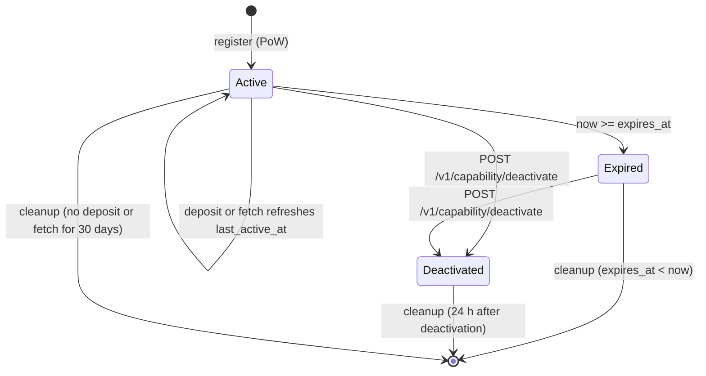

# S16 — Mailbox Server

## Overview

A Najwa mailbox is a small store-and-forward server. Clients cannot reach each
other directly, so a sender leaves an encrypted blob at the recipient's mailbox
and the recipient collects it later. The mailbox also holds each recipient's
signed prekey bundles so that a new contact can start an X3DH session while the
recipient is offline ([S06](06-key-agreement-ratchet.md)).

The mailbox runs only as a Tor v3 onion service. It has no user accounts. Every
request is authorized by a random 32-byte **capability** carried in the request
body:

- A **fetch capability** lets its holder read, acknowledge, check status and
  deactivate one receive queue. The owner keeps it private.
- A **deposit capability** lets its holder write to that queue and fetch the
  queue's prekey bundle. The owner hands it to the people who should be able to
  send.

A client registers one capability pair per receive queue: a primary queue per
mailbox, a separate cover-traffic queue ([S10 §5](10-cover-traffic.md)), one
queue per contact, and one single-use queue for each invitation
([S05 §5](05-contact-establishment.md)). The server cannot tell which queues
belong to the same person.

Blobs are opaque to the server. Each deposited blob is a deposit envelope keyed
by an `envelope_secret` that travels with the deposit capability between clients
and is never sent to the server ([S07 §3](07-message-format.md)). Real messages
and cover traffic look the same to the operator.

The operator still sees traffic metadata: which deposit and fetch capabilities
form a pair, when deposits and fetches happen, blob sizes, and prekey fetches.
This specification states what the server does with that data and what it
cannot hide (§2.4, §14.2).

The client side of this protocol is `najwa-protocol::mailbox`. The server is
the `najwa-mailbox` crate. Deployment and operation are covered in
[Deployment](../server/deployment.md) and [Operations](../server/operations.md).

## 1. Scope

This specification defines:

- The HTTP API: ten endpoints on the onion-facing listener and one on a
  private health listener (§3).
- Capability types and lifecycle, including the single-use receive queue with
  an absolute expiry (§2).
- Silent accept-and-discard for deposits to unknown, deactivated or expired
  capabilities (§3.3).
- Durable acceptance: a stored deposit is committed to disk before the server
  answers `accepted: true` (§3.3, §12).
- The server-side SQLite schema (§4) and the TOML configuration (§5).
- Release timing (hold and jitter) (§6).
- Proof-of-work (§7), per-capability rate limits (§8), quotas (§9) and the
  cleanup task with its 90-day hard retention cap (§10).
- Tor configuration (§11), server hardening (§12), server status (§13), and
  server-side invariants and security considerations (§14).

This release has no directory service, no push relay, no feed endpoints and no
endpoint that links extra deposit capabilities to an existing fetch capability.
The fetch endpoint returns only real stored blobs; the server adds no noise.

## 2. Server Role

The mailbox server:

1. Registers capability pairs and enforces their lifecycle.
2. Accepts deposit envelopes for active capabilities and stores them durably.
3. Releases stored blobs to the matching fetch capability and deletes them when
   the owner acknowledges them.
4. Hosts one prekey bundle per receive queue and hands out one-time prekeys
   (OPKs) under the rules of §3.7.
5. Runs only behind a Tor v3 onion service. The server process makes no
   outbound connections.
6. Holds no key that decrypts a blob. The deposit envelope key derives from
   `envelope_secret`, which the server never receives
   ([S07 §3](07-message-format.md)). The `cap_hint` it returns is
   `SHA256(deposit_capability)[0:8]`, a lookup hint with no decryption value.

### 2.1 Capabilities

| Item | Size | Encoding on the wire |
| --- | --- | --- |
| `fetch_capability` | 32 bytes | standard base64 with padding |
| `deposit_capability` | 32 bytes | standard base64 with padding |
| `cap_hint` | 8 bytes | standard base64: `SHA256(deposit_capability)[0:8]` |
| message id | 40 characters | `msg-` followed by a lowercase hyphenated UUIDv4 |

Clients MUST generate capabilities with a CSPRNG. In this release each fetch
capability has exactly one deposit capability: registration fails with `409`
when either value is already registered in a different pair (§3.1).

### 2.2 Capability types

`capability_type` is fixed at registration.

| Type | Name | Used for | Server rules |
| --- | --- | --- | --- |
| `1` | single-use receive queue | invitation queues ([S05 §5](05-contact-establishment.md)) | absolute expiry, clamped to at most `ephemeral_max_lifetime_hours` (default 48 h) after registration and assigned when omitted; every deposit needs PoW (§7.2); reduced quota of 100 messages and 8 MiB (§9); prekey fetch consumes at most one OPK and is idempotent (§3.7); cannot use recovery replacement (§3.6) |
| `2` | long-term receive queue | primary, cover and per-contact queues | optional absolute expiry, not clamped; expires after 30 days without a deposit or fetch (§10); full quota |

A type-1 queue is single-use by contract. The server accepts several deposits
while it is active. The owner processes the first valid `Initial`, discards the
rest, and deactivates the queue ([S05 §5.2](05-contact-establishment.md)).

### 2.3 Capability lifecycle



| State | Deposit | Fetch | Prekey upload / fetch | Status | Deactivate |
| --- | --- | --- | --- | --- | --- |
| Active | stored | `200` | `200` | `200` | `200` |
| Expired | silently discarded (`200`) | `410` | `410` | `404` | `200`, deletes stored data |
| Deactivated | silently discarded (`200`) | `410` | `410` | `404` | `200`, `messages_deleted: 0` |
| Unknown (never registered or already cleaned up) | silently discarded (`200`) | `404` | `404` | `404` | `404` |

Prekey upload answers as in the table only to the owner. Without the matching
fetch capability it answers `404` in every state (§3.6).

Deactivation is irreversible and immediately deletes the queue's messages,
prekey bundle and available OPKs. Cleanup deletes the remaining records later
(§10).

### 2.4 What the operator can observe

- The (fetch, deposit) pairing of every registered queue, its type, expiry and
  registration settings.
- The time and size of every deposit and fetch, and which capability made it.
- Prekey uploads and prekey fetches per queue, and how many OPKs remain.
- The `release_at` time it computes for each blob (§6).

The operator cannot read blob contents, cannot link two queues of the same user
from capability values alone, and cannot learn sender identities from the
envelope. Tor hides client network addresses from the server.

## 3. API Endpoints

### Conventions

- The API is HTTP/1.1 behind the onion service on virtual port 80. Clients use
  `http://<56-character-address>.onion/v1/...`.
- Request bodies are JSON with `Content-Type: application/json`. Responses are
  JSON unless noted.
- Binary values are standard base64 (RFC 4648 §4) with padding. Times are Unix
  seconds. Integers are JSON numbers.
- The server ignores unknown request fields.
- Every request passes the JSON limits of §12 and the fixed response deadline
  of §14.1.
- Clients MUST NOT parse the human-readable `error` text.

Error bodies have this shape:

```json
{
  "error": "<human-readable text>",
  "pow_challenge": {
    "challenge": "<base64, 32 bytes>",
    "difficulty": 20,
    "algorithm": "sha256-leading-zeros",
    "expires_at": 1767225600
  }
}
```

`pow_challenge` is present only on a `429` that requires proof-of-work.

| Status | Body | Meaning |
| --- | --- | --- |
| `400` | JSON | malformed field, bad capability length, invalid settings, failed or reused PoW, prekey ID conflict |
| `400` | text | JSON limit violation (§12) |
| `404` | JSON or empty | unknown capability on an owner or prekey endpoint, missing or wrong `fetch_capability` on prekey upload, no prekey bundle, unknown route |
| `405` | empty | wrong HTTP method |
| `409` | JSON | registration conflict |
| `410` | JSON | deactivated or expired capability on fetch or prekey endpoints |
| `413` | JSON | blob larger than the server or capability limit |
| `413` | text | request body larger than 1 MiB |
| `415` | text | missing JSON content type |
| `422` | text | valid JSON that does not match the request schema |
| `429` | JSON with `pow_challenge` | proof-of-work required |
| `429` | JSON without `pow_challenge` | per-capability rate ceiling reached |
| `500` | JSON | database error |
| `503` | JSON | registration refused because the server is not Active (§13) |
| `507` | JSON | message, storage or OPK quota exceeded |

### 3.1 POST /v1/capability/register

Registers a capability pair.

**Request:**

```json
{
  "fetch_capability": "<base64, 32 bytes>",
  "deposit_capability": "<base64, 32 bytes>",
  "capability_type": 1,
  "expires_at": 1767398400,
  "pow_solution": {
    "challenge": "<base64, 32 bytes>",
    "nonce": 1234567,
    "hash": "<base64, 32 bytes>",
    "timestamp": 1767225600
  },
  "settings": { "retention_days": 14, "max_message_size": 262144 }
}
```

| Field | Required | Meaning |
| --- | --- | --- |
| `fetch_capability` | yes | 32 bytes |
| `deposit_capability` | yes | 32 bytes |
| `capability_type` | no | `1` or `2`; default `2` |
| `expires_at` | no | absolute expiry in Unix seconds |
| `pow_solution` | when `registration_always_requires_pow` | solution bound per §7.1 |
| `settings.retention_days` | no | `1`–`90`; default `[quotas].default_retention_days` |
| `settings.max_message_size` | no | `1`–`[quotas].max_blob_size_bytes`; default `max_blob_size_bytes` |

The release client always sends `capability_type`, `pow_solution` and
`settings = {"retention_days": 14, "max_message_size": 262144}`. For type 1 it
sends `expires_at = created_at + 172800`.

**Response:** `200` → `{"status": "ok"}`

**Algorithm:**

1. If the server status is not Active (§13), return `503`.
2. Decode both capabilities. Return `400` unless each is exactly 32 bytes.
3. Count the request in the registration window of `fetch_capability` (§8).
   Above `register_per_min`, return `429` without a challenge.
4. If `registration_always_requires_pow` is true:
   1. Without `pow_solution`, return `429` with a challenge at
      `adaptive(load, min_difficulty, max_difficulty)` (§7.2).
   2. Verify the solution with binding `fetch_capability ‖ deposit_capability`,
      `blob_hash = zeros(32)` and minimum difficulty `min_difficulty` (§7.1).
      Return `400` on failure.
5. Apply setting defaults. Return `400` if `capability_type` is not 1 or 2, if
   `retention_days` is outside 1–90, or if `max_message_size` is 0 or larger than
   `max_blob_size_bytes`.
6. In one immediate transaction:
   1. If `fetch_capability` exists and `deposit_capability` maps to it, return
      `200` without changing the stored record. This holds even when that
      capability is expired or deactivated.
   2. If `fetch_capability` exists with another deposit capability, or
      `deposit_capability` exists for another fetch capability, return `409`.
   3. Compute the effective expiry. Type 1:
      `min(expires_at, now + ephemeral_max_lifetime_hours × 3600)`, or the bound
      itself when `expires_at` is omitted. Type 2: `expires_at` as given, or none.
   4. Insert the capability with `created_at = last_active_at = now` and the
      deposit mapping. Commit durably.
7. Return `200`.

An idempotent re-registration still consumes its PoW solution. Clients that
retry a registration after a lost response MUST resend the same pair and MUST
solve a fresh challenge.

### 3.2 POST /v1/challenge

Issues a proof-of-work challenge.

**Request:** `{"capability_hint": "<base64>"}`. The field is required. The
server does not interpret it. The release client sends
`SHA256(deposit_capability)[0:8]`.

**Response:** `200`

```json
{
  "challenge": "<base64, 32 bytes>",
  "difficulty": 20,
  "algorithm": "sha256-leading-zeros",
  "expires_at": 1767225900
}
```

**Algorithm:**

1. Draw 32 bytes from a CSPRNG.
2. `difficulty = adaptive(load, min_difficulty, max_difficulty)` (§7.2).
3. `expires_at = now + challenge_expiry_secs`.
4. Store the challenge as unused in memory and return it.

Outstanding challenges, from this endpoint and from every `429` that carries
one, are held in memory only; issuing one writes nothing to disk. The store holds
at most 65,536 challenges. At capacity, issuing a new one drops the oldest, so a
flood can void an honest client's challenge only by issuing 65,536 more while
that client solves. A restart drops every outstanding challenge; a solution for a
dropped challenge gets `400` and the client asks for a new one.

A challenge is single-use and is not bound to an endpoint. Any endpoint accepts
an unused, unexpired challenge whose stored difficulty is at least that
endpoint's floor (§7.2). The release client obtains every challenge it solves
from this endpoint, so its solutions are always at least `min_difficulty` bits.

### 3.3 POST /v1/deposit

Deposits one envelope-encrypted blob.

**Request:**

```json
{
  "deposit_capability": "<base64, 32 bytes>",
  "blob": "<base64, 1 to 262144 bytes>",
  "pow_solution": {
    "challenge": "<base64, 32 bytes>",
    "nonce": 98765,
    "hash": "<base64, 32 bytes>",
    "timestamp": 1767225600
  }
}
```

`pow_solution` is optional and needed only when the server asks for it.

**Response:** `200` → `{"accepted": true, "message_id": "msg-<uuid>"}`

**Algorithm:**

1. Decode `deposit_capability` (`400` unless 32 bytes). Decode `blob` (`400` if
   not base64 or empty). Return `413` if the decoded blob exceeds
   `max_blob_size_bytes`. These checks do not depend on the capability.
2. **Rate limit.** Record the request in the deposit rate window of this
   deposit capability, whether or not the capability exists. If the count
   exceeds `deposit_per_min_per_cap`, return `429` without a challenge.
3. **Look up and proof-of-work.**
   1. Look up the capability. Use its stored type even when it is deactivated
      or expired. An unknown capability counts as type 2.
   2. Proof-of-work is required when the type is 1 and
      `ephemeral_deposit_min_difficulty > 0`, or when the window count exceeds
      `deposit_pow_threshold_per_min`. Without a solution, return `429` with a
      challenge (floor `ephemeral_deposit_min_difficulty` for type 1, 8 for
      type 2). Verify a supplied solution with binding `deposit_capability` and
      `blob_hash = SHA256(blob)` against the same floor; return `400` on failure.
   3. If the capability is unknown, return
      `200 {"accepted": true, "message_id": <discard id>}` and store nothing.
      Its size limit is the type-2 default `max_blob_size_bytes`, already
      checked in step 1.
4. **Size and deduplicate.** Begin one immediate transaction that covers
   steps 4–8.
   1. Return `413` if the blob exceeds the capability's registered
      `max_message_size`. This applies to a deactivated or expired capability
      too, whose settings stay stored until cleanup removes it (§10).
   2. If `deposit_dedup` holds an unexpired row for
      `(deposit_capability, SHA256(blob))`, return `200` with that row's
      original `message_id`. Store nothing and charge no quota. This also
      holds for a capability deactivated or expired since that deposit.
   3. If the capability is no longer stored, or is deactivated or expired,
      return the step 3.3 response and store nothing.
5. **Quota.** Return `507` if the queue already holds its message quota, or if
   stored bytes plus the blob would exceed its storage quota (§9).
6. Assign `message_id = "msg-" ‖ UUIDv4` and compute `release_at` (§6).
7. Insert the message with `deposited_at = now` and the deposit capability.
   Insert or replace the dedup row with
   `expires_at = now + max(max_hold_secs + jitter_secs, 600)`. Set the
   capability's `last_active_at = now`.
8. Commit durably and return `200 {"accepted": true, "message_id": ...}`.

**Durability (normative).** The server MUST make a stored deposit durable before
it returns `accepted: true`. The server opens SQLite with `journal_mode=WAL` and
`synchronous=FULL`, so the commit in step 8 completes the WAL sync before the
response. The sender treats `accepted: true` as final and does not retry that
blob ([S08 §5](08-messaging-service.md)).

**Silent discard (normative).** The deposit path MUST NOT return `404` or `410`.
A deposit to an unknown, deactivated or expired capability MUST receive the same
status and body shape as an accepted deposit, with a well-formed
`message_id`, under the same response deadline (§14.1). A dedicated status
would let any holder of a deposit capability watch when the owner deactivates
or lets a queue expire. For the same reason such a deposit first passes the
same rate limit, proof-of-work and size checks as a live capability of its
type (steps 2–4), so `429` and `413` answer alike for live and dead queues.
§14.3 lists the signals that remain.

**Discard id.** A discarded deposit gets

```text
message_id = "msg-" ‖ UUIDv4 layout of HMAC-SHA256(discard_key, deposit_capability ‖ SHA256(blob))[0:16]
```

with the UUID version (4) and variant (RFC 4122) bits set, so it reads like a
random UUIDv4. `discard_key` is 32 bytes from a CSPRNG, drawn at startup and
kept only in memory. A repeated identical deposit therefore gets the same
`message_id`, as deduplication gives a live queue (step 4.2), and the server
stores nothing about the capability.

Because a discarded deposit gets the same answer, `accepted: true` does not
prove that the queue is live. End-to-end delivery is confirmed only by the
recipient ([S07 §8](07-message-format.md)).

### 3.4 POST /v1/fetch

Returns released, unacknowledged blobs.

**Request:** `{"fetch_capability": "<base64, 32 bytes>", "limit": 10}`

`limit` is optional; default 50, values above 100 are reduced to 100.

**Response:** `200`

```json
{
  "messages": [
    {
      "id": "msg-0f8e2a7c-5d1b-4c3a-9e6f-2b7d8c9a0e1f",
      "blob": "<base64>",
      "deposited_at": 1767225600,
      "size": 4096,
      "cap_hint": "<base64, 8 bytes>"
    }
  ],
  "has_more": false
}
```

**Algorithm:**

1. Decode `fetch_capability`. Return `404` if unknown, `410` if deactivated or
   expired.
2. Record the request in the fetch rate window. Return `429` without a
   challenge above `fetch_per_min_per_cap`.
3. In one immediate transaction, select this queue's messages with
   `release_at <= now`, ordered by `release_at` ascending. The order of
   messages with equal `release_at` is unspecified.
4. Keep the first `limit` messages. Set `has_more` to true when more selected
   messages remain.
5. Set `fetched_at = now` on each returned message that has no `fetched_at`.
   This starts its retention clock (§9).
6. Set the capability's `last_active_at = now` and commit.
7. Return the page and `has_more`.

`size` is the blob length in bytes. `cap_hint` is
`SHA256(deposit_capability)[0:8]` of the capability that deposited the blob; it
is also the envelope AAD ([S07 §3](07-message-format.md)).

Fetching does not delete. Acknowledgement (§3.5) is the only cursor: a blob is
returned on every fetch until it is acknowledged or cleaned up. Release times
can be randomized (§6), so a cursor over time or ID would skip blobs released
later. Clients MUST keep fetching and acknowledging until a page is empty,
shorter than `limit`, or `has_more` is false ([S08 §6.1](08-messaging-service.md)).
The release client fetches pages of 10.

The server returns only real stored blobs. It never adds dummy entries.
Clients still discard any blob that fails envelope decryption
([S07 §3.2](07-message-format.md)) and MUST NOT judge blobs by `id`.

### 3.5 POST /v1/acknowledge

Deletes blobs the owner has processed.

**Request:**

```json
{
  "fetch_capability": "<base64, 32 bytes>",
  "message_ids": ["msg-0f8e2a7c-5d1b-4c3a-9e6f-2b7d8c9a0e1f"]
}
```

**Response:** `200` → `{"status": "ok", "deleted": 1}`

**Algorithm:**

1. Decode `fetch_capability` (`400`). Return `400` if `message_ids` is empty.
   The JSON limits cap the array at 200 entries (§12).
2. In one transaction, delete each message whose `id` matches and whose queue is
   this fetch capability. Commit.
3. Return the number of rows deleted.

Unknown IDs, IDs of other queues, and unknown or inactive capabilities are not
errors; they delete nothing. Clients MUST acknowledge a blob only after its
outcome is committed locally.

### 3.6 POST /v1/prekey/upload

Publishes or updates the queue's prekey bundle.

**Request:**

```json
{
  "deposit_capability": "<base64, 32 bytes>",
  "fetch_capability": "<base64, 32 bytes>",
  "replace_opks": false,
  "bundle": {
    "mailbox_ik_pub": "<base64, 32 bytes>",
    "signed_prekey": "<base64, 32 bytes>",
    "signed_prekey_id": 7,
    "signed_prekey_signature": "<base64, 64 bytes>",
    "signed_prekey_timestamp": 1767225600,
    "one_time_prekeys": [{ "id": 101, "key": "<base64, 32 bytes>" }],
    "manifest": {
      "opk_id_set_hash": "<base64, 32 bytes>",
      "opk_count": 200,
      "opk_ids": [101, 102],
      "timestamp": 1767225600,
      "signature": "<base64, 64 bytes>"
    }
  }
}
```

| Field | Required | Meaning |
| --- | --- | --- |
| `deposit_capability` | yes | the queue to update |
| `fetch_capability` | yes | owner proof: the queue's fetch capability, sent on every upload |
| `replace_opks` | no | `true` for an owner recovery replacement (step 5.2); default `false`; never set on ordinary uploads |
| `bundle.mailbox_ik_pub` | yes | per-mailbox Ed25519 signing key ([S05 §3](05-contact-establishment.md)); the alias `identity_key` is accepted |
| `bundle.signed_prekey` | yes | X25519 public key |
| `bundle.signed_prekey_id` | yes | u32 |
| `bundle.signed_prekey_signature` | yes | Ed25519 signature ([S06 §4.2](06-key-agreement-ratchet.md)) |
| `bundle.signed_prekey_timestamp` | yes for release clients | u64; part of the SPK signature input; the server stores 0 when absent |
| `bundle.one_time_prekeys` | no | list of `{id: u32, key: 32 bytes}`; default empty |
| `bundle.manifest` | when OPKs are present | opaque JSON value; signed by the uploader ([S06 §2.2](06-key-agreement-ratchet.md)) |

**Response:** `200` → `{"status": "ok", "prekeys_stored": 200}`. The value is
the number of available OPKs after the upload.

**Algorithm:**

1. Decode `deposit_capability`. Return `400` unless `mailbox_ik_pub` and
   `signed_prekey` decode to 32 bytes and `signed_prekey_signature` to 64 bytes.
2. Look up the capability and compare `fetch_capability` in constant time with
   the fetch capability stored for it. Return `404` if the deposit capability is
   unknown or `fetch_capability` is missing, malformed or different; the two
   cases get the identical status and body, so only the owner learns anything
   about the capability.
3. Return `410` if the capability is deactivated or expired.
4. Decode every OPK key (`400` unless 32 bytes). Return `400` if OPKs are present
   and `manifest` is absent.
5. In one immediate transaction:
   1. Return `410` if the capability is not active.
   2. For a `replace_opks` upload on a type-1 capability, return `410`. For any
      other replacement, delete every available OPK whose ID is not in the uploaded
      list.
   3. For each uploaded OPK: if its ID was ever uploaded for this queue, the key
      MUST match the recorded key (`400` otherwise) and the entry is skipped.
      A consumed ID therefore never becomes available again. Two entries with
      the same new ID and different keys return `400`.
   4. Return `507` if available IDs plus new IDs exceed `max_opks_per_capability`.
   5. Replace the stored bundle (`mailbox_ik_pub`, signed prekey, ID, signature,
      timestamp and manifest) as one row. Record and insert the new OPKs.
   6. Commit.

Every upload replaces the signed prekey and manifest, including an upload with
no OPKs. OPKs append; only a `replace_opks` upload (step 5.2) removes available
keys. Contacts and invitation holders hold the deposit capability but not the
fetch capability, so they cannot upload. The server does not verify the SPK
signature or the manifest. Initiators MUST verify both before X3DH
([S06 §2.2](06-key-agreement-ratchet.md)).

### 3.7 POST /v1/prekey/fetch

Returns the queue's bundle and at most one OPK.

**Request:**

```json
{
  "deposit_capability": "<base64, 32 bytes>",
  "pow_solution": {
    "challenge": "<base64, 32 bytes>",
    "nonce": 4242,
    "hash": "<base64, 32 bytes>",
    "timestamp": 1767225600
  }
}
```

**Response:** `200`

```json
{
  "mailbox_ik_pub": "<base64, 32 bytes>",
  "signed_prekey": "<base64, 32 bytes>",
  "signed_prekey_id": 7,
  "signed_prekey_signature": "<base64, 64 bytes>",
  "signed_prekey_timestamp": 1767225600,
  "one_time_prekeys": [{ "id": 101, "key": "<base64, 32 bytes>" }],
  "manifest": { "...": "verbatim from upload" }
}
```

`one_time_prekeys` is omitted when no OPK is served. `manifest` is omitted when
the stored bundle has none.

**Algorithm:**

1. Decode `deposit_capability`. Return `404` if unknown, `410` if deactivated or
   expired.
2. Record the request in the prekey-fetch rate window of this deposit
   capability. Return `429` without a challenge above `prekey_fetch_per_min`.
3. Above `prekey_fetch_pow_threshold_per_min`, require PoW: return `429` with a
   challenge (difficulty `adaptive(load, 8, 20)`) when absent; verify a supplied
   solution with binding `deposit_capability`, `blob_hash = zeros(32)` and
   floor 8 (`400` on failure).
4. In one immediate transaction:
   1. If the capability is deactivated, return `404`.
   2. **Type-1 idempotency.** For a type-1 capability with a cached result,
      return the cached bundle and OPK unchanged and consume nothing.
   3. Load the bundle. Return `404` if none was uploaded.
   4. **Refuse the last OPK.** If more than one OPK is available, remove the
      oldest uploaded one and serve it. If one or none is available, serve none.
   5. For type 1, cache the bundle and the served OPK (or its absence).
   6. Commit.
5. Return the bundle, the OPK if any, and the manifest.

The server MUST NEVER serve the last available OPK. The response is built from
one stored row, so the signed prekey, its ID, signature, timestamp and the
manifest always come from the same upload. A type-1 queue's cached response
does not change after the first fetch, so a type-1 capability spends at most
one OPK in its lifetime.

An empty `one_time_prekeys` is not on its own a reason to accept 3-DH. The
initiator decides from the signed manifest whether a missing OPK is legitimate
([S06 §2.5](06-key-agreement-ratchet.md)).

### 3.8 POST /v1/status

Reports the state of one queue to its owner.

**Request:** `{"fetch_capability": "<base64, 32 bytes>"}`

**Response:** `200`

```json
{
  "messages_stored": 5,
  "quota_remaining": 4091,
  "oldest_message_age": 3600,
  "prekey_count": 3,
  "prekey_ids": [101, 102, 103],
  "current_retention_days": 14,
  "opk_low": true,
  "batching_attestation": {
    "signature": "<base64, 64 bytes>",
    "min_hold_secs": 0,
    "max_hold_secs": 0,
    "jitter_secs": 0,
    "signed_at": 1767225600
  },
  "server_status": "Retiring",
  "retire_at": 1769817600
}
```

| Field | Meaning |
| --- | --- |
| `messages_stored` | messages held for this queue, released or not |
| `quota_remaining` | message quota of the queue's type minus `messages_stored` (not bytes) |
| `oldest_message_age` | `now − min(deposited_at)` over stored messages; 0 when empty |
| `prekey_count` | available OPKs |
| `prekey_ids` | sorted IDs of available OPKs; length equals `prekey_count`; at most 200 |
| `current_retention_days` | the queue's registered `retention_days` |
| `opk_low` | `prekey_count <= [opk].low_alert_threshold` |
| `batching_attestation` | present only when `publish_batching_attestation` is true and an operator key is configured |
| `server_status` | `"Active"`, `"Retiring"` or `"ReadOnly"` (§13), as in `/v1/health` |
| `retire_at` | present only when a retirement time is set (§13) |

Unknown, deactivated and expired capabilities return `404`. Status does not
refresh `last_active_at`.

Clients use `prekey_ids` to reconcile which keys the server still holds. An ID
missing from the list does not by itself authorize deleting the private key.

**Batching attestation.** The server signs its configured hold and jitter values:

```text
digest    = SHA256("najwa-batching-attestation-v1"   // 29 ASCII bytes
                   ‖ min_hold_secs  (u32 BE)
                   ‖ max_hold_secs  (u32 BE)
                   ‖ jitter_secs    (u32 BE)
                   ‖ signed_at      (i64 BE))
signature = Ed25519-Sign(operator_key, digest)            // over the 32-byte digest
```

The signature is computed on the first request after startup and reused until it
is 24 hours old. It authenticates the operator's claim, not the server's
behavior. Retention is not part of the signed data. The release client does not
request or verify this object.

### 3.9 POST /v1/capability/deactivate

Permanently deactivates a queue.

**Request:** `{"fetch_capability": "<base64, 32 bytes>"}`

**Response:** `200` → `{"status": "deactivated", "messages_deleted": 5}`

**Algorithm:**

1. Decode `fetch_capability` (`400`).
2. In one immediate transaction, set `deactivated = 1` and
   `deactivated_at = now` where the capability is not yet deactivated.
   1. If no row changed and the capability exists, return `200` with
      `messages_deleted: 0`.
   2. If it does not exist, return `404`.
3. Delete the queue's messages, prekey bundle and available OPKs. Commit.
4. Return the number of messages deleted.

Deactivation is idempotent until cleanup removes the record 24 hours later;
after that the capability is unknown (`404`). The release client treats `404`
as success when it deactivates during local profile erasure.

### 3.10 GET or POST /v1/attestation

Returns the operator's self-signed statement. The endpoint takes no input; a POST
body is checked against the JSON limits and ignored.

**Response:** `200`

```json
{
  "operator_id": "<base64, 32-byte Ed25519 public key>",
  "jurisdiction": "CH",
  "infrastructure_provider": "provider-name",
  "onion_address": "<56-character v3 address without .onion>",
  "timestamp": 1767225600,
  "signature": "<base64, 64 bytes>"
}
```

```text
digest    = SHA256("najwa-operator-attestation-v2"            // 29 ASCII bytes
                   ‖ len(onion_address) (u64 BE) ‖ onion_address  // UTF-8
                   ‖ len(jurisdiction) (u64 BE) ‖ jurisdiction
                   ‖ len(infrastructure_provider) (u64 BE) ‖ infrastructure_provider
                   ‖ timestamp (i64 BE))
signature = Ed25519-Sign(operator_key, digest)                // over the 32-byte digest
```

Each length is the field's UTF-8 byte count, so the signature fixes the
boundary between adjacent fields: `"ab"` + `"c"` and `"a"` + `"bc"` sign
differently. The earlier unlabelled digest concatenated the three fields with
no lengths; signatures in that format do not verify under this one. The label
also separates attestations from the batching attestation (§3.8), which the
same key signs.

The server signs a fresh timestamp on every request. The values come from
`[server].onion_address` and `[attestation]`. Without an operator key,
`operator_id` and `signature` are empty strings. A valid signature proves only
possession of the operator key. The release client does not request
attestations; operators and the development probe use them.

### 3.11 GET /v1/health

Served only on the health listener, `127.0.0.1:{health_port}` (default 9090).
The listener always binds the IPv4 loopback address and is never mapped through
Tor. The onion-facing API returns `404` for this path.

**Response:** `200`

```json
{
  "status": "healthy",
  "server_status": "Active",
  "uptime_secs": 86400,
  "capabilities_active": 1234,
  "messages_stored": 56789,
  "disk_usage_mb": 512,
  "version": "0.1.0"
}
```

| Field | Meaning |
| --- | --- |
| `status` | always `"healthy"` when the handler completes; a database error returns `500` |
| `server_status` | `"Active"`, `"Retiring"` or `"ReadOnly"` (§13) |
| `uptime_secs` | seconds since startup |
| `capabilities_active` | capabilities not deactivated, including expired ones awaiting cleanup |
| `messages_stored` | messages across all queues |
| `disk_usage_mb` | size of the main database file in MiB, rounded down; excludes the WAL and SHM files |
| `version` | the server's crate version |
| `retire_at` | present only when a retirement time is set (§13) |

The health listener does not apply the JSON limits or the response deadline.

### 3.12 Reserved

## 4. Database Schema

The server stores everything in one SQLite database (schema version 2). The file
is ordinary unencrypted SQLite; the server applies no database key. On startup
the server creates the full schema in an empty database, opens a version-2
database unchanged, and refuses to start on any other version.

```sql
CREATE TABLE schema_version (
    version     INTEGER NOT NULL
);

CREATE TABLE capabilities (
    fetch_cap           BLOB(32) PRIMARY KEY,
    settings_json       TEXT NOT NULL,
    created_at          INTEGER NOT NULL,
    last_active_at      INTEGER,
    deactivated         INTEGER NOT NULL DEFAULT 0,
    deactivated_at      INTEGER,
    capability_type     INTEGER NOT NULL DEFAULT 2,
    expires_at          INTEGER,
    prekey_fetch_cache  TEXT
);

CREATE TABLE deposit_caps (
    deposit_cap     BLOB(32) PRIMARY KEY,
    fetch_cap       BLOB(32) NOT NULL REFERENCES capabilities(fetch_cap),
    created_at      INTEGER NOT NULL
);
CREATE INDEX idx_deposit_fetch ON deposit_caps(fetch_cap);

CREATE TABLE messages (
    id              TEXT PRIMARY KEY,
    fetch_cap       BLOB(32) NOT NULL REFERENCES capabilities(fetch_cap),
    blob            BLOB NOT NULL,
    deposited_at    INTEGER NOT NULL,
    size            INTEGER NOT NULL,
    release_at      INTEGER,
    deposit_cap     BLOB,
    fetched_at      INTEGER
);
CREATE INDEX idx_messages_fetch ON messages(fetch_cap, deposited_at);
CREATE INDEX idx_messages_release ON messages(fetch_cap, release_at);

CREATE TABLE deposit_dedup (
    deposit_cap  BLOB(32) NOT NULL,
    blob_hash    BLOB(32) NOT NULL,
    message_id   TEXT NOT NULL,
    expires_at   INTEGER NOT NULL,
    PRIMARY KEY (deposit_cap, blob_hash)
);

CREATE TABLE prekey_bundles (
    fetch_cap       BLOB(32) PRIMARY KEY REFERENCES capabilities(fetch_cap),
    bundle_json     TEXT NOT NULL,
    updated_at      INTEGER NOT NULL
);

CREATE TABLE one_time_prekeys (
    id              INTEGER PRIMARY KEY AUTOINCREMENT,
    fetch_cap       BLOB(32) NOT NULL REFERENCES capabilities(fetch_cap),
    prekey_id       INTEGER NOT NULL,
    key_bytes       BLOB(32) NOT NULL,
    created_at      INTEGER NOT NULL
);
CREATE INDEX idx_opk_fetch ON one_time_prekeys(fetch_cap);

CREATE TABLE prekey_upload_ids (
    fetch_cap BLOB(32) NOT NULL REFERENCES capabilities(fetch_cap) ON DELETE CASCADE,
    prekey_id INTEGER NOT NULL,
    key_bytes BLOB(32) NOT NULL,
    PRIMARY KEY(fetch_cap, prekey_id)
);

CREATE TABLE pow_challenges (
    challenge       BLOB(32) PRIMARY KEY,
    difficulty      INTEGER NOT NULL,
    expires_at      INTEGER NOT NULL,
    used            INTEGER NOT NULL DEFAULT 0
);

INSERT INTO schema_version (rowid, version) VALUES (1, 2);
```

| Table.column | Meaning |
| --- | --- |
| `capabilities.settings_json` | `{"retention_days": u32, "max_message_size": usize}` from registration |
| `capabilities.last_active_at` | last registration, deposit or fetch; drives the 30-day inactivity expiry |
| `capabilities.deactivated_at` | time of deactivation; drives the 24-hour removal |
| `capabilities.expires_at` | absolute expiry; always set for type 1 |
| `capabilities.prekey_fetch_cache` | type-1 cached prekey-fetch result: JSON `{"bundle_json": string, "opk": [id, [32 bytes]] or null}` |
| `deposit_caps` | deposit-to-fetch mapping; one row per registered pair |
| `messages.release_at` | earliest fetch time (§6) |
| `messages.deposit_cap` | source of `cap_hint` |
| `messages.fetched_at` | first time a fetch returned the message; starts the retention clock (§9) |
| `deposit_dedup` | retry deduplication (§3.3 step 4) |
| `prekey_bundles.bundle_json` | the bundle without OPKs: `mailbox_ik_pub`, `signed_prekey`, `signed_prekey_id`, `signed_prekey_signature`, `signed_prekey_timestamp`, `manifest` |
| `one_time_prekeys` | available OPKs; served in `id` order |
| `prekey_upload_ids` | every OPK ID ever uploaded for a queue with its key; prevents reuse |
| `pow_challenges` | unused: challenges are held in memory (§3.2). Kept so every version-2 database has the same tables; cleanup removes rows written by earlier servers |

Every connection sets `journal_mode=WAL`, `synchronous=FULL`,
`secure_delete=ON`, `temp_store=MEMORY` and `foreign_keys=ON`. All access goes
through one connection guarded by a mutex; every multi-statement write runs in
an immediate transaction.

## 5. Configuration (TOML)

The server takes one command-line argument: the path of its TOML file (default
`mailbox.toml` in the working directory). The file MUST exist and parse;
otherwise the server prints an error naming the file and exits without opening
a database or a listener. There are no built-in fallback defaults.

The sections `[server]`, `[quotas]`, `[pow]`, `[rate_limits]`, `[cleanup]` and
`[logging]` MUST be present (they may be empty, except that
`[server].database_path` is required). `[capability_expiry]`, `[opk]`,
`[attestation]` and `[batching]` are optional. An unknown key or table, in any
section, stops startup with an error naming it, so a misspelled key cannot
silently fall back to its default. Configurations written for earlier servers
MUST drop `batching.enabled`, `logging.directory` and `logging.rotate_days`,
which had no effect and are no longer accepted.

| Key | Type | Default | Meaning |
| --- | --- | --- | --- |
| `server.listen_addr` | string | `"127.0.0.1"` | API bind address; an IP literal (bracket IPv6) |
| `server.listen_port` | u16 | `8080` | API port; the onion service maps virtual port 80 here |
| `server.health_port` | u16 | `9090` | health listener port on `127.0.0.1` |
| `server.database_path` | path | required | SQLite database file |
| `server.onion_address` | string | `""` | 56-character v3 address without `.onion`; reported by `/v1/attestation` |
| `server.retire_at` | i64 | unset | when set, the server starts `Retiring` with this Unix time (§13); MUST be positive |
| `quotas.max_messages_per_capability` | u64 | `4096` | type-2 message quota |
| `quotas.max_blob_size_bytes` | usize | `262144` | largest decoded blob; upper bound for registered `max_message_size`; MUST be at least 262144 for release clients |
| `quotas.max_storage_per_capability_mb` | u64 | `512` | type-2 storage quota in MiB |
| `quotas.max_opks_per_capability` | u32 | `200` | available OPK limit per queue |
| `quotas.default_retention_days` | u32 | `14` | retention for registrations that omit it; MUST be 1–90 |
| `quotas.ephemeral_max_messages` | u64 | `100` | type-1 message quota |
| `quotas.ephemeral_max_storage_mb` | u64 | `8` | type-1 storage quota in MiB |
| `pow.min_difficulty` | u8 | `20` | registration floor; floor of `/v1/challenge` |
| `pow.max_difficulty` | u8 | `24` | adaptive ceiling for registration, `/v1/challenge` and deposits |
| `pow.challenge_expiry_secs` | u64 | `300` | challenge lifetime; also the PoW timestamp look-back |
| `pow.registration_always_requires_pow` | bool | `true` | require PoW on every registration |
| `pow.deposit_pow_threshold_per_min` | u32 | `10` | deposits per minute per capability before PoW is required |
| `pow.prekey_fetch_pow_threshold_per_min` | u32 | `5` | prekey fetches per minute per capability before PoW is required |
| `pow.ephemeral_deposit_min_difficulty` | u8 | `16` | PoW floor on every type-1 deposit; `0` disables the always-on requirement |
| `rate_limits.register_per_min` | u32 | `10` | registration ceiling per fetch capability (§8) |
| `rate_limits.deposit_per_min_per_cap` | u32 | `60` | deposit ceiling per deposit capability |
| `rate_limits.fetch_per_min_per_cap` | u32 | `120` | fetch ceiling per fetch capability |
| `rate_limits.prekey_fetch_per_min` | u32 | `10` | prekey-fetch ceiling per deposit capability |
| `capability_expiry.ephemeral_max_lifetime_hours` | u64 | `48` | type-1 expiry clamp |
| `opk.low_alert_threshold` | u32 | `50` | `opk_low` threshold |
| `opk.refuse_last_opk` | bool | `true` | MUST be true; the server refuses to start when false |
| `attestation.jurisdiction` | string | `""` | reported jurisdiction |
| `attestation.infrastructure_provider` | string | `""` | reported provider |
| `attestation.operator_key_seed_hex` | string | `""` | inline Ed25519 seed, 64 hex characters |
| `attestation.operator_key_path` | path | unset | file holding the 64-hex-character seed; surrounding whitespace is trimmed; takes precedence over the inline seed |
| `attestation.publish_batching_attestation` | bool | `false` | include `batching_attestation` in `/v1/status` |
| `batching.min_hold_secs` | u32 | `0` | minimum hold (§6) |
| `batching.max_hold_secs` | u32 | `0` | maximum hold (§6) |
| `batching.jitter_secs` | u32 | `0` | maximum extra jitter (§6) |
| `cleanup.interval_secs` | u64 | `600` | cleanup period (§10) |
| `cleanup.vacuum_threshold_percent` | u32 | `10` | VACUUM when free pages reach this share |
| `logging.level` | string | `"info"` | log filter; the `RUST_LOG` environment variable overrides it |
| `logging.format` | string | `"json"` | `"json"` for JSON lines; any other value for plain text |

Logs always go to standard output (journald, or the container log); the server
writes no log files.

If an operator key path is set but unreadable, or a configured seed is not 64 hex
characters, the server MUST refuse to start rather than run unsigned.

The supplied production template is `scripts/deployment/config/mailbox.toml`:

```toml
[server]
listen_addr = "0.0.0.0"          # container use; set "127.0.0.1" on a host
listen_port = 8080
health_port = 9090
database_path = "/var/lib/najwa-mailbox/mailbox.db"
onion_address = ""
# retire_at = 1767225600         # §13: set and restart to refuse new registrations

[quotas]
max_messages_per_capability = 4096
max_blob_size_bytes = 262144
max_storage_per_capability_mb = 512
max_opks_per_capability = 200
default_retention_days = 14

[pow]
min_difficulty = 20
max_difficulty = 24
challenge_expiry_secs = 300
registration_always_requires_pow = true
deposit_pow_threshold_per_min = 10
prekey_fetch_pow_threshold_per_min = 5
ephemeral_deposit_min_difficulty = 16

[rate_limits]
register_per_min = 10
deposit_per_min_per_cap = 60
fetch_per_min_per_cap = 120
prekey_fetch_per_min = 10

[capability_expiry]
ephemeral_max_lifetime_hours = 48

[opk]
low_alert_threshold = 50
refuse_last_opk = true

[attestation]
jurisdiction = ""
infrastructure_provider = ""
operator_key_seed_hex = ""
publish_batching_attestation = true

[batching]
min_hold_secs = 0
max_hold_secs = 0
jitter_secs = 0

[cleanup]
interval_secs = 600
vacuum_threshold_percent = 10

[logging]
level = "info"
format = "json"
```

## 6. Release Timing

Each stored blob gets a release time:

```text
hold      = uniform_int[min_hold_secs, max_hold_secs]   if max_hold_secs > min_hold_secs
          = min_hold_secs                               otherwise
jitter    = uniform_int[0, jitter_secs]                 if jitter_secs > 0
          = 0                                           otherwise
release_at = deposited_at + hold + jitter
```

Both ranges are inclusive. The random values MUST come from a CSPRNG; the server
uses a generator seeded from the operating system and checks at startup that
the OS generator returns non-zero output (§12).

A fetch returns a blob only when `release_at <= now`.

| Profile | `min_hold_secs` | `max_hold_secs` | `jitter_secs` | Effect |
| --- | --- | --- | --- | --- |
| Responsive (all supplied configs) | 0 | 0 | 0 | a blob is fetchable as soon as it is stored |
| Timing privacy (explicit opt-in) | 30 | 300 | 60 | a blob becomes fetchable 30–360 s after deposit |

A hold separates deposit time from fetch time for an observer who watches
traffic to the onion service but cannot see inside the server. It is no defense
against the operator, who computes `release_at`, knows every capability pair,
and sees every deposit and fetch.

Independent random holds reorder blobs relative to deposit order. Clients MUST
tolerate reordering ([S06 §3.7](06-key-agreement-ratchet.md)).

A change of these values applies to blobs deposited after the restart that loads
it. Stored blobs keep their `release_at`.

**Batching attestation.** When `publish_batching_attestation` is true and an
operator key is configured, `/v1/status` carries the three values signed with
the operator key and re-signed at most every 24 hours (§3.8). The signature
states what the operator configured; it cannot show that the server applies it.

## 7. Proof-of-Work

### 7.1 PoW Computation

A solution is a `nonce` such that `SHA256(preimage)` has at least `difficulty`
leading zero bits, counted from the most significant bit of byte 0.

```text
preimage = challenge (32) ‖ cap_binding ‖ timestamp (u64 BE, 8) ‖ blob_hash (32) ‖ nonce (u64 BE, 8)
```

| Endpoint | `cap_binding` | `blob_hash` | Preimage length |
| --- | --- | --- | --- |
| register | `fetch_capability (32) ‖ deposit_capability (32)` | `zeros(32)` | 144 bytes |
| deposit | `deposit_capability (32)` | `SHA256(blob)` | 112 bytes |
| prekey fetch | `deposit_capability (32)` | `zeros(32)` | 112 bytes |

The solution object is:

```json
{ "challenge": "<base64, 32 bytes>", "nonce": 12345, "hash": "<base64, 32 bytes>", "timestamp": 1767225600 }
```

`timestamp` is the solver's clock in Unix seconds, fixed for the whole search.

**Verification:**

1. Decode `challenge` and `hash`; each MUST be 32 bytes (`400`).
2. Atomically mark the challenge used if it exists, is unused and
   `expires_at > now`, and read its stored difficulty. Otherwise return `400`.
   The challenge is spent from this point, even if a later check fails.
3. Return `400` if the stored difficulty is below the endpoint's floor (§7.2).
4. Return `400` unless `now − challenge_expiry_secs <= timestamp <= now + 60`.
5. Recompute the hash from the preimage. Return `400` unless it equals `hash`
   and has at least the stored difficulty in leading zero bits.

A solution is bound to one challenge, one capability set and, for deposits, one
blob. It cannot be reused or moved to another request.

### 7.2 Difficulty Schedule

The adaptive difficulty depends on an estimated load in percent:

```text
capability_load = min(100, active_capabilities × 100 / 10000)
latency_load    = overrun_score if the first overrun in the current window was < 60 s ago, else 0
load            = max(capability_load, latency_load)
```

`active_capabilities` counts capabilities that are not deactivated. Each
response that misses the response deadline (§14.1) adds 10 to `overrun_score`
(capped at 100); the score resets 60 seconds after the first overrun in a window.

| Load | Raw difficulty |
| --- | --- |
| below 50 | 8 bits |
| 50–79 | 16 bits |
| 80–94 | 20 bits |
| 95 and above | 24 bits |

`adaptive(load, floor, ceiling)` clamps the raw value to `[floor, ceiling]`. If
`floor > ceiling`, the floor wins.

| Use | When | Floor | Ceiling |
| --- | --- | --- | --- |
| Registration | always, unless `registration_always_requires_pow = false` | `min_difficulty` (20) | `max_difficulty` (24) |
| `/v1/challenge` | every request | `min_difficulty` | `max_difficulty` |
| Deposit, type 2 | above `deposit_pow_threshold_per_min` (10/min) | 8 | `max_difficulty` |
| Deposit, type 1 | every deposit, unless the floor is 0 | `ephemeral_deposit_min_difficulty` (16) | `max_difficulty` |
| Prekey fetch | above `prekey_fetch_pow_threshold_per_min` (5/min) | 8 | 20 |

The floor applies both to the challenge a `429` carries and to the stored
difficulty of any challenge presented (§7.1 step 3). A cheap challenge from one
endpoint therefore cannot satisfy a stricter one.

| Difficulty | Expected hashes |
| --- | --- |
| 8 bits | 256 |
| 16 bits | 65,536 |
| 20 bits | about 1 million |
| 24 bits | about 16.8 million |

## 8. Rate Limits

All limits are per capability. The backend sees only local TCP connections from
the Tor daemon and cannot identify Tor circuits, so per-circuit limits are not
possible. Abuse across many capabilities or circuits is priced by proof-of-work,
which binds each solution to one request (§7.1).

Each limiter is an in-memory sliding window of 60 seconds keyed by a
capability. The server counts a request when it reaches the limiter step, before
PoW verification and before storage. Windows reset on restart; stale keys are
evicted every 300 seconds.

| Endpoint | Key | Ceiling (`429`, no challenge) | PoW trigger |
| --- | --- | --- | --- |
| register | fetch capability | `register_per_min` (10) | always (§7.2) |
| deposit | deposit capability | `deposit_per_min_per_cap` (60) | type 1 always; type 2 above 10/min |
| fetch | fetch capability | `fetch_per_min_per_cap` (120) | never |
| prekey fetch | deposit capability | `prekey_fetch_per_min` (10) | above 5/min |
| challenge, acknowledge, status, deactivate, prekey upload, attestation | none | none | never |

The deposit limiter counts every well-formed deposit capability before the
lookup (§3.3 step 2), so unknown, deactivated and expired capabilities reach the
same ceiling as live ones. Each distinct key holds memory until the next
eviction, up to 360 seconds.

The registration ceiling stops one pair being retried in a loop. It does not
limit registrations of fresh pairs, which the always-on proof-of-work prices.
`/v1/challenge` has no ceiling; its cost to the server is bounded by the
in-memory challenge store instead (§3.2).

## 9. Quotas

| Resource | Type 2 | Type 1 | Config key |
| --- | --- | --- | --- |
| Stored messages per queue | 4,096 | 100 | `max_messages_per_capability`, `ephemeral_max_messages` |
| Stored bytes per queue | 512 MiB | 8 MiB | `max_storage_per_capability_mb`, `ephemeral_max_storage_mb` |
| Blob size | 262,144 bytes, or the registered `max_message_size` if lower | same | `max_blob_size_bytes` |
| Available OPKs per queue | 200 | 200 | `max_opks_per_capability` |

The supplied production template uses the same values. Quota checks and the
insert run in one immediate transaction (§3.3 steps 4–8), so concurrent deposits
cannot exceed a quota. A deduplicated retry stores nothing and is never refused
for quota. A blob of 262,144 bytes is the largest deposited-blob bucket
([S07 §5.1](07-message-format.md)); files travel as many such blobs, so one file
can use many message slots.

**Retention.** A queue's `retention_days` (1–90, chosen at registration; the
release client chooses 14) applies only to messages that a fetch has returned
at least once and that the owner has not acknowledged. Such a message is deleted
once `deposited_at` is older than `retention_days`. A message that was never
fetched is not subject to `retention_days`; it is deleted at the 90-day hard cap
(§10.1).

The queue itself expires 30 days after its last registration, deposit or fetch
(§10). Expiry deletes all of its messages. For an owner who stops fetching, the
effective limit is therefore 30 days after the last deposit, capped at 90 days
from each blob's deposit.

## 10. Cleanup Task

The server runs cleanup every `cleanup.interval_secs` (600 s in the supplied
configs). The first run happens one interval after startup.

```text
1. Delete messages with fetched_at set and
   deposited_at < now − min(retention_days × 86400, 7776000),
   where retention_days is the queue's registered value
   (fallback: quotas.default_retention_days).
2. Delete messages with deposited_at < now − 7776000 (90 days).
3. Acknowledged messages: nothing to do; /v1/acknowledge deletes them at once.
4. Delete pow_challenges with expires_at < now (rows left by earlier servers;
   challenges are held in memory, §3.2).
5. Delete deposit_dedup rows with expires_at < now.
6. Select capabilities with expires_at < now.
7. Select capabilities with deactivated = 1 and deactivated_at < now − 86400.
8. Select capabilities with deactivated = 0 and last_active_at < now − 2592000 (30 days).
   For each capability selected in steps 6–8, delete its dedup rows, messages,
   available OPKs, prekey bundle, deposit mapping and capability row
   (prekey_upload_ids rows cascade). Commit steps 1–8 as one transaction.
9. If freelist_count × 100 / page_count >= vacuum_threshold_percent, run VACUUM.
```

A failed run is logged and retried at the next interval. VACUUM holds the
database lock and blocks requests while it runs.

### 10.1 Maximum Message Retention (Hard Cap)

```text
MAX_RETENTION_DAYS = 90
```

The server MUST delete every message within one cleanup interval after it is 90
days old, whatever the queue settings. Registration MUST reject
`retention_days` outside 1–90. Acknowledged messages MUST be deleted at
acknowledgement. The cap bounds the timing metadata available if the server is
later seized or compromised.

## 11. Tor Configuration

The mailbox MUST be reachable only as a Tor v3 onion service. The supplied
`scripts/deployment/config/torrc`:

```text
HiddenServiceDir /var/lib/tor/najwa-mailbox/
HiddenServicePort 80 127.0.0.1:8080
HiddenServiceVersion 3
SocksPort 0
ControlPort 0
Log notice file /var/log/tor/notices.log
```

- `HiddenServicePort` maps virtual port 80 to `listen_addr:listen_port`.
- The health port MUST NOT be mapped.
- `SocksPort 0` and `ControlPort 0`: the mailbox needs no outbound Tor and no
  control interface.
- The hidden-service directory holds the onion private key. Losing it changes
  the address.

## 12. Server Hardening

The release server implements these measures:

- **Startup checks.** Before reading configuration, the server disables core
  dumps (on Linux: `PR_SET_DUMPABLE = 0` and `RLIMIT_CORE = 0`) and checks that
  32 bytes from the OS CSPRNG are not all zero. Either failure stops startup.
- **Build.** Release builds use `panic = "unwind"` so zeroizing destructors run
  on a panic, and `strip = true`.
- **No outbound connections.** The server contains no network client. The
  host's Tor daemon does: it connects to relays on whatever ORPort each relay
  advertises. The supplied `scripts/deployment/harden-server.sh` firewall
  therefore allows inbound SSH only and outbound TCP to any port, NTP (UDP 123)
  and DNS ([Deployment §2](../server/deployment.md#2-harden-the-host-optional)).
- **Durability.** `journal_mode=WAL` with `synchronous=FULL` on every
  connection; a stored deposit is durable before `accepted: true` (§3.3).
- **Deletion.** `secure_delete=ON` overwrites deleted content in database pages.
  `temp_store=MEMORY` keeps temporary tables off disk.
- **Request limits** on the API listener, applied before any handler:

  | Limit | Value |
  | --- | --- |
  | Body size | 1 MiB (`413`) |
  | JSON nesting depth | 4 (root object = 1) |
  | Elements per JSON array | 200 |
  | Duplicate object keys | rejected after unescaping |
  | Encoding | UTF-8; no raw control characters in strings; valid escapes and surrogate pairs |
  | Trailing data after the document | rejected |

  Violations return `400` with a plain-text body. Empty bodies pass through.
- **Logging.** The server MUST NOT log capability values, blob contents or
  message IDs. Logs carry sizes, counts and outcome classes only. Events any
  client can trigger without proof-of-work MUST NOT produce one line each: the
  silent-drop warning of §3.3 is written at most once a minute and carries the
  number of drops since the previous line.
- **Process.** The server MUST run as an unprivileged account with a system-call
  filter. The supplied systemd unit sets `NoNewPrivileges`,
  `ProtectSystem=strict`, `SystemCallFilter=@system-service` and related
  sandboxing.
- **Files.** The database, its WAL and SHM files, and the operator seed MUST NOT
  be readable by other accounts. The server does not set file modes itself;
  deployments use a `0700` data directory owned by the service account, and
  the supplied systemd unit sets `UMask=0077` so new database files are `0600`.
- **One process.** Exactly one server process MAY serve a given database and
  onion address. Rate windows and the overrun score are per process, and a
  second live copy of a database produces divergent state.

On SIGINT or SIGTERM (`docker stop`, `systemctl stop`) the server stops
accepting connections, finishes in-flight requests and exits with status 0. It
installs both handlers before it logs `API server listening`. SIGKILL or a crash
ends the process immediately; durable commits mean no accepted deposit is lost.

## 13. Server Status and Retirement

The server has one process-wide status:

| Status | Registration | Other endpoints |
| --- | --- | --- |
| `Active` | accepted | normal |
| `Retiring` | `503` | normal |
| `ReadOnly` | `503` | normal |

`/v1/health` and `/v1/status` (§3.8) report the status as `server_status` and,
when set, `retire_at`. Only queue owners see `/v1/status`; everyone else learns of
a non-Active server through `503` on registration. The release client does not
read these fields yet.

Retirement sequence:

1. The operator sets `[server].retire_at` to a Unix time and restarts the
   server, which then starts in `Retiring` with that time.
2. It refuses new registrations with `503`.
3. It keeps serving existing queues until `retire_at`. It does not stop by
   itself.
4. The operator then stops the server and destroys the database, every backup,
   the operator seed and the onion keys.

Without `retire_at` the server starts `Active`. Removing the key and restarting
returns it to `Active`. `ReadOnly` has no operator trigger in this release.
Operators also announce the shutdown through a trusted channel and keep the
server running long enough for users to move their queues
([Operations](../server/operations.md)).

## 14. Server-Side Invariants and Security Considerations

### 14.1 Invariants

- **Capabilities only.** The server identifies no users. Deployments MUST NOT add
  another identification layer (IP allowlists, HTTP authentication, API keys).
- **Exact input sizes.** Every capability is exactly 32 bytes; other lengths
  return `400`. Blob size is checked before storage.
- **Idempotent deactivation** (§3.9).
- **Fixed response deadline.** Every response on the API listener is sent no
  earlier than `RESPONSE_DEADLINE_MS = 100` ms after the request arrives,
  whatever the outcome. A response that takes longer is sent when ready and
  counts as an overrun for adaptive PoW (§7.2). Response timing therefore does
  not reveal whether a capability lookup hit, missed or found an inactive
  record. The deadline covers body buffering, JSON checks and the handler.

### 14.2 Operator visibility

The capability pair link is structural: the server needs it to route deposits.
Nothing in the protocol hides it. Release timing (§6) and cover traffic
([S10](10-cover-traffic.md)) target network observers, not the operator. The
supplied configurations release blobs immediately, so deposit and fetch times
can be matched directly by the operator. Users who need protection from an
operator spread their queues across independent operators and rely on the
unlinkability of separately registered pairs. See the
[threat model](../understanding/threat-model.md).

### 14.3 Limitations

- **Liveness signals.** A holder of a deposit capability can still tell a live
  queue from a dead one when the queue is full, or by fetching prekeys. Only a
  live queue answers `507` at quota (§9), and `/v1/prekey/fetch` answers `200`,
  `404` or `410` to any holder of the deposit capability (§3.7). The rate
  ceiling, the proof-of-work prompt and the size limit answer alike for live,
  deactivated and expired capabilities of the same type (§3.3), and a
  repeated identical deposit gets the same `message_id` from both (the discard
  id). Four gaps remain. Live deduplication lasts only
  `max(max_hold_secs + jitter_secs, 600)` seconds; a blob repeated after that
  is stored again under a new `message_id`, while a dead queue keeps returning
  the same discard id. The server keeps no record of the first deposit to a
  dead queue, so it cannot reproduce that window. The discard key also changes
  at each restart while dedup rows persist, which shows only when a repeat
  straddles a restart inside the window. Once cleanup removes
  a dead capability (§10) it is unknown and answers as type 2, so a removed
  type-1 capability no longer asks for proof-of-work on the first deposit. A
  removed capability is also held only to `max_blob_size_bytes`, not to its
  registered `max_message_size`; the release client registers 262,144 bytes,
  the default `max_blob_size_bytes`, so with default settings the two agree.
- **Self-asserted attestations.** Attestation fields are operator claims; the
  signature proves only possession of the operator key (§3.10).
- **Unthrottled endpoints.** `/v1/challenge` and deposits to unknown capabilities
  need no capability, and a deposit that uses a fresh random capability each
  time never reaches the proof-of-work threshold. Challenges are held in a
  bounded in-memory store (§3.2) and silent drops are logged at most once a
  minute (§12), so neither grows disk or log volume. A flood of 65,536
  challenges within one solve time can still void an honest client's
  challenge, which then retries. Each distinct deposit capability holds an
  entry in the in-memory deposit rate window for up to 360 seconds (§8). The
  rate window has no size cap, so its memory grows with the rate of such
  deposits. Operators watch memory ([Operations](../server/operations.md)).
- **Remote deletion.** Secure delete and the 90-day cap apply to the live
  database. Backups, filesystem snapshots and a hostile operator's copies are
  outside the server's control.
- **Retirement.** The only in-band retirement signal is `server_status` and
  `retire_at` in `/v1/status`, which queue owners see and the release client
  does not yet act on (§13).

## 15. Reserved

## 16. Conformance Checklist

- Ten onion-facing endpoints (§3.1–§3.10) and `GET /v1/health` on a
  separate loopback listener (§3.11); no `/v1/bloom` (§3.12 is reserved).
- Capability types 1 and 2 persisted per capability; type-1 expiry clamped to
  `ephemeral_max_lifetime_hours` and assigned when omitted (§3.1).
- Registration PoW bound to `fetch_capability ‖ deposit_capability` with zero
  blob hash; idempotent re-registration of the same pair; `409` on conflicting
  pairs (§3.1, §7.1).
- Deposit: size checks and the rate ceiling before lookup, for every
  well-formed capability; proof-of-work by stored type, unknown capabilities as
  type 2; registered `max_message_size` applied to deactivated and expired
  capabilities; dedup before the inactive check; silent discard with the
  keyed discard id for unknown, deactivated or expired capabilities; never
  `404` or `410` (§3.3).
- Deposit dedup on `(deposit_capability, SHA256(blob))` for
  `max(max_hold_secs + jitter_secs, 600)` seconds, returning the original ID
  and exempt from quota (§3.3).
- Atomic quota check and insert; reduced type-1 quota (§3.3, §9).
- Durable commit (`WAL`, `synchronous=FULL`) before `accepted: true` (§3.3, §12).
- Fetch without a cursor; `release_at <= now`; `limit` default 50, maximum 100;
  `has_more`; `cap_hint = SHA256(deposit_capability)[0:8]`; `fetched_at` set on
  first return; no server-side noise (§3.4).
- Acknowledge deletes immediately and ignores unknown IDs (§3.5).
- Prekey upload: owner-only, authorized by a constant-time `fetch_capability`
  check before any capability state is revealed; unknown deposit capability and
  missing or wrong `fetch_capability` get the identical `404`; SPK and manifest
  replaced as one row; OPKs appended; manifest required with OPKs; consumed IDs
  never reusable; `replace_opks` refused on type 1 (§3.6).
- Prekey fetch: refuse the last OPK; type-1 idempotent cached response;
  snapshot-consistent bundle; PoW above 5/min, ceiling 10/min (§3.7).
- Status with `prekey_ids`, `opk_low`, optional signed batching attestation,
  `server_status` and `retire_at` (§3.8, §13).
- Idempotent, irreversible deactivation (§3.9).
- Signed operator attestation over the labelled, length-prefixed digest;
  unsigned only when no key is configured; startup failure on a configured but
  invalid key (§3.10, §5).
- Schema version 2 created in full; other versions refused (§4).
- Startup refusal when the config file is missing, has an unknown key in any
  table, or sets `opk.refuse_last_opk = false` (§5).
- Release time from a CSPRNG with inclusive hold and jitter ranges (§6).
- Challenges held in memory only, at most 65,536, oldest dropped at capacity
  (§3.2).
- PoW verification: single-use, expiring challenges; endpoint floors; timestamp
  window; recomputed hash (§7).
- Adaptive difficulty from capability count and deadline overruns (§7.2).
- Per-capability sliding-window rate limits, registration keyed by fetch
  capability; no per-circuit limits (§8).
- Cleanup with fetched/unfetched retention split, 90-day hard cap, expiry,
  24-hour deactivated removal, 30-day inactivity expiry, dedup and challenge
  expiry, and threshold VACUUM (§10).
- Startup core-dump disabling and CSPRNG check (§12).
- JSON limits: 1 MiB body, nesting 4, arrays of 200, duplicate keys rejected
  (§12).
- No capability values, blob contents or message IDs in logs; silent-drop
  warning at most once a minute with a count (§12).
- Graceful shutdown on SIGINT and SIGTERM (§12).
- `Retiring` from `[server].retire_at` at startup; registration `503` (§13).
- Fixed 100 ms response deadline on the API listener (§14.1).
