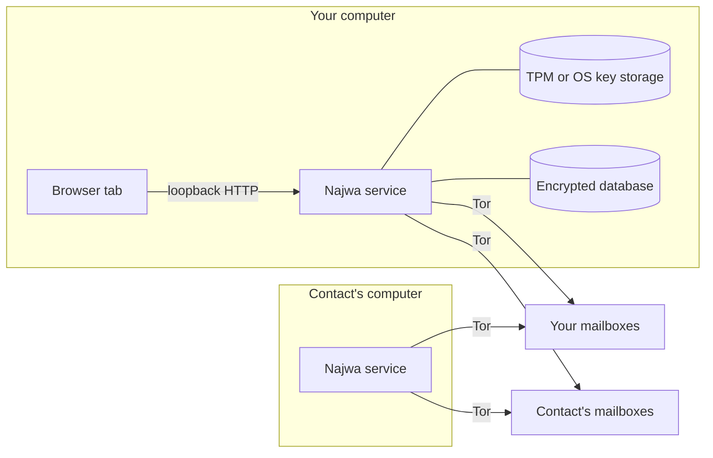
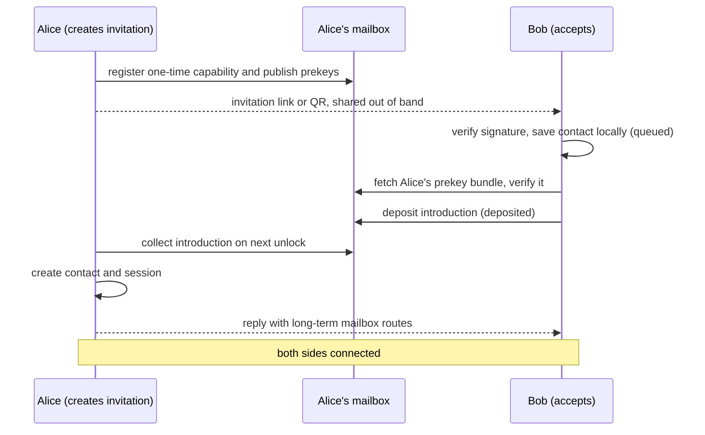

# How Najwa works

Najwa is a one-to-one messenger for the desktop. Three things work together:
your identity, which lives on your computer; an encrypted session with each
contact; and mailboxes, which hold encrypted messages while people are offline.
This page explains each part and how a message travels. The
[specifications](../SPECS-VERSION.md) define the exact formats and algorithms.

## 1. The app runs on your computer

When you open Najwa, a native service starts on your computer. The service owns
everything sensitive: your identity keys, the operating-system key storage, the
Tor client and the encrypted database. It shows its interface in your browser
at `http://127.0.0.1:1421`, an address only your computer can reach. No website
is involved, and your passphrase goes only to this local service.

The service accepts requests only from pages it served itself. A browser
connects once through a launch link that the service opens when it starts.
After that, the same browser can come back for 30 days. Every tab and browser
connected to the service shows the same profile and the same identity.

One profile holds one identity. The packaged app keeps the profile in your
operating-system user's application-data folder, outside the app folder, so
updating the app leaves it in place.

## 2. Your identity

Your identity is an Ed25519 key pair that Najwa generates on your computer. Its
public half is what your contacts know you by. No phone number, email address
or server account is involved.

The private key is stored encrypted under two factors. One is derived from your
passphrase with Argon2id. The other is a random device key held by your
computer's TPM 2.0. Neither factor alone opens the identity: a stolen passphrase
is useless without your computer, and a copy of your files is useless without
the passphrase. If the TPM is unavailable, Najwa asks for your explicit
approval before it keeps the device key in operating-system key storage instead,
and it shows that choice while it is in effect. Wrong passphrases make you wait
longer each time, and ten failures in a row lock the profile out until the
recovery kit is used or 24 hours pass. See
[S02 Identity Key Protection](../specs/02-identity-key-protection.md).

The recovery kit is a separate way in. It has 24 recovery words (BIP-39) and an
encrypted recovery file. The words unlock the file, and the file holds your
identity key. On the same computer, the words alone reset your passphrase. On
another computer, the words and the file together restore your identity. The
kit holds no contacts or messages. Creating a replacement kit does not cancel a
complete old kit.

## 3. Mailboxes

A mailbox is a small server reached as a Tor onion service. It stores encrypted
blobs until the recipient collects them. It has no user accounts. Instead, your
app registers pairs of random 32-byte capabilities: a deposit capability that
lets someone leave a blob, and a fetch capability that lets you collect it.
Registration costs a small proof of work, which makes mass registration
expensive. See [S16 Mailbox Server](../specs/16-mailbox-server.md).

At each mailbox your app signs with a key derived from your identity and that
mailbox's address. Every mailbox sees a different key, and none sees your
identity key, so operators cannot link you across mailboxes by key. See
[S05 §3](../specs/05-contact-establishment.md).

You can register up to eight mailboxes and pick a primary. Najwa tells your
contacts about your mailboxes, and they deposit to them. Mailboxes run by
different operators keep you reachable if one fails. Najwa has no built-in
mailbox directory: you get addresses from operators you choose, for example from
the [public mailbox list](../../MAILBOXES.md).

## 4. Invitations and contact setup

To connect, one person creates an invitation and the other accepts it. Setup
finishes in the background, even if the two people are never online together.

The invitation is signed with Alice's identity key. It carries her public
identity key, her display name, an end time, and for each of her registered
mailboxes a one-time capability, the secret needed to encrypt deposits to it,
and a certificate that binds the mailbox-specific key to her identity. The link
and the QR code encode the same invitation, which is valid for up to 48 hours.
See [S05 Contact Establishment](../specs/05-contact-establishment.md).

When Bob accepts, his app checks the signature and saves the contact at once.
In the background it registers his own receive routes, fetches Alice's prekey
bundle from her mailbox, and checks that the bundle is signed by the
mailbox-specific key from the invitation. It then runs X3DH, a key agreement
that combines both identities with Alice's prekeys, and deposits an encrypted
introduction. The next time Alice unlocks, her app collects the introduction,
creates the contact and the session, and replies with the long-term routes Bob
should use. Alice's app accepts one introduction per one-time capability: the
first valid one wins, and the capability is then deactivated. See
[S06 §2](../specs/06-key-agreement-ratchet.md).

A valid signature proves only that the invitation came from whoever holds that
key. The safety number ties the key to a person. It is derived from both
identity keys and shown as eight groups of four hexadecimal digits. If both
people see the same number, no one replaced the invitation in transit. See
[S05 §9](../specs/05-contact-establishment.md).

## 5. Sending a message

Each message is encrypted with the Double Ratchet. Every message uses a fresh
key, and the keys move forward with each exchange, so a key captured today does
not decrypt earlier messages. The cipher is XChaCha20-Poly1305. See
[S06 §3](../specs/06-key-agreement-ratchet.md) and
[S07 Message Format](../specs/07-message-format.md).

The encrypted message is padded to one of a fixed set of sizes, from 256 bytes
to 256 KiB, and wrapped in a second encryption layer for the mailbox. That outer
layer uses a secret the recipient shared with you and never registered with the
mailbox. The mailbox can store the blob but cannot open either layer. See
[S07 §3](../specs/07-message-format.md) and [§5](../specs/07-message-format.md).

Before anything goes on the network, Najwa saves the message, the new ratchet
state and the queued encrypted copy in one database transaction. A crash or
restart then resumes the same send instead of reusing a key. A background
worker deposits the blob over Tor. When the mailbox accepts it, the message
shows one tick and you can close Najwa. Temporary failures are retried while
Najwa is unlocked.

## 6. Receiving a message

While unlocked, your app polls your mailboxes every few seconds. For each blob
it removes the mailbox layer, decrypts the message, checks it against replay
and duplicate rules, and saves it with the updated session state in one
transaction. Only then does it tell the mailbox to delete the blob, so a crash
cannot lose a message. Your app then sends an encrypted acknowledgement back,
and the sender sees two ticks. See [S08 §6](../specs/08-messaging-service.md).

When the message is on screen in the open conversation and the window has
focus, your app also sends a read receipt; the sender then sees two blue ticks.
Read receipts are always on.

If a session falls out of step, for example after a lost message, the two apps
repair it automatically. The conversation shows **Repairing encrypted session…**
meanwhile. See [S06 §3.7.1](../specs/06-key-agreement-ratchet.md).

## 7. Being offline

Najwa is store-and-forward. The sender needs to stay unlocked only until the
deposit succeeds. The recipient collects the blob whenever they next unlock.
Queued work survives restarts.

Mailboxes do not keep data forever. A blob is deleted as soon as its recipient
acknowledges it. A blob that was fetched but never acknowledged is deleted after
the operator's retention period. A blob nobody collects is deleted after 90 days
at most. A capability that nobody deposits to or fetches from for 30 days is
deleted together with its blobs. A locked or switched-off computer does nothing,
so there is no fixed delivery time. See
[S16 §10](../specs/16-mailbox-server.md).

## 8. Delivery modes and cover traffic

After the first unlock, Najwa sends cover traffic: dummy deposits to, and
fetches from, capabilities your app registered for that purpose. Cover traffic
continues while Najwa is locked and stops when the service stops. See
[S10 Cover Traffic](../specs/10-cover-traffic.md).

In **Responsive** mode, the default, a message is deposited as soon as it is
queued. In **Timing privacy** mode, each deposit waits for the next cover slot
and replaces a dummy deposit, so the deposit rate looks the same whether you
are writing or idle. Slots are about 30 seconds apart on average, so messages
take longer. The mailbox server that ships with Najwa releases blobs
to the recipient as soon as they arrive; an operator can configure a random
hold instead.

Receiving does not follow cover slots in either mode. Your app polls its real
capabilities often while unlocked and stops while locked.

## 9. Files

Before sending, Najwa cleans the file on your computer. Pictures are decoded
and saved again as WebP, which discards everything except the pixels. Audio,
video and documents have their metadata removed by format-specific cleaners.
Najwa refuses any file it cannot clean. See
[S11 File Transfer and Sanitization](../specs/11-file-transfer-sanitization.md).

The cleaned file is split into parts. Each part is encrypted in the
conversation's session and deposited like a message, and progress is saved so
transfers resume after a restart. The recipient's app reassembles the parts and
checks the size and the SHA-256 digest before offering the download. The limit
is 256 MiB, shown as 256 MB. Files of 10 MB or less are recommended, because
Tor is slow. In Responsive mode the parts of one file share a Tor circuit for
speed. In Timing privacy mode each part uses a fresh circuit and waits for a
cover slot.

## 10. Disappearing messages

A conversation can have a timer from 30 seconds up. Sent messages start
counting down when they are delivered; received messages start when they are
viewed. When the timer runs out, both apps delete the message. Content under a
timer is protected by its own key, which is destroyed at expiry. A timer change
travels as an encrypted control message, and sending pauses until the contact's
app confirms it. Files cannot be sent while a timer is on. See
[S12 Disappearing Messages](../specs/12-disappearing-messages.md).

## 11. Locking, quitting and erasing

**Lock** clears the identity key, session keys and database key from the
service, closes the database and stops sending and receiving. Najwa locks after
an idle period (5 minutes by default, from 1 to 60 minutes) and when you close
the page. The service enforces the idle limit itself, so a crashed browser
cannot keep Najwa unlocked. **Keep unlocked** suspends the idle limit while
that page stays open. **Quit Najwa** locks and stops the service. See
[S13 §8](../specs/13-privacy-hardening.md).

**Erase local profile** records its intent first, then deletes the profile's
files and the device key. If the erase is interrupted, Najwa blocks unlocking
until you finish it. If the profile is unlocked, Najwa first asks your
mailboxes, for up to 20 seconds, to deactivate your receive queues, and then
erases whatever they answer. A locked profile is erased without contacting any
mailbox. Erasing cannot reach other people's copies.

## Where to read more

- [Frequently asked questions](faq.md)
- [Threat model](threat-model.md): who can learn what, and what Najwa does not
  protect against.
- [Security properties](../security/properties.md): each guarantee with its
  assumptions and defining specification.
- [Key inventory](../reference/keys.md) and [glossary](../reference/glossary.md).
- [Architecture](../development/architecture.md) for the code layout.
