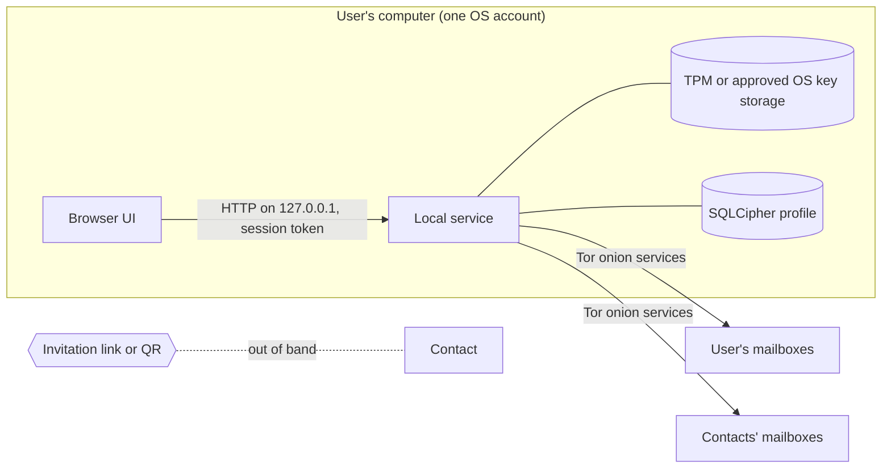

# Threat model

This document states who Najwa defends against, what each adversary can and
cannot learn or do, which assumptions the defences rest on, and what Najwa does
not attempt. It covers the desktop release: one identity per profile, one-to-one
conversations, and store-and-forward mailboxes reached over Tor.
[Security properties](../security/properties.md) lists each guarantee with the
specification section that defines it. Najwa has not had an independent
security audit.

## System summary

The local service (`apps/local-web`) holds every secret: the identity key, the
session state, the database key and the Tor client. The browser shows the
interface and carries the passphrase to the service. Mailboxes store encrypted
blobs addressed by random capabilities. Contacts first connect through an
invitation shared outside Najwa.

## Assets

| Asset | Where it lives |
| --- | --- |
| Identity private key (Ed25519) and keys derived from it | Profile, encrypted under passphrase and device factor; in service memory while unlocked |
| Session state (ratchet keys, prekeys) | SQLCipher database |
| Message and file content, contact list, display names | SQLCipher database |
| Passphrase | User's memory; the browser and service while it is entered |
| Recovery kit (24 words and 105-byte encrypted file) | Wherever the user keeps them |
| Communication metadata: who, when, how much | Network paths and mailbox servers |
| Availability of sending and receiving | Tor, mailboxes, the user's unlocked app |

## Trust boundaries

1. **Browser and local service.** The service listens only on `127.0.0.1`. It
   rejects requests whose `Host` is not its exact origin, whose `Origin` or
   `Sec-Fetch-Site` shows another site, or that lack the per-run session token.
   It serves a restrictive Content Security Policy. A browser gets the token
   through a launch link, or through a 30-day cookie that reaches only the
   bootstrap endpoint and never unlocks anything.
2. **Service and key storage.** The device factor stays in the TPM, or in OS key
   storage after explicit approval.
3. **Service and network.** All mailbox traffic goes to `.onion` addresses over
   Tor. Mailboxes see capabilities, never accounts.
4. **User and contact.** Trust in a contact's key comes from the invitation
   channel and from comparing safety numbers.

## Assumptions

The defences below hold only if these hold:

- **Authentic software.** The user runs an unmodified build. Preview packages
  are unsigned; see [supply chain](../security/supply-chain.md).
- **Uncompromised endpoint while unlocked.** The OS, the browser and its
  extensions, and other software running as the same user are not hostile.
- **Sound primitives.** Ed25519, X25519, XChaCha20-Poly1305, HKDF-SHA256,
  SHA-256 and Argon2id meet their security goals; see
  [cryptographic rationale](../security/crypto-rationale.md).
- **Tor.** Tor onion services provide their stated location hiding and
  self-authenticating addresses.
- **User practice.** Invitations are shared privately; safety numbers are
  compared over an independent channel; the passphrase is not reused elsewhere;
  the two halves of the recovery kit are stored apart.

## Adversaries

### 1. Local network observer

An ISP, a Wi-Fi operator or anyone on the path between the computer and the Tor
network.

- **Can learn:** that the computer uses Tor, or a bridge when bridges are
  configured; traffic volume and timing. Najwa polls its mailboxes every few
  seconds while unlocked and stops while locked, so the traffic pattern reveals
  unlocked periods. In Responsive mode, sends add traffic at the moment they
  happen. Large file transfers are visible as sustained transfers.
- **Cannot learn:** which mailboxes, contacts or content are involved. Mailbox
  addresses are onion services, resolved inside Tor; Najwa has no clearnet path
  and no DNS lookups for mailboxes.
- **Mitigations:** Tor onion transport; obfs4 or Snowflake bridges where Tor is
  blocked; cover traffic, which continues while locked; the Timing privacy
  mode, in which real deposits take the place of cover deposits.

### 2. Global passive observer

An adversary who watches traffic entering and leaving the Tor network at many
points, including near the user, the contact and the mailbox.

- **Can do:** correlate timing and volume across those points over time and
  link a user to a mailbox or to a contact. Responsive mode, polling while
  unlocked, and file transfers give the clearest signals.
- **Mitigations:** Timing privacy makes the deposit rate independent of
  activity while the cover scheduler runs. Polling is not paced in either mode.
- **Position:** Najwa makes no claim of resistance to a global passive
  observer and publishes no anonymity bound.

### 3. Active network attacker

An adversary who can block, delay or alter traffic outside Tor.

- **Can do:** block Tor or bridges and so deny service; delay traffic.
- **Cannot do:** redirect a connection to a different onion service, because
  onion addresses authenticate the service; alter a message undetected, because
  every layer is authenticated encryption; make Najwa fall back to a
  non-Tor connection.

### 4. Mailbox operator

The operator of any mailbox the user registers with, honest-but-curious or
malicious, including one compelled to hand over records.

- **Can learn about its own users:**
  - each registered capability pair, its type (one-time invitation or
    long-term) and expiry;
  - when each capability receives a deposit or a fetch, and the padded size of
    each blob (one of eleven sizes from 256 bytes to 256 KiB);
  - which capabilities belong to one user. The app polls all of them together,
    over one circuit per mailbox, so the operator can count a user's contact
    routes on that mailbox and see when the app is unlocked;
  - prekey fetches against an invitation capability. These show that someone is
    setting up a contact, but not who;
  - the mailbox-specific signing key and the prekeys published under it;
  - delivery timing. The shipped server releases blobs immediately, so the gap
    between deposit and fetch is visible. An operator that configures a random
    hold blinds outside observers, not itself.
- **Can do:** drop, delay or refuse deposits, fetches and registrations; keep
  copies of blobs beyond the published retention; withhold one-time prekeys;
  claim batching or retention settings it does not apply. The server answers a
  deposit to an unknown or deleted capability with the same acceptance as a
  stored one, so **Deposited** proves acceptance, not storage.
- **Cannot:** read content or display names, since both layers of encryption
  are end to end and the envelope secret is never registered with the server;
  learn the user's identity key, since it sees only a key derived for that
  mailbox; learn the user's IP address; forge or replay messages, since
  authenticated encryption, message IDs, a timestamp window and deduplication
  reject them; silently downgrade contact setup, since the prekey bundle and its
  manifest are signed by the mailbox-specific key bound into the invitation.
- **Residual:** contact-route counts and online periods, per mailbox, as above.
  Cover traffic uses dedicated capability pairs. It changes what a network
  observer sees, but it does not hide from the operator which capabilities carry
  contact traffic.

### 5. Colluding mailbox operators

Several operators, possibly with a network observer, who share logs.

- **Cannot:** link one user's registrations across servers by key or by
  capability. Each server sees a different derived signing key and independent
  random capabilities.
- **Can:** correlate by timing and volume. A deposit to the contact's mailbox
  matched to a fetch at the user's own, or simultaneous polling of all of one
  user's mailboxes, can link them. Several onion addresses can belong to one
  operator; the app cannot verify operator independence and ships no directory.
  The [public mailbox list](../../MAILBOXES.md) asks each operator to name the
  other listed mailboxes they run, but nobody can check the answer.

### 6. Invitation interception or substitution

Anyone who sees or replaces an invitation in transit.

- **An invitation reveals:** the creator's identity public key, display name and
  mailbox addresses, plus one-time capabilities and the secrets to deposit to
  them. Treat an unused invitation as a secret.
- **An interceptor can:** use the invitation first. The creator's app accepts
  only the first valid introduction per one-time capability, so the intended
  person then cannot connect. Invitations created before the previous one was
  used share the same one-time capability, so whoever answers any of them first
  takes it.
- **A substituter can:** hand over a self-consistent invitation for their own
  key. The signature verifies, because it proves only control of that key.
- **Mitigation:** compare safety numbers over an independent channel. The
  conversation shows **Identity not verified** until the user confirms the
  numbers match. Display names prove nothing.

### 7. Malicious or careless contact

A contact, possibly running modified software.

- **Learns:** the user's display name, identity public key and mailbox
  addresses; when the user's app was unlocked, from delivery acknowledgements;
  when messages were on screen, from read receipts, which cannot be turned off;
  whether a queue it can deposit to is still live. The mailbox accepts deposits
  to a dead queue like any other and applies the same rate limit,
  proof-of-work and size checks and the same reply to a repeated blob, but a
  full queue, a prekey fetch or a blob repeated after the deduplication window
  (10 minutes by default) still tells a live queue from a dead one
  ([S16 §14.3](../specs/16-mailbox-server.md)).
- **Can do:** keep, copy, photograph or publish anything received, whatever the
  disappearing-message timer; lie in or withhold receipts; send files that its
  own app did not clean. The receiving app checks a file's size and SHA-256
  against the sender's metadata, but it does not clean or inspect received
  files. Treat downloads like any file from that person.
  By deleting the user, the contact also removes the conversation and the
  contact entry from the user's Najwa, at any time and without asking
  ([S08 §7.1](../specs/08-messaging-service.md)). Blocking the contact first
  prevents this.
- **Cannot:** learn the user's IP address or other contacts; impersonate
  another contact.
- **User controls:** blocking ignores the contact's new messages and holds back
  queued sends, and sends nothing. Deleting also asks the contact's Najwa to
  remove the conversation; modified software can ignore that, and neither
  action recalls deposited messages.

### 8. Other software on the same computer

Web pages in the user's browser, other OS accounts, and other programs.

- **Web pages:** cannot reach the service. Requests from another origin fail the
  `Host`, `Origin` and `Sec-Fetch-Site` checks, and pages cannot read the session
  token.
- **Other OS accounts:** can connect to the loopback port but lack the token.
  On Linux the profile directory is mode `0700`; on Windows it lies under the
  user's `%LOCALAPPDATA%`.
- **Programs running as the same user, and browser extensions:** are outside
  the protection boundary. They can read the instance file that holds the
  token, or the page itself, and act as the user while the profile is unlocked.

### 9. Theft of a locked or powered-off computer

- **Without the passphrase:** the identity record needs both the passphrase
  factor (Argon2id) and the device factor. With a TPM, the device factor cannot
  be copied off the machine, so a disk image alone supports no offline guessing.
  Unlock attempts on the machine back off exponentially, and ten failures lock
  the profile out until the recovery kit is used or 24 hours pass. The attempt
  counter is authenticated with the device key, so tampering locks the profile.
- **With approved OS key storage:** the device factor is protected only by the
  OS account. An attacker who gets into that account can extract it and guess
  the passphrase offline at Argon2id cost.
- **With a weak or reused passphrase, or a complete recovery kit:** the identity
  falls. The words and the file together restore the identity without the
  passphrase or the device. Replacing the kit does not invalidate an old
  complete kit.
- **Stored data:** the database is SQLCipher, keyed from the identity, with
  additional field encryption. Without the identity it is unreadable. Mailbox
  routes stay registered after theft; anyone who unlocks the profile can
  receive pending messages.

### 10. Compromise of the unlocked computer

Malware, a hostile administrator or a hostile browser extension while the
profile is unlocked.

- **Can:** read everything displayed, the passphrase as it is typed, decrypted
  messages and keys in service memory; send messages as the user. Hardware key
  protection does not protect a running, unlocked session.
- **Limits that help afterwards:** locking zeroizes the identity, session and
  database keys in the service. Forward secrecy means a later capture of the
  session state does not decrypt earlier traffic. Retained history on disk
  remains readable to anyone who later unlocks the profile.
- **Locking behaviour:** the service locks after the idle limit (default 5
  minutes, 1 to 60 minutes), when the page closes, and when the OS locks the
  session, switches user or goes to sleep. **Keep unlocked** suspends only the
  idle limit while that page stays open.

### 11. Denial of service

Against mailboxes, against a specific user, or against contact setup.

- **Mitigations:** proof of work for registration (at least 20 bits) and,
  adaptively, for deposits and prekey fetches; per-capability rate limits and
  storage quotas; a 256 KiB blob limit; idempotent prekey fetches and the
  signed prekey manifest against prekey exhaustion; bounded parsers; a
  per-contact limit on incoming messages.
- **Residual:** a resourced attacker can still exhaust a mailbox or block Tor.
  A mailbox can refuse service. Messages nobody collects expire after at most
  90 days, and a capability unused for 30 days is deleted with its blobs, so
  long absences lose messages.

### 12. Coercion

Najwa cannot tell a willing user from a coerced one. Anyone who obtains the
passphrase on the user's computer, or a complete recovery kit, has the identity.
Cover traffic keeps running while Najwa is locked, which shows that Najwa is
running. Najwa has no duress passphrase and no hidden profiles.

## Privacy summary

| Party | Can learn | Cannot learn |
| --- | --- | --- |
| Local network observer | Tor or bridge use; volume and timing; unlocked periods | Mailboxes, contacts, content |
| Global passive observer | Links between user, mailbox and contact, by correlation over time | Content |
| User's mailbox operator | Capability pairs and their types; per-capability timing and padded sizes; route count; unlocked periods; contact-setup events | Identity key, IP address, names, content |
| Contact's mailbox operator | Deposits to that contact's capabilities, with timing and padded size | Who deposited, content |
| Contact | Display name, identity key, mailbox addresses; delivery and read timing; everything sent | IP address, other contacts |
| Holder of an unused invitation | Creator's identity key, display name and mailboxes; can connect once | Anything sent to other contacts |
| Software on the unlocked computer | Everything | — |

Responsive delivery, the default, exposes more send timing than Timing
privacy. In Responsive mode the parts of one file share a Tor circuit, which
links them to one another; in Timing privacy each part uses a fresh circuit.
Out-of-band invitation sharing, read receipts and the visible content of files
can identify a person whatever the transport does.

## Non-goals

Najwa does not attempt to provide:

- protection from an adversary controlling the unlocked computer, the browser
  or its extensions;
- resistance to global traffic correlation, or any measured anonymity level;
- hiding that a computer runs Najwa or uses Tor, beyond what bridges offer;
- guaranteed delivery, or availability against a hostile mailbox operator;
- recall or remote deletion of single sent messages, or guaranteed deletion of
  another person's copies: Delete contact only asks their Najwa to remove the
  conversation;
- protection against screenshots, photographs or copies made by a contact;
- revocation of a complete recovery kit;
- secure deletion on SSDs or copy-on-write file systems, or removal from backups
  made outside Najwa;
- deniability toward the contact;
- protection against future quantum computers; all public-key primitives are
  classical;
- coercion resistance: no duress codes or hidden profiles;
- group conversations, linked devices or mobile clients, which this release
  does not include.

## Related documents

- [Security properties](../security/properties.md)
- [Cryptographic rationale](../security/crypto-rationale.md)
- [Dependency assessment](../security/dependencies.md) and
  [supply chain](../security/supply-chain.md)
- [How Najwa works](how-it-works.md)
- [Release status](../../RELEASE-READINESS.md)
